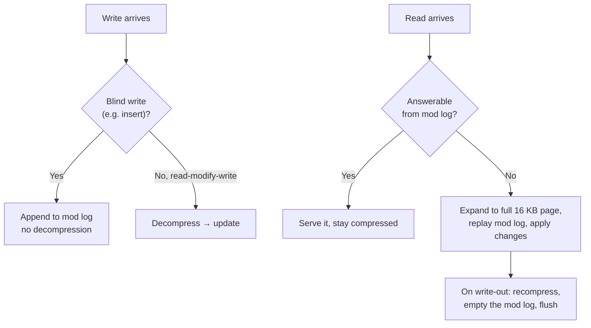

# 08 — Naive block-level compression (and why it isn't enough)

## The scheme

- Take a page, run it through a general-purpose compression algorithm before writing to disk ([`47:28`](https://www.youtube.com/watch?v=nhlpwmOBEiE&t=2848)).
- Candidate algorithms ([`47:44`](https://www.youtube.com/watch?v=nhlpwmOBEiE&t=2864)):
  - LZO, LZ4.
  - **Snappy** — Google's modern LZ4 variant.
  - **Zstandard** (Facebook) — considered state of the art, the best performance/ratio trade-off; from the same author as xxHash.
  - Oracle's proprietary OZIP ("because they patent everything") ([`48:09`](https://www.youtube.com/watch?v=nhlpwmOBEiE&t=2889)).
- Concerns: compression/decompression cost, storage overhead, and **buffer pool fit** — compressed pages have varying sizes, which clashes with a fixed page size ([`48:09`](https://www.youtube.com/watch?v=nhlpwmOBEiE&t=2889)).

## MySQL's implementation

- Compressed pages come in exactly **four sizes: 1, 2, 4 or 8 KB**; anything in between is **padded with zeros** up to the next size (e.g. 3.8 KB → 4 KB), preserving fixed-length offsets for page jumps ([`48:41`](https://www.youtube.com/watch?v=nhlpwmOBEiE&t=2921)).
- Each page header carries a **mod log** that absorbs writes without decompressing — yet another appearance of log-structured storage ([`49:07`](https://www.youtube.com/watch?v=nhlpwmOBEiE&t=2947)).

- Blind writes go straight to the mod log; read-modify-write (e.g. incrementing a bank balance) forces decompression ([`49:28`](https://www.youtube.com/watch?v=nhlpwmOBEiE&t=2968), [`49:44`](https://www.youtube.com/watch?v=nhlpwmOBEiE&t=2984)).
- Reads that the mod log can answer stay compressed; otherwise the page expands to MySQL's standard **16 KB** page, the mod log is replayed into it, and on flush it is recompressed with an empty mod log ([`49:58`](https://www.youtube.com/watch?v=nhlpwmOBEiE&t=2998), [`50:18`](https://www.youtube.com/watch?v=nhlpwmOBEiE&t=3018)).

## Class debate: good idea or bad?

- Nobody raised a hand for "good idea" ([`50:39`](https://www.youtube.com/watch?v=nhlpwmOBEiE&t=3039)).
- Student objection: write-heavy workloads keep appending to the mod log until it explodes ([`50:39`](https://www.youtube.com/watch?v=nhlpwmOBEiE&t=3039), [`51:05`](https://www.youtube.com/watch?v=nhlpwmOBEiE&t=3065)). Counter: keep new pages uncompressed and insert into them directly ([`51:27`](https://www.youtube.com/watch?v=nhlpwmOBEiE&t=3087)).
- Andy's verdict: **it is a good idea** — Postgres can't do this, the on-disk footprint shrinks, and every I/O returns more tuples ([`51:41`](https://www.youtube.com/watch?v=nhlpwmOBEiE&t=3101)).
- Header metadata can even answer `SELECT COUNT(*)` (active tuples per page) without decompressing ([`52:05`](https://www.youtube.com/watch?v=nhlpwmOBEiE&t=3125)).
- Bad case only in extremes: read-after-write-after-read churn that compresses and decompresses repeatedly ([`52:05`](https://www.youtube.com/watch?v=nhlpwmOBEiE&t=3125)).

## Why it still falls short

1. **No late materialization** — reading anything inside the page potentially requires decompressing the whole page ([`52:41`](https://www.youtube.com/watch?v=nhlpwmOBEiE&t=3161)).
2. **Poor ratio** — it's a row store, so the page mixes zip codes, phone numbers, email addresses: different domains. The best case for a compressor is a run of identical bits (e.g. a billion zeros); random-looking data barely compresses, like zipping a movie file ([`52:41`](https://www.youtube.com/watch?v=nhlpwmOBEiE&t=3161), [`53:12`](https://www.youtube.com/watch?v=nhlpwmOBEiE&t=3192)).
3. **Opaque box** — the DBMS cannot derive meaning from what Snappy or Zstd did to the bytes; it doesn't understand the algorithm's internal dictionary ([`53:33`](https://www.youtube.com/watch?v=nhlpwmOBEiE&t=3213)).

## What we actually want

- The DBMS owns the compression, so it knows how to extract information **without decompressing** ([`54:00`](https://www.youtube.com/watch?v=nhlpwmOBEiE&t=3240)).
- Worked example: a `users(name, salary)` table dictionary-compressed to 2-character codes. For `SELECT * FROM users WHERE name = 'Andy'`, the engine converts the input string `'Andy'` into the same code (`XX`) and matches on codes — never decompressing the non-matching tuples ([`54:19`](https://www.youtube.com/watch?v=nhlpwmOBEiE&t=3259), [`54:53`](https://www.youtube.com/watch?v=nhlpwmOBEiE&t=3293)).
- This only works at the **column level**, where all values share one domain — JSON breaks the assumption ([`55:16`](https://www.youtube.com/watch?v=nhlpwmOBEiE&t=3316), [`55:28`](https://www.youtube.com/watch?v=nhlpwmOBEiE&t=3328)).
