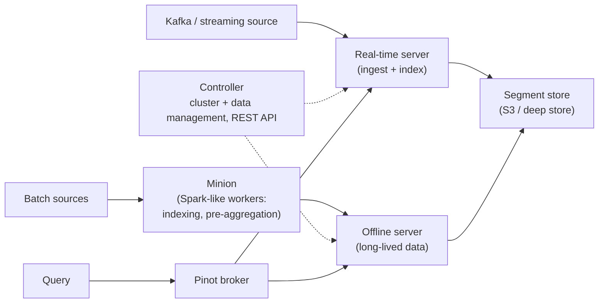

# 10 — Guest talk: Apache Pinot / StarTree

Speaker: **Sean**, PMC member and committer on Apache Pinot, and co-founder of **StarTree**, the company wrapping Pinot as a SaaS solution ([`1:12:17`](https://www.youtube.com/watch?v=nhlpwmOBEiE&t=4337)).

## What Pinot is for: real-time OLAP

- Analytical, not transactional: queries scan large amounts of data and typically touch **every row** — a very different query pattern from transactional databases ([`1:12:40`](https://www.youtube.com/watch?v=nhlpwmOBEiE&t=4360)).
- Pinot is pitched as the fastest real-time OLAP database, optimized for high throughput, extremely low latency and high query concurrency ([`1:18:22`](https://www.youtube.com/watch?v=nhlpwmOBEiE&t=4702)).
- Users span retail, banking, food, and logistics ([`1:18:22`](https://www.youtube.com/watch?v=nhlpwmOBEiE&t=4702)).

## Use cases

| Use case | Detail |
| --- | --- |
| **LinkedIn "Who viewed my profile"** | Computed over months of viewing history and served directly from Pinot with fresh data ([`1:13:44`](https://www.youtube.com/watch?v=nhlpwmOBEiE&t=4424)) |
| **Uber Eats** | Restaurant owners see revenue, delivery-radius traffic, ordering patterns, supply/demand — Uber is very sensitive to data freshness, so ingestion is kept extremely tight ([`1:14:29`](https://www.youtube.com/watch?v=nhlpwmOBEiE&t=4469), [`1:14:57`](https://www.youtube.com/watch?v=nhlpwmOBEiE&t=4497)) |
| **Business metrics & anomaly detection** | Analyze performance, debug what went wrong, root-cause issues ([`1:15:28`](https://www.youtube.com/watch?v=nhlpwmOBEiE&t=4528)) |
| **Internal dashboards** | Data visualization powered by the analytical database ([`1:15:28`](https://www.youtube.com/watch?v=nhlpwmOBEiE&t=4528)) |

**Serving targets**: on the order of **10,000 queries per second** with **p99 latency under 100 ms** — low enough to query the database live while a user's browser page loads ([`1:14:11`](https://www.youtube.com/watch?v=nhlpwmOBEiE&t=4451), [`1:14:29`](https://www.youtube.com/watch?v=nhlpwmOBEiE&t=4469)).

## Why real time

- **Aggregate data**: value grows with volume — aggregation, ML, drilling into patterns ([`1:16:06`](https://www.youtube.com/watch?v=nhlpwmOBEiE&t=4566)).
- **Individual events**: value **decays with time**. Fraud detection is the canonical case — you want the bank to catch a swiped card immediately, not in a day or two ([`1:16:43`](https://www.youtube.com/watch?v=nhlpwmOBEiE&t=4603)).
- Industry trend: pushing more real-time data into analytics, and exposing analytics to end users — "**user-facing analytics**", where user data becomes the product feature ([`1:17:13`](https://www.youtube.com/watch?v=nhlpwmOBEiE&t=4633)).
- User-facing means the QPS ceiling moves from internal-dashboard scale to hundreds of thousands or **millions of queries per second** ([`1:17:52`](https://www.youtube.com/watch?v=nhlpwmOBEiE&t=4672)).

## Architecture

- Split into a **real-time server** and an **offline server**, both backed by a **segment store** (deep store) — typically cloud storage like S3 ([`1:18:55`](https://www.youtube.com/watch?v=nhlpwmOBEiE&t=4735)).
- The **controller** handles cluster and data management and exposes the REST management API ([`1:19:22`](https://www.youtube.com/watch?v=nhlpwmOBEiE&t=4762)).
- Real-time data arrives from Kafka or similar, is written and indexed on the real-time server, and is persisted to the deep store ([`1:19:22`](https://www.youtube.com/watch?v=nhlpwmOBEiE&t=4762)).
- Batch/offline data is ingested and computed through **Minion** — Spark-like workers that build indexes and pre-aggregates ([`1:20:03`](https://www.youtube.com/watch?v=nhlpwmOBEiE&t=4803)).
- The **Pinot broker** handles all incoming queries ([`1:20:29`](https://www.youtube.com/watch?v=nhlpwmOBEiE&t=4829)).

## Segments and indexing philosophy

- A table is split into chunks called **Pinot data segments** — groups of columns, plus a lot of indexes to speed up queries ([`1:20:43`](https://www.youtube.com/watch?v=nhlpwmOBEiE&t=4843)).
- Engineering philosophy: **"work smart," not just scan fast**. Traditional analytical engines optimize raw scan speed; Pinot invests in indexing to minimize how much data is scanned at all, and in pre-aggregation so frequent queries aren't recomputed ([`1:21:21`](https://www.youtube.com/watch?v=nhlpwmOBEiE&t=4881)).
- Index types: inverted, sorted, range, and geospatial — the latter avoids computing latitude/longitude per query, so a polygon query already knows which points fall inside ([`1:22:24`](https://www.youtube.com/watch?v=nhlpwmOBEiE&t=4944)).

## The star-tree index — the headline feature

- The trade-off it addresses ([`1:22:24`](https://www.youtube.com/watch?v=nhlpwmOBEiE&t=4944), [`1:23:18`](https://www.youtube.com/watch?v=nhlpwmOBEiE&t=4998)):
  - **Full materialized view / key-value pre-aggregate**: O(1) lookup, but you must store every combination.
  - **Raw table**: no extra storage, but computing the aggregate scans the entire table → high latency.
- The **star-tree index** makes this a *tunable* trade-off rather than an either/or: you choose a point on the sliding latency-vs-storage curve ([`1:23:18`](https://www.youtube.com/watch?v=nhlpwmOBEiE&t=4998), [`1:24:10`](https://www.youtube.com/watch?v=nhlpwmOBEiE&t=5050)).
- **The measured result**: LinkedIn's "who viewed my profile", previously a materialized view on a key-value store, needed ~**1,000 machines to serve 1,000 QPS**. With Pinot it serves **5,000 QPS on ~75 machines** ([`1:24:10`](https://www.youtube.com/watch?v=nhlpwmOBEiE&t=5050), [`1:24:39`](https://www.youtube.com/watch?v=nhlpwmOBEiE&t=5079)).

## Pluggable architecture

- Designed to be pluggable and extensible for contributors, via multiple SPIs ([`1:24:39`](https://www.youtube.com/watch?v=nhlpwmOBEiE&t=5079)):
  - **Pinot Segment SPI** — plug in your own data structure or storage format.
  - **Pinot Query SPI** — plug in your own query engine implementation ([`1:25:12`](https://www.youtube.com/watch?v=nhlpwmOBEiE&t=5112)).
- Recent work: a **multi-stage query engine** supporting more join types ([`1:25:40`](https://www.youtube.com/watch?v=nhlpwmOBEiE&t=5140)).
- For joins, Pinot applies heuristics to **co-locate data** so work happens locally instead of via cross-node exchange ([`1:26:02`](https://www.youtube.com/watch?v=nhlpwmOBEiE&t=5162)).

## Closing note

- Pinot was built **internally at LinkedIn** for user-facing analytics. LinkedIn also produced Kafka (which became Confluent); Pinot is the other famous system to come out of it ([`1:26:17`](https://www.youtube.com/watch?v=nhlpwmOBEiE&t=5177)).
