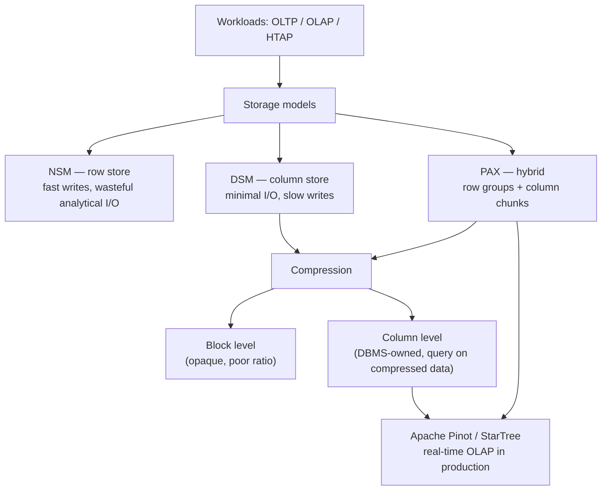

# #05 - Row vs. Column Storage + Compression ✸ StarTree Database Talk (CMU Intro to Database Systems)

*CMU Database Group · 1:28:00 · https://www.youtube.com/watch?v=nhlpwmOBEiE*

## Summary

The final lecture of CMU 15-445/645's storage-layer sequence, contrasting how a DBMS can physically lay out tuples and what that costs. Andy Pavlo first separates OLTP from OLAP workloads, then walks the same Wikipedia-derived query through the N-ary Storage Model (row store), the Decomposition Storage Model (column store), and the PAX hybrid used by Parquet, ORC and Arrow — showing why analytical scans waste most of their I/O in a row store. The second half covers compression: why block-level compression with Snappy/Zstd is an opaque box the engine cannot reason about, and how DBMS-owned columnar schemes (RLE, bit packing with patching, bitmap, delta, and above all dictionary encoding) let queries run directly on compressed data. The lecture closes with a guest talk from Sean of StarTree on Apache Pinot, a real-time OLAP system serving user-facing analytics at ~10,000 QPS with sub-100 ms p99 latency.

**Classification**: university lecture (educational) + an appended industry conference talk.

## Topics

1. [Lecture scope and logistics](./01-lecture-scope-and-logistics.md) — where this lecture sits in the storage sequence, and the agenda ([`0:27`](https://www.youtube.com/watch?v=nhlpwmOBEiE&t=27))
2. [Database workloads: OLTP, OLAP, HTAP](./02-database-workloads-oltp-olap-htap.md) — the quadrant chart and the origin of the term "OLAP" ([`4:44`](https://www.youtube.com/watch?v=nhlpwmOBEiE&t=284))
3. [Running example: the Wikipedia schema](./03-running-example-wikipedia-schema.md) — the tables and the two query shapes used throughout ([`10:56`](https://www.youtube.com/watch?v=nhlpwmOBEiE&t=656))
4. [N-ary Storage Model (row store)](./04-nsm-row-storage.md) — layout, query walkthroughs, and the useless-I/O problem ([`15:10`](https://www.youtube.com/watch?v=nhlpwmOBEiE&t=910))
5. [Decomposition Storage Model (column store)](./05-dsm-column-storage.md) — offsets, variable-length data, write penalty, mitigations ([`22:12`](https://www.youtube.com/watch?v=nhlpwmOBEiE&t=1332))
6. [PAX: the hybrid storage model](./06-pax-hybrid-storage.md) — row groups, column chunks, Parquet/ORC footers and sizes ([`36:14`](https://www.youtube.com/watch?v=nhlpwmOBEiE&t=2174))
7. [Why compress, and at what granularity](./07-compression-goals-and-granularity.md) — the three goals and the four granularity levels ([`40:52`](https://www.youtube.com/watch?v=nhlpwmOBEiE&t=2452))
8. [Naive block-level compression](./08-naive-block-level-compression.md) — MySQL's compressed pages and mod log, and why it falls short ([`47:28`](https://www.youtube.com/watch?v=nhlpwmOBEiE&t=2848))
9. [Columnar compression schemes](./09-columnar-compression-schemes.md) — RLE, bit packing, patching, bitmap, delta, dictionary ([`55:28`](https://www.youtube.com/watch?v=nhlpwmOBEiE&t=3328))
10. [Guest talk: Apache Pinot / StarTree](./10-startree-apache-pinot-talk.md) — real-time OLAP, architecture, and the star-tree index ([`1:12:17`](https://www.youtube.com/watch?v=nhlpwmOBEiE&t=4337))

## Key takeaways

- On the lecture's 6-page toy database, the same analytical query read **all 6 pages** as a row store but only **2 pages** as a column store — and at cloud scale that is also a direct bill reduction, since S3 charges per lookup ([`26:02`](https://www.youtube.com/watch?v=nhlpwmOBEiE&t=1562), [`26:23`](https://www.youtube.com/watch?v=nhlpwmOBEiE&t=1583)).
- Column stores identify tuples by **fixed-length offsets**, not embedded tuple IDs; variable-length types are forced fixed-length via dictionary encoding first ([`27:51`](https://www.youtube.com/watch?v=nhlpwmOBEiE&t=1671), [`29:45`](https://www.youtube.com/watch?v=nhlpwmOBEiE&t=1785)).
- Nearly every production "column store" — Parquet, ORC, Arrow — is really **PAX**: 128 MB row groups in Parquet, a fixed 1 million tuples per row group in ORC, ~1 MB pages, metadata in the **footer** because the files are immutable ([`37:17`](https://www.youtube.com/watch?v=nhlpwmOBEiE&t=2237), [`38:03`](https://www.youtube.com/watch?v=nhlpwmOBEiE&t=2283), [`39:09`](https://www.youtube.com/watch?v=nhlpwmOBEiE&t=2349)).
- Off-the-shelf block compression (Snappy, Zstd, LZ4) is rejected for analytics on three grounds: it breaks fixed-length offsets, it blocks late materialization, and the compressed bytes are an **opaque box** the engine cannot interpret ([`43:03`](https://www.youtube.com/watch?v=nhlpwmOBEiE&t=2583), [`52:41`](https://www.youtube.com/watch?v=nhlpwmOBEiE&t=3161), [`53:33`](https://www.youtube.com/watch?v=nhlpwmOBEiE&t=3213)).
- Bitmap encoding is only viable at low cardinality: 10 million zip codes cost **40 MB raw** but **53 GB** as 43,000 uncompressed bitmaps — hence roaring bitmaps in real systems, including Pinot ([`1:03:17`](https://www.youtube.com/watch?v=nhlpwmOBEiE&t=3797), [`1:04:27`](https://www.youtube.com/watch?v=nhlpwmOBEiE&t=3867)).
- Sorting is the multiplier for RLE: an unsorted 8-tuple boolean column produced triplets **larger** than the original data, while sorting collapsed it to **2 triplets** ([`57:59`](https://www.youtube.com/watch?v=nhlpwmOBEiE&t=3479), [`58:20`](https://www.youtube.com/watch?v=nhlpwmOBEiE&t=3500)).
- **Order-preserving dictionary encoding** is the most important scheme: `LIKE 'And%'` rewrites into `BETWEEN 10 AND 20`, so a billion-tuple table with ~100 codes is answered from the dictionary without reading the column at all ([`1:08:01`](https://www.youtube.com/watch?v=nhlpwmOBEiE&t=4081), [`1:08:49`](https://www.youtube.com/watch?v=nhlpwmOBEiE&t=4129)).
- Contorting a row store into a column store is a documented failure mode: Microsoft paid ~**$200 million** for DATAllegro and discarded the code within **three months** ([`28:51`](https://www.youtube.com/watch?v=nhlpwmOBEiE&t=1731), [`1:10:57`](https://www.youtube.com/watch?v=nhlpwmOBEiE&t=4257)).
- Apache Pinot's star-tree index turns the materialized-view choice into a tunable latency/storage curve; LinkedIn's "who viewed my profile" went from **~1,000 machines serving 1,000 QPS** on a key-value materialized view to **5,000 QPS on ~75 machines** ([`1:23:18`](https://www.youtube.com/watch?v=nhlpwmOBEiE&t=4998), [`1:24:39`](https://www.youtube.com/watch?v=nhlpwmOBEiE&t=5079)).
- Pinot's production envelope for user-facing analytics: ~**10,000 QPS** at **p99 < 100 ms**, fresh enough to query live while a profile page loads ([`1:14:11`](https://www.youtube.com/watch?v=nhlpwmOBEiE&t=4451), [`1:14:29`](https://www.youtube.com/watch?v=nhlpwmOBEiE&t=4469)).
