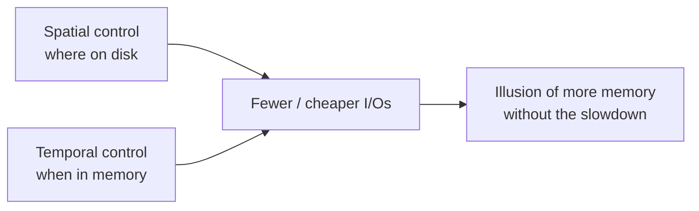

# 01 — Introduction: Spatial and Temporal Control

## Where this lecture sits in the course

- The previous lecture answered *how data is represented on disk*; this one answers *how it moves between disk and memory, and how we track what lives where* ([`1:41`](https://www.youtube.com/watch?v=aoewwZwVmv4&t=101), [`2:00`](https://www.youtube.com/watch?v=aoewwZwVmv4&t=120)).
- Root cause: the von Neumann architecture — you cannot operate directly on disk-resident data, so it must be copied into memory ([`2:00`](https://www.youtube.com/watch?v=aoewwZwVmv4&t=120)).
  - Exception noted: some specialized SSDs (e.g. Samsung drives with on-board ARM cores) let you push computation down, but general-purpose DBMSs cannot assume that ([`2:33`](https://www.youtube.com/watch?v=aoewwZwVmv4&t=153)).
- The goal of the whole lecture, stated plainly: **make it look like we have more memory than we actually do, without slowing things down** ([`2:33`](https://www.youtube.com/watch?v=aoewwZwVmv4&t=153)).

## The two things a DBMS optimizes for

### 1. Spatial control — *where* pages are physically placed on disk

- Put data that is used together close together on disk, ideally in contiguous pages, so one fetch does sequential access and drags in a lot of useful bytes ([`2:52`](https://www.youtube.com/watch?v=aoewwZwVmv4&t=172)).
- Extreme example: **Spanner** supports denormalization where a tuple from one table is physically packed inside the tuple of the table it has a foreign-key relation to, so a join finds all the data on one page. Most systems do not do this ([`2:52`](https://www.youtube.com/watch?v=aoewwZwVmv4&t=172)).

### 2. Temporal control — *when* pages are read in and evicted

- Once a page is in memory, keep it there for as many queries/operations as possible, and evict only when it is unlikely to be needed ([`3:41`](https://www.youtube.com/watch?v=aoewwZwVmv4&t=221)).
- Worst case is **thrashing**: read a page, use it, evict it, then have the very next query read the same page from disk again ([`3:41`](https://www.youtube.com/watch?v=aoewwZwVmv4&t=221)).
- The motivation is stall avoidance — disk is dramatically slower than memory, so both the buffer-pool replacement policy and the background writer try to pick victims unlikely to be reused. This is not always easy ([`4:16`](https://www.youtube.com/watch?v=aoewwZwVmv4&t=256), [`4:39`](https://www.youtube.com/watch?v=aoewwZwVmv4&t=279)).

## Lecture roadmap

Stated agenda ([`9:19`](https://www.youtube.com/watch?v=aoewwZwVmv4&t=559), [`9:42`](https://www.youtube.com/watch?v=aoewwZwVmv4&t=582)):

1. Buffer pool manager — background and implementation
2. Buffer pool policies
3. Why **not** to use `mmap` in a database system
4. Disk I/O scheduling
5. Replacement policies
6. Optimizations that beat anything the OS could provide
7. Project 1 walkthrough

