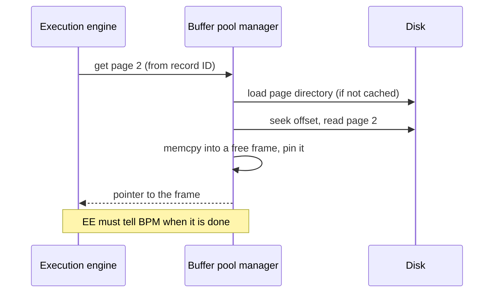

# 02 — Buffer Pool Manager Anatomy

## The big picture

- On disk: database files split into pages. Whether the layout is a heap file or LSM does not matter for this lecture ([`4:54`](https://www.youtube.com/watch?v=aoewwZwVmv4&t=294)).
- In memory: the **buffer pool**, an array of **frames**. A frame is a reusable memory slot the same size as a database page ([`4:54`](https://www.youtube.com/watch?v=aoewwZwVmv4&t=294), [`9:42`](https://www.youtube.com/watch?v=aoewwZwVmv4&t=582)).
- Above it: the **execution engine**, which asks for pages by page number derived from a record ID (file number + object number + page number + slot number) ([`5:33`](https://www.youtube.com/watch?v=aoewwZwVmv4&t=333), [`5:51`](https://www.youtube.com/watch?v=aoewwZwVmv4&t=351)).

Request flow ([`5:51`](https://www.youtube.com/watch?v=aoewwZwVmv4&t=351) → [`6:10`](https://www.youtube.com/watch?v=aoewwZwVmv4&t=370)):

- The copy is essentially a `memcpy` from the on-disk page into the frame ([`6:10`](https://www.youtube.com/watch?v=aoewwZwVmv4&t=370)).
- What comes back is a **pointer**, but the caller may never assume the pointer is stable across requests — the buffer manager is the sole coordinator and may relocate pages freely; a re-fetched page can land in a different frame ([`7:14`](https://www.youtube.com/watch?v=aoewwZwVmv4&t=434), [`7:39`](https://www.youtube.com/watch?v=aoewwZwVmv4&t=459)).
- Frame ordering in memory need not match page ordering on disk ([`11:01`](https://www.youtube.com/watch?v=aoewwZwVmv4&t=661)).

## Other consumers of the buffer pool

Anything that may need to spill to disk should be backed by the buffer pool ([`8:14`](https://www.youtube.com/watch?v=aoewwZwVmv4&t=494), [`8:30`](https://www.youtube.com/watch?v=aoewwZwVmv4&t=510)):

- Sort buffers and join buffers (e.g. a hash table larger than available memory, written out to a temp/scratch space rather than the regular database file)
- Buffers for other in-memory operations
- Query caching

Systems that support multiple page sizes (per table or per table space) need **one buffer pool per page size** ([`10:23`](https://www.youtube.com/watch?v=aoewwZwVmv4&t=623)).

## Write-back, not write-through

- The buffer pool is a **write-back cache**: modifications hit the in-memory page first, and the dirty page is flushed to disk later ([`11:16`](https://www.youtube.com/watch?v=aoewwZwVmv4&t=676)).
- It is *not* write-through, for durability reasons — at write time we do not yet know whether the operation that dirtied the page committed, or whether the changes should become durable at all ([`11:41`](https://www.youtube.com/watch?v=aoewwZwVmv4&t=701), [`11:58`](https://www.youtube.com/watch?v=aoewwZwVmv4&t=718)).
- Extra constraint previewed for later: the corresponding **log record must reach disk before** the page it describes ([`11:41`](https://www.youtube.com/watch?v=aoewwZwVmv4&t=701)).

## The page table and its metadata

- **Page table**: an in-memory map from page ID → frame location inside the buffer pool ([`12:12`](https://www.youtube.com/watch?v=aoewwZwVmv4&t=732)).
- Metadata tracked alongside each entry ([`12:39`](https://www.youtube.com/watch?v=aoewwZwVmv4&t=759) → [`14:06`](https://www.youtube.com/watch?v=aoewwZwVmv4&t=846)):
  - **Dirty flag** — has the page been written? If yes it cannot simply be dropped; it must be written back first.
  - **Pin / reference counter** — how many threads or workers currently hold pointers to this page.
  - **Tracking metadata** — timestamps of the last access, or of the last *k* accesses, used later by the replacement policy.
  - **Access context** — was it a query, a background maintenance worker, a transaction?
- Why the protection matters: without pinning, one worker could hand out page 2, another could reuse the same frame for page 3, and the first worker would then read page 3's bytes believing they are page 2 ([`13:00`](https://www.youtube.com/watch?v=aoewwZwVmv4&t=780), [`15:51`](https://www.youtube.com/watch?v=aoewwZwVmv4&t=951)).

### Pin lifecycle

- A page is pinned the moment its pointer is handed out ([`15:27`](https://www.youtube.com/watch?v=aoewwZwVmv4&t=927)).
- It stays pinned as long as the caller holds the pointer ([`15:51`](https://www.youtube.com/watch?v=aoewwZwVmv4&t=951)).
- The **caller** (execution engine or whoever asked) is contractually responsible for telling the buffer manager it is done. This is enforceable because it is all in-house code, "not randos on the internet" ([`16:13`](https://www.youtube.com/watch?v=aoewwZwVmv4&t=973)).

### Hit vs miss path

- **Hit** (page 3 present): take a latch on the page table, find the entry, pin it, return the pointer ([`14:06`](https://www.youtube.com/watch?v=aoewwZwVmv4&t=846)).
- **Miss** (page 2 absent): latch the empty entry so nobody else inserts concurrently, copy the page into a free frame, update the metadata (location, accessor, timestamp), **pin it first**, then release the latch ([`14:37`](https://www.youtube.com/watch?v=aoewwZwVmv4&t=877), [`15:06`](https://www.youtube.com/watch?v=aoewwZwVmv4&t=906), [`15:27`](https://www.youtube.com/watch?v=aoewwZwVmv4&t=927)).

## Latch vs lock — a DBMS vocabulary distinction

| | **Lock** | **Latch** |
|---|---|---|
| Protects | Higher-level logical entities: a table, a tuple, an index entry ([`17:08`](https://www.youtube.com/watch?v=aoewwZwVmv4&t=1028)) | Internal critical sections in the system's own code ([`17:38`](https://www.youtube.com/watch?v=aoewwZwVmv4&t=1058)) |
| Deadlock handling | System-provided: detects deadlocks and kills a worker to break them ([`17:08`](https://www.youtube.com/watch?v=aoewwZwVmv4&t=1028)) | None — "programmer discipline"; nothing floats above to kill your deadlocks ([`18:08`](https://www.youtube.com/watch?v=aoewwZwVmv4&t=1088)) |
| Implementation | DBMS lock manager | A mutex ([`16:42`](https://www.youtube.com/watch?v=aoewwZwVmv4&t=1002)) |

- The OS world's "lock" is the DB world's "latch" ([`16:42`](https://www.youtube.com/watch?v=aoewwZwVmv4&t=1002)).
- You *can* use `std::mutex` (a futex on Linux), but most DBMSs avoid OS-provided primitives and **roll their own latches** ([`18:21`](https://www.youtube.com/watch?v=aoewwZwVmv4&t=1101)).

## Page table vs page directory

| | **Page directory** | **Page table** |
|---|---|---|
| Lives | On disk ([`18:52`](https://www.youtube.com/watch?v=aoewwZwVmv4&t=1132)) | In memory, inside the buffer pool manager ([`18:52`](https://www.youtube.com/watch?v=aoewwZwVmv4&t=1132)) |
| Maps | Page ID → location in the database file(s) | Page ID → frame holding the copy |
| On restart | Reloaded, must stay synchronized with the actual files | Blown away and rebuilt — pages may land in different frames the second time ([`19:35`](https://www.youtube.com/watch?v=aoewwZwVmv4&t=1175)) |
| Updated | Whenever pages are added/changed | On every fetch/eviction |
