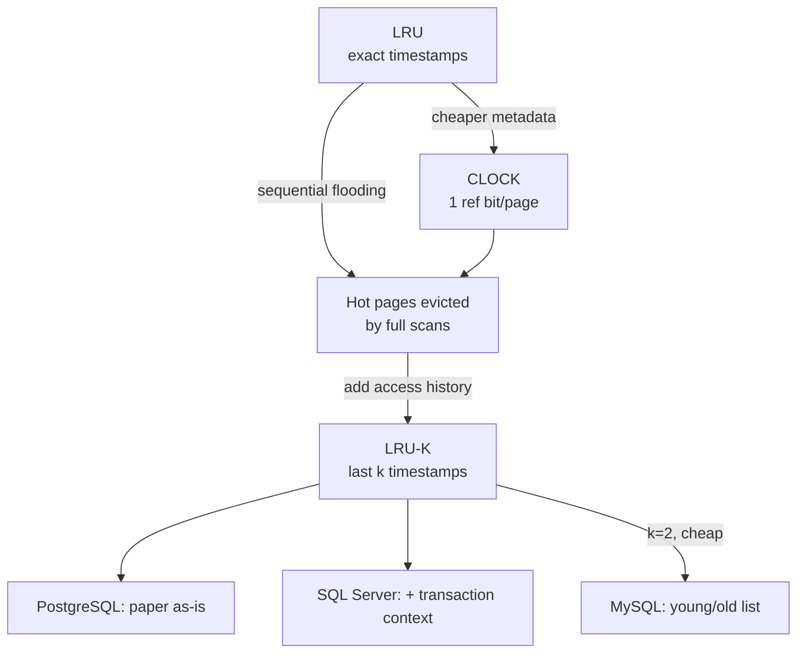

# 04 — Buffer Replacement Policies

## What a good policy must balance

Also called *buffer replacement* or *cache replacement* policies — one of the oldest problems in CS, with a paper from nearly everyone ([`32:31`](https://www.youtube.com/watch?v=aoewwZwVmv4&t=1951)). Four criteria ([`32:31`](https://www.youtube.com/watch?v=aoewwZwVmv4&t=1951) → [`33:39`](https://www.youtube.com/watch?v=aoewwZwVmv4&t=2019)):

1. **Correctness** — never evict the page the query is about to use next, or you thrash.
2. **Speed** — the decision must be cheap. If picking the optimal victim takes 100 ms but reading a page takes 10 ms, the policy is a net loss.
3. **Durability** — never evict a page whose corresponding log record has not yet been written out.
4. **Metadata size** — every byte spent tracking access history is a byte not spent caching pages.

> This is a major differentiator between open source and high-end enterprise systems (Oracle, SQL Server, DB2, Teradata), which have spent millions of dollars and enormous engineering time here. Postgres and friends simply cannot compete on bells and whistles — and the enterprise vendors mostly do not publish what they do ([`33:54`](https://www.youtube.com/watch?v=aoewwZwVmv4&t=2034), [`34:23`](https://www.youtube.com/watch?v=aoewwZwVmv4&t=2063)).

## LRU — Least Recently Used

- Record a timestamp (wall clock or logical counter) at every buffer-manager access ([`34:45`](https://www.youtube.com/watch?v=aoewwZwVmv4&t=2085), [`35:10`](https://www.youtube.com/watch?v=aoewwZwVmv4&t=2110)).
- Keep pages sorted by that timestamp in a linked list, B+Tree, trie, whatever ([`35:10`](https://www.youtube.com/watch?v=aoewwZwVmv4&t=2110)).
- On access, move the page to the head; on eviction, take the tail ([`35:10`](https://www.youtube.com/watch?v=aoewwZwVmv4&t=2110)).
- Maintains an **exact** ordering; simple and works reasonably well ([`35:44`](https://www.youtube.com/watch?v=aoewwZwVmv4&t=2144)).

## CLOCK — approximate LRU

An approximation that drops timestamps in favor of **one reference bit per page** ([`36:12`](https://www.youtube.com/watch?v=aoewwZwVmv4&t=2172)). This is what **Linux** uses, in a multi-hand variant ([`36:12`](https://www.youtube.com/watch?v=aoewwZwVmv4&t=2172)).

Algorithm ([`36:35`](https://www.youtube.com/watch?v=aoewwZwVmv4&t=2195) → [`37:37`](https://www.youtube.com/watch?v=aoewwZwVmv4&t=2257)):

1. Arrange pages in a circle; set the ref bit to 1 on every access.
2. When a frame is needed, sweep a hand around (start anywhere — random, fixed, or where you left off; it evens out).
3. Bit = 1 → do not evict, but reset it to 0.
4. Bit = 0 → not accessed since the last sweep, so evict it.

Two clarifications from Q&A:

- A newly loaded page gets ref bit **0**, not 1: you have no history for it, and the request that needed it has already been serviced. If it was a one-shot read it will be evicted; if it is genuinely needed it will be re-accessed and set to 1 ([`37:37`](https://www.youtube.com/watch?v=aoewwZwVmv4&t=2257), [`37:56`](https://www.youtube.com/watch?v=aoewwZwVmv4&t=2276), [`38:23`](https://www.youtube.com/watch?v=aoewwZwVmv4&t=2303)).
- If every bit is 1 they get reset on the first pass and are evictable on the second. Guard against an infinite loop with a lap counter; if everything is pinned, reject the query or return an out-of-memory error — at that point queries are so slow a human operator would notice anyway ([`38:44`](https://www.youtube.com/watch?v=aoewwZwVmv4&t=2324), [`39:14`](https://www.youtube.com/watch?v=aoewwZwVmv4&t=2354), [`39:26`](https://www.youtube.com/watch?v=aoewwZwVmv4&t=2366)).

## The failure mode: sequential flooding

- A query doing a sequential scan reads every page of a table, making everything look recently accessed and wiping genuinely hot pages out of the pool ([`39:52`](https://www.youtube.com/watch?v=aoewwZwVmv4&t=2392), [`40:18`](https://www.youtube.com/watch?v=aoewwZwVmv4&t=2418)).
- In OLAP workloads the **most** recently used page is often the right victim — once scanned, it will not be read again in that query ([`40:18`](https://www.youtube.com/watch?v=aoewwZwVmv4&t=2418), [`40:50`](https://www.youtube.com/watch?v=aoewwZwVmv4&t=2450)).
- Root cause: LRU and CLOCK store only *when* a page was last accessed, not *how many times*, so they cannot judge whether to keep it ([`40:50`](https://www.youtube.com/watch?v=aoewwZwVmv4&t=2450)).

Worked example ([`41:12`](https://www.youtube.com/watch?v=aoewwZwVmv4&t=2472) → [`42:29`](https://www.youtube.com/watch?v=aoewwZwVmv4&t=2549)):

1. `SELECT ... WHERE id = 1` — a common OLTP point lookup — brings page 0 in.
2. `SELECT AVG(...)` scans every page; frames run out.
3. Page 0 is the least recently used, so it is evicted for page 3.
4. The hot point lookup runs again and must go back to disk for page 0.

## LRU-K

- From the same author as the log-structured merge tree, from the 1990s ([`42:29`](https://www.youtube.com/watch?v=aoewwZwVmv4&t=2549)).
- Track the timestamps of the last **k** references per page; evict the page with the longest interval between successive accesses ([`42:41`](https://www.youtube.com/watch?v=aoewwZwVmv4&t=2561), [`43:00`](https://www.youtube.com/watch?v=aoewwZwVmv4&t=2580)).
- This balances recency against **frequency** ([`43:00`](https://www.youtube.com/watch?v=aoewwZwVmv4&t=2580)).
- **PostgreSQL implements exactly the paper's algorithm** — traceable to a 2002 mailing-list post where someone proposed it ([`44:35`](https://www.youtube.com/watch?v=aoewwZwVmv4&t=2675), [`44:51`](https://www.youtube.com/watch?v=aoewwZwVmv4&t=2691)).

Refinements:

- **SQL Server** additionally tracks whether repeat accesses came from the *same transaction* (read Andy's order record, then update it), so those count as one access rather than two. Postgres does not do this ([`43:18`](https://www.youtube.com/watch?v=aoewwZwVmv4&t=2598), [`43:44`](https://www.youtube.com/watch?v=aoewwZwVmv4&t=2624)).
- **Cold-start problem**: after restart there is no history. Fix by persisting the metadata, or by keeping a small cache of access history for recently evicted pages so the algorithm reconverges quickly instead of relearning from scratch ([`43:44`](https://www.youtube.com/watch?v=aoewwZwVmv4&t=2624), [`44:12`](https://www.youtube.com/watch?v=aoewwZwVmv4&t=2652), [`44:35`](https://www.youtube.com/watch?v=aoewwZwVmv4&t=2675)).

## MySQL's approximate LRU

- One linked list with **two entry points**: a **young** section head and an **old** section head ([`44:51`](https://www.youtube.com/watch?v=aoewwZwVmv4&t=2691)).
- First access inserts the page at the **old** midpoint, not the front — "we needed you, but you are not staying long yet" ([`45:23`](https://www.youtube.com/watch?v=aoewwZwVmv4&t=2723), [`45:47`](https://www.youtube.com/watch?v=aoewwZwVmv4&t=2747)).
- A second access promotes it to the front of the young section, making eviction much less likely; if it is never touched again it drifts back down and is evicted ([`45:47`](https://www.youtube.com/watch?v=aoewwZwVmv4&t=2747), [`46:06`](https://www.youtube.com/watch?v=aoewwZwVmv4&t=2766), [`46:27`](https://www.youtube.com/watch?v=aoewwZwVmv4&t=2787)).
- Effectively LRU-K with **k = 2**, chosen because it is far less metadata and an easy extension of LRU compared with what Postgres and SQL Server do ([`46:06`](https://www.youtube.com/watch?v=aoewwZwVmv4&t=2766), [`46:27`](https://www.youtube.com/watch?v=aoewwZwVmv4&t=2787)).

## Policy scope: global vs localized

- Policies can be applied globally, per query, or in some systems per table, per index, or per table space ([`46:46`](https://www.youtube.com/watch?v=aoewwZwVmv4&t=2806)).
- **PostgreSQL ring buffer**: a sequential scan gets a dedicated slice of the buffer pool and evicts only within that slice, so it never pollutes the global policy ([`47:21`](https://www.youtube.com/watch?v=aoewwZwVmv4&t=2841), [`47:48`](https://www.youtube.com/watch?v=aoewwZwVmv4&t=2868)).
  - Size cited: about **256 KB per query ≈ 32 pages** at 8 KB per page — not much memory, but enough to prevent pollution ([`48:11`](https://www.youtube.com/watch?v=aoewwZwVmv4&t=2891)).
  - The pages remain visible to other queries via the page table; they are just evicted locally when no one else needs them ([`48:11`](https://www.youtube.com/watch?v=aoewwZwVmv4&t=2891)).

## Priority hints

- Queries can pass hints to the buffer manager about how they will access a page — effectively a "light pin": *this is important, try not to evict it, but you may if you must* ([`48:49`](https://www.youtube.com/watch?v=aoewwZwVmv4&t=2929), [`49:17`](https://www.youtube.com/watch?v=aoewwZwVmv4&t=2957)).
- Canonical case: inserts with an auto-incrementing/serial key all land on the right edge of a B+Tree, and **every insert touches the root first**, then the right-hand path. Hinting "keep the root resident" is a clear win ([`49:17`](https://www.youtube.com/watch?v=aoewwZwVmv4&t=2957), [`49:37`](https://www.youtube.com/watch?v=aoewwZwVmv4&t=2977), [`49:57`](https://www.youtube.com/watch?v=aoewwZwVmv4&t=2997)).
- LRU-K would probably learn the root is hot anyway, but the hint makes it certain ([`50:24`](https://www.youtube.com/watch?v=aoewwZwVmv4&t=3024)).
