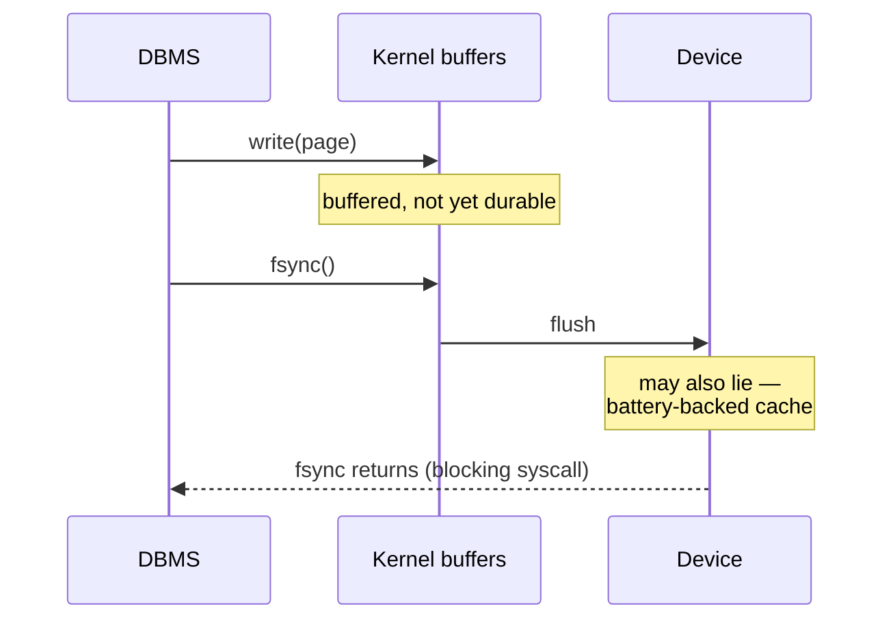

# 06 — Disk I/O Scheduling and OS Pitfalls

## Why the DBMS schedules its own I/O

- Hardware and OS already reorder and batch I/O requests to maximize bandwidth ([`55:28`](https://www.youtube.com/watch?v=aoewwZwVmv4&t=3328)).
- Modern M.2 / NVMe drives are fast **because of parallelism** — one thread doing one read at a time will be slow even on the newest hardware ([`55:55`](https://www.youtube.com/watch?v=aoewwZwVmv4&t=3355)).
- But the OS sees only "read these blocks" — it does not know the relationships between requests or which is more important ([`55:55`](https://www.youtube.com/watch?v=aoewwZwVmv4&t=3355)).
- Linux I/O priority exists but is **per process only**, never per request ([`55:55`](https://www.youtube.com/watch?v=aoewwZwVmv4&t=3355)).
- And `fsync` destroys priorities anyway: the OS treats it as most important and flushes immediately ([`57:12`](https://www.youtube.com/watch?v=aoewwZwVmv4&t=3432)).

So most DBMSs maintain their **own disk manager / disk scheduler** with an internal queue of read/write requests, and decide the service order themselves ([`56:47`](https://www.youtube.com/watch?v=aoewwZwVmv4&t=3407), [`57:34`](https://www.youtube.com/watch?v=aoewwZwVmv4&t=3454)).

- Vendors (Oracle, MySQL) publish manuals telling you to **turn off Linux's extra I/O scheduling** and use a simple scheduler such as deadline or FIFO ([`56:47`](https://www.youtube.com/watch?v=aoewwZwVmv4&t=3407), [`57:12`](https://www.youtube.com/watch?v=aoewwZwVmv4&t=3432)).

Scheduling decisions only the DBMS can make ([`57:34`](https://www.youtube.com/watch?v=aoewwZwVmv4&t=3454), [`57:57`](https://www.youtube.com/watch?v=aoewwZwVmv4&t=3477)):

- A mission-critical query should outrank a background cleanup job.
- A query holding many tuple locks should be serviced first, because finishing it releases those locks and unblocks other queries.

## Asynchronous I/O and `io_uring`

Out of scope for the class, but noted as a newer way to build disk managers ([`58:26`](https://www.youtube.com/watch?v=aoewwZwVmv4&t=3506)):

- Instead of blocking a thread on a request, use coroutines/promises: "notify me when this block is available."
- Linux's `io_uring` provides a ring buffer for filling in requests and getting notifications ([`58:50`](https://www.youtube.com/watch?v=aoewwZwVmv4&t=3530)).
- Example: scanning a table needing pages 1, 2, 3 with only 1 and 3 resident — issue the async request for page 2, process 1 and 3 meanwhile, then process 2 when it arrives ([`58:50`](https://www.youtube.com/watch?v=aoewwZwVmv4&t=3530), [`59:14`](https://www.youtube.com/watch?v=aoewwZwVmv4&t=3554)).
- Still new; not many systems use it yet ([`59:14`](https://www.youtube.com/watch?v=aoewwZwVmv4&t=3554)).

## The OS page cache and `O_DIRECT`

- On a `read`, the kernel first checks the **OS page cache** — essentially a buffer manager living inside the OS ([`59:52`](https://www.youtube.com/watch?v=aoewwZwVmv4&t=3592), [`1:00:11`](https://www.youtube.com/watch?v=aoewwZwVmv4&t=3611)).
- Miss → fetch from hardware, store in the page cache, **then copy again** into user space. Result: **two copies of every page**, doubling memory usage ([`1:00:26`](https://www.youtube.com/watch?v=aoewwZwVmv4&t=3626), [`1:00:51`](https://www.youtube.com/watch?v=aoewwZwVmv4&t=3651)).
- Fix: **direct I/O** — pass `O_DIRECT` to `open` to bypass the page cache. One copy, no OS-side eviction policy to fight, full control ([`1:00:51`](https://www.youtube.com/watch?v=aoewwZwVmv4&t=3651), [`1:01:16`](https://www.youtube.com/watch?v=aoewwZwVmv4&t=3676)).

### The famous exception: PostgreSQL

- Postgres relies on the OS page cache ([`1:01:39`](https://www.youtube.com/watch?v=aoewwZwVmv4&t=3699), [`1:01:57`](https://www.youtube.com/watch?v=aoewwZwVmv4&t=3717)).
- Consequence in its documented tuning advice ([`1:01:57`](https://www.youtube.com/watch?v=aoewwZwVmv4&t=3717), [`1:02:21`](https://www.youtube.com/watch?v=aoewwZwVmv4&t=3741), [`1:03:06`](https://www.youtube.com/watch?v=aoewwZwVmv4&t=3786)):

| System | Recommended buffer pool size | On a 100 GB box |
|---|---|---|
| PostgreSQL | ~25–30% of RAM (the rest is left for the OS page cache) | ~25 GB |
| Every other DBMS | ~80% of RAM | ~80 GB |

- The lecturer's read: a leftover from the 1980s design ([`1:02:21`](https://www.youtube.com/watch?v=aoewwZwVmv4&t=3741)).
- Side effect: a page evicted from the Postgres buffer pool may still sit in the OS page cache ([`1:03:06`](https://www.youtube.com/watch?v=aoewwZwVmv4&t=3786)).
- Postgres knows this is bad and is moving off it: an **experimental feature turns off the OS page cache and lets Postgres use direct I/O**, described in a LinkedIn post from a Postgres developer at Microsoft, shipping in later versions ([`1:03:27`](https://www.youtube.com/watch?v=aoewwZwVmv4&t=3807), [`1:03:39`](https://www.youtube.com/watch?v=aoewwZwVmv4&t=3819)).

## The `fsync` scandal (fsyncgate, 2018)

The chain when a DBMS calls `write` ([`1:03:58`](https://www.youtube.com/watch?v=aoewwZwVmv4&t=3838) → [`1:05:13`](https://www.youtube.com/watch?v=aoewwZwVmv4&t=3913)):

The bug ([`1:05:36`](https://www.youtube.com/watch?v=aoewwZwVmv4&t=3936) → [`1:07:02`](https://www.youtube.com/watch?v=aoewwZwVmv4&t=4022)):

1. `fsync` fails and returns an errno. You cannot tell whether the write partially succeeded, fully failed, or nothing was written.
2. **Linux marks the dirty pages clean anyway.**
3. Many DBMSs called `fsync` in a retry loop.
4. The second call finds no dirty pages and reports **success** — a lie. Your data is gone.

Why Linux did it: kernel developers worried about someone `fsync`-ing a USB thumb drive that gets unplugged and never returns, leaving permanently dirty pages in the page table. Marking them clean cleans up. But databases do not run off thumb drives, so this is the worst possible behavior for them ([`1:07:02`](https://www.youtube.com/watch?v=aoewwZwVmv4&t=4022), [`1:07:28`](https://www.youtube.com/watch?v=aoewwZwVmv4&t=4048)).

Scope and discovery ([`1:07:41`](https://www.youtube.com/watch?v=aoewwZwVmv4&t=4061), [`1:08:01`](https://www.youtube.com/watch?v=aoewwZwVmv4&t=4081), [`1:08:12`](https://www.youtube.com/watch?v=aoewwZwVmv4&t=4092)):

- Surfaced in **2018**, after being a bug in many systems for **~20 years**.
- Affected PostgreSQL, MySQL, MongoDB and others.
- Found when a user reported to the Postgres mailing list that he had lost data with **no kernel panic and no error numbers**; digging revealed `fsync` had been lying for two decades.
- Moral: "the operating system is not our friend" — do not trust it ([`1:08:12`](https://www.youtube.com/watch?v=aoewwZwVmv4&t=4092)).
