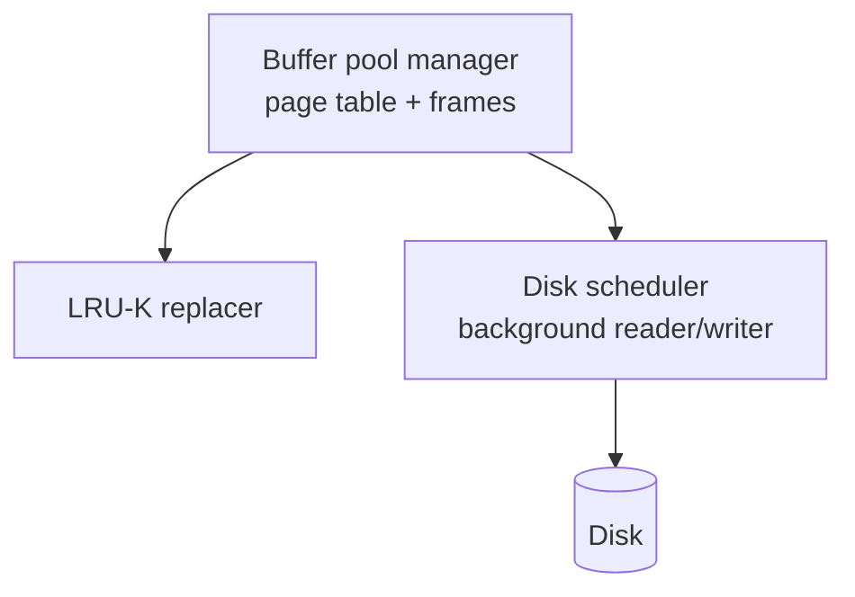

# 08 — Conclusion and Project 1

## Closing thesis

- The DBMS is always better than the OS at memory management. Not that the OS always makes the *wrong* call, but it makes your life much harder ([`1:19:59`](https://www.youtube.com/watch?v=aoewwZwVmv4&t=4799)).
- Because the DBMS knows the query plan, it makes better decisions on **evictions, allocations and prefetching** ([`1:20:24`](https://www.youtube.com/watch?v=aoewwZwVmv4&t=4824)).
- Next class: hash tables ([`1:20:24`](https://www.youtube.com/watch?v=aoewwZwVmv4&t=4824)).

## Project 1 — build your own buffer pool manager

Three tasks, with a provided API skeleton to fill in and wire together ([`1:20:24`](https://www.youtube.com/watch?v=aoewwZwVmv4&t=4824)):

1. **LRU-K replacement policy** — a class you manage yourself; your choice of data structure, STL allowed ([`1:20:52`](https://www.youtube.com/watch?v=aoewwZwVmv4&t=4852)).
2. **Disk scheduler** — a background reader/writer for requests, built on **STL promises for callbacks** ([`1:20:52`](https://www.youtube.com/watch?v=aoewwZwVmv4&t=4852)).
3. **Buffer pool manager instance** — sits on top, owns the page table and frames, runs the eviction policy ([`1:21:17`](https://www.youtube.com/watch?v=aoewwZwVmv4&t=4877)).

### Implementation warnings

- **Thread safety is mandatory** — use latches; the graders hit it with multiple threads at once ([`1:20:52`](https://www.youtube.com/watch?v=aoewwZwVmv4&t=4852), [`1:21:17`](https://www.youtube.com/watch?v=aoewwZwVmv4&t=4877)).
- **Pinning order matters**: get it wrong and you give up a page you should have kept, it gets overwritten, and the program crashes ([`1:21:17`](https://www.youtube.com/watch?v=aoewwZwVmv4&t=4877)).

### Logistics

- Only a specific subset of files is yours to change; edits to any other file are **overwritten on Gradescope** ([`1:21:52`](https://www.youtube.com/watch?v=aoewwZwVmv4&t=4912)).
- Solutions are provided only for the one task posted late; all other tests are private, but the test suite is exhaustive — **100% on it should mean no bugs for the rest of the semester** ([`1:21:52`](https://www.youtube.com/watch?v=aoewwZwVmv4&t=4912), [`1:22:19`](https://www.youtube.com/watch?v=aoewwZwVmv4&t=4939)).
- Questions go to Piazza or office hours; not for basic C++ questions ([`1:22:19`](https://www.youtube.com/watch?v=aoewwZwVmv4&t=4939)).
- Use the provided formatting tools ([`1:22:19`](https://www.youtube.com/watch?v=aoewwZwVmv4&t=4939)).
- **Leaderboard**: a separate benchmark from the correctness tests; the fastest implementations earn bonus points, and the top bonus-point total for the semester wins BusTub swag (sweatshirts, stickers) ([`1:22:19`](https://www.youtube.com/watch?v=aoewwZwVmv4&t=4939), [`1:22:48`](https://www.youtube.com/watch?v=aoewwZwVmv4&t=4968)).
- Do not plagiarize ([`1:22:59`](https://www.youtube.com/watch?v=aoewwZwVmv4&t=4979)).

## Course logistics mentioned at the start

- Industry database companies were on campus for info sessions; students were asked to put their CV and availability on the Piazza spreadsheet ([`0:27`](https://www.youtube.com/watch?v=aoewwZwVmv4&t=27)).
- Sessions start at 9:30, plus a last-minute bonus session at 12:30 from Confluent ([`1:00`](https://www.youtube.com/watch?v=aoewwZwVmv4&t=60)).
- The schedule was generated by asking ChatGPT to write a **linear program** over student availability and preferences ([`1:13`](https://www.youtube.com/watch?v=aoewwZwVmv4&t=73)).
- Attendees included the Weaviate CTO/co-founders from Germany and the ClickHouse representative from the Netherlands ([`1:41`](https://www.youtube.com/watch?v=aoewwZwVmv4&t=101)).
