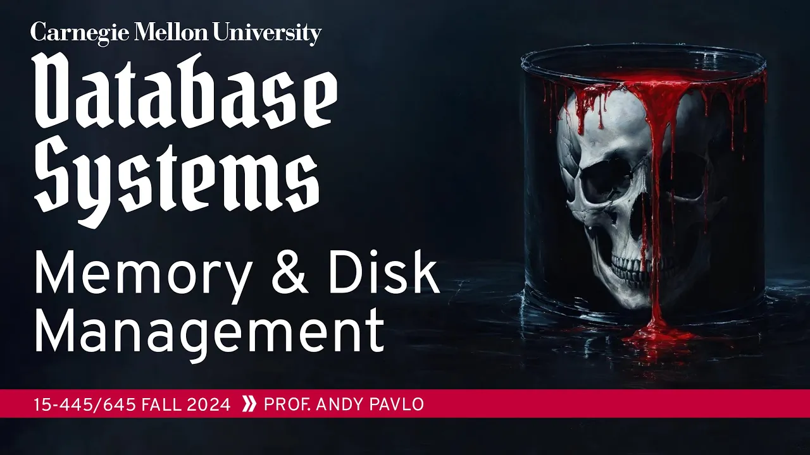
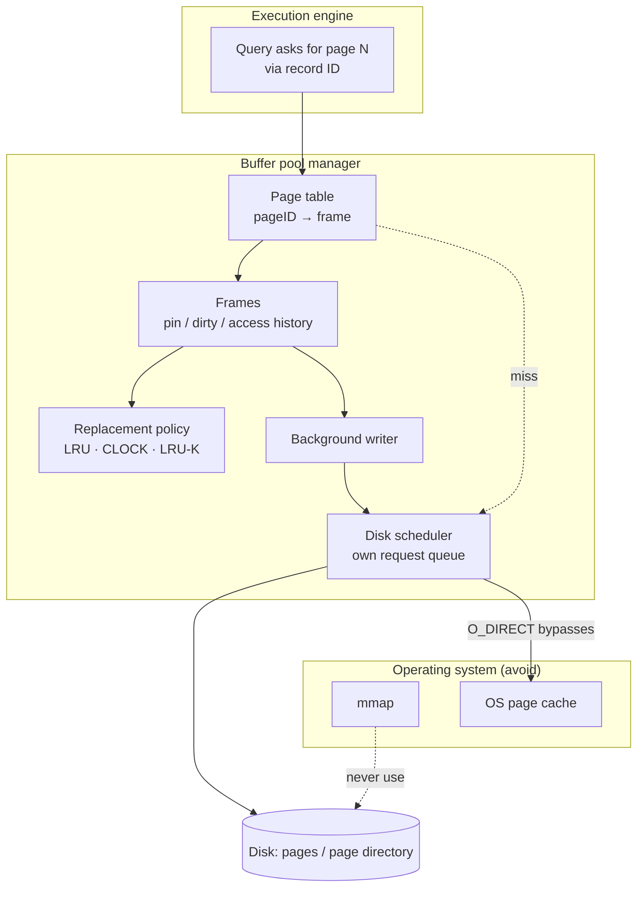

# #06 - Memory & Disk I/O Management (CMU Intro to Database Systems)

*CMU Database Group · 1:23:56 · [Watch on YouTube](https://www.youtube.com/watch?v=aoewwZwVmv4)*

## Summary

Lecture 6 of CMU 15-445/645 (Fall 2024) covers how a DBMS moves pages between disk and memory and why it must do that job itself instead of delegating it to the operating system. It builds the **buffer pool manager** from the ground up — frames, the page table, pins, dirty flags and latches — then argues at length against `mmap`, walks through buffer replacement policies (LRU, CLOCK, LRU-K and the variants shipped by PostgreSQL, MySQL and SQL Server), and covers dirty-page handling with a background writer. The last third moves to disk I/O scheduling, the OS page cache, direct I/O, the 2018 `fsync` data-loss scandal, and four buffer pool optimizations, closing with the Project 1 assignment: implement your own LRU-K replacer, disk scheduler and buffer pool manager.

## Topics

1. [Introduction: spatial and temporal control](./01-introduction-spatial-and-temporal-control.md)
2. [Buffer pool manager anatomy](./02-buffer-pool-manager-anatomy.md)
3. [Why not `mmap`](./03-why-not-mmap.md)
4. [Buffer replacement policies](./04-buffer-replacement-policies.md)
5. [Dirty pages and the background writer](./05-dirty-pages-and-the-background-writer.md)
6. [Disk I/O scheduling and OS pitfalls](./06-disk-io-scheduling-and-os-pitfalls.md)
7. [Buffer pool optimizations](./07-buffer-pool-optimizations.md)
8. [Conclusion and Project 1](./08-conclusion-and-project-1.md)

Source material: [`transcript.md`](./transcript.md)

## Key takeaways

- The buffer pool is a **write-back** cache, never write-through: writes hit the in-memory page first, because at write time the DBMS does not yet know whether the operation committed or whether the change should be durable ([`11:16`](https://www.youtube.com/watch?v=aoewwZwVmv4&t=676), [`11:58`](https://www.youtube.com/watch?v=aoewwZwVmv4&t=718)).
- `mmap` is disqualified for four concrete reasons: the OS can flush any dirty page at any time (breaking multi-page atomicity), it stalls threads invisibly, it reports errors as `SIGBUS` interrupts that force error handling into every memory access site instead of one I/O path, and its page-table mutexes throw away every contention optimization you could have made ([`23:01`](https://www.youtube.com/watch?v=aoewwZwVmv4&t=1381), [`23:56`](https://www.youtube.com/watch?v=aoewwZwVmv4&t=1436), [`25:11`](https://www.youtube.com/watch?v=aoewwZwVmv4&t=1511), [`25:51`](https://www.youtube.com/watch?v=aoewwZwVmv4&t=1551)).
- **MongoDB is the proof by counterexample**: with funding, customers and top engineers it still abandoned its mmap storage engine for WiredTiger, a buffer-pool-manager design — the same design Project 1 asks students to build ([`29:38`](https://www.youtube.com/watch?v=aoewwZwVmv4&t=1778)).
- LRU and CLOCK both fail under **sequential flooding**, because they record only *when* a page was last touched, not *how often*: a full-table scan evicts a genuinely hot point-lookup page. LRU-K fixes it by tracking the last *k* access timestamps — PostgreSQL implements the paper exactly, SQL Server adds transaction context, and MySQL approximates it with a cheap young/old two-headed list (effectively k = 2) ([`39:52`](https://www.youtube.com/watch?v=aoewwZwVmv4&t=2392), [`40:50`](https://www.youtube.com/watch?v=aoewwZwVmv4&t=2450), [`42:41`](https://www.youtube.com/watch?v=aoewwZwVmv4&t=2561), [`44:51`](https://www.youtube.com/watch?v=aoewwZwVmv4&t=2691), [`46:06`](https://www.youtube.com/watch?v=aoewwZwVmv4&t=2766)).
- Relying on the **OS page cache doubles memory usage** — one copy in the kernel, one in user space — which is why most systems open files with `O_DIRECT`. PostgreSQL is the famous holdout, and the cost is visible in its tuning advice: ~25–30% of RAM for the buffer pool versus ~80% everywhere else. Postgres is now shipping an experimental direct-I/O mode to escape it ([`1:00:51`](https://www.youtube.com/watch?v=aoewwZwVmv4&t=3651), [`1:01:57`](https://www.youtube.com/watch?v=aoewwZwVmv4&t=3717), [`1:02:21`](https://www.youtube.com/watch?v=aoewwZwVmv4&t=3741), [`1:03:39`](https://www.youtube.com/watch?v=aoewwZwVmv4&t=3819)).
- **fsyncgate (2018)**: Linux marked dirty pages clean after a failed `fsync`, so the retry loop used by PostgreSQL, MySQL, MongoDB and others reported success on the second call while data was silently lost — a bug that survived roughly 20 years, and was designed that way to handle unplugged USB drives ([`1:05:57`](https://www.youtube.com/watch?v=aoewwZwVmv4&t=3957), [`1:06:28`](https://www.youtube.com/watch?v=aoewwZwVmv4&t=3988), [`1:07:02`](https://www.youtube.com/watch?v=aoewwZwVmv4&t=4022), [`1:07:41`](https://www.youtube.com/watch?v=aoewwZwVmv4&t=4061)).
- Of the four optimizations presented, **multiple buffer pool instances is the biggest and easiest win** — it partitions memory to cut latch contention; MySQL routes with `hash(record_id) mod n` while enterprise systems route by object ID and let each pool have its own page size and policy ([`1:08:58`](https://www.youtube.com/watch?v=aoewwZwVmv4&t=4138), [`1:09:34`](https://www.youtube.com/watch?v=aoewwZwVmv4&t=4174), [`1:11:04`](https://www.youtube.com/watch?v=aoewwZwVmv4&t=4264)).
- **Index prefetching and scan sharing are strictly DBMS-only capabilities**: the OS can prefetch sequentially through `mmap`, but only the DBMS knows leaf sibling pointers (Oracle prefetches pages 3→5→6, skipping the useless page 2) or can piggyback a second query onto an in-flight scan's cursor ([`1:12:52`](https://www.youtube.com/watch?v=aoewwZwVmv4&t=4372), [`1:13:55`](https://www.youtube.com/watch?v=aoewwZwVmv4&t=4435), [`1:15:04`](https://www.youtube.com/watch?v=aoewwZwVmv4&t=4504)).
