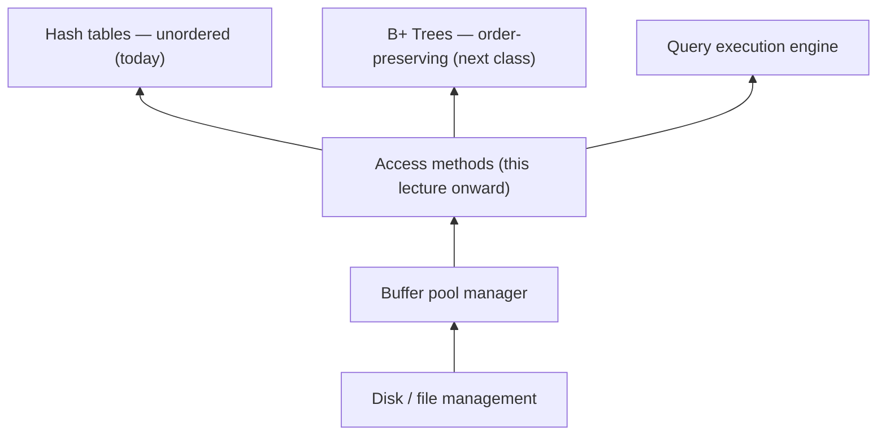

# 01 — Course logistics and where this lecture sits

## Administrivia

- Homework 2 due Sunday the 22nd; Project 1 due the following Sunday, the 29th [`0:27`](https://www.youtube.com/watch?v=VkP_yLM5KBU&t=27).
- Project 1 recitation held over Zoom at 6 p.m. the next night, recorded and posted to Piazza; students are told to read the code first so questions are substantive [`0:48`](https://www.youtube.com/watch?v=VkP_yLM5KBU&t=48).
- Leaderboard extra credit goes to roughly the top 10 performers [`1:21`](https://www.youtube.com/watch?v=VkP_yLM5KBU&t=81).
- Optional talks announced: an Apache DataFusion overview from InfluxDB, then DataFusion's inventor (now at Apple) on **DataFusion Comet** — a Spark accelerator that replaces Spark's Java execution engine with Rust-based DataFusion [`1:31`](https://www.youtube.com/watch?v=VkP_yLM5KBU&t=91), plus an Oracle talk at the DB group meeting on October 1st [`2:16`](https://www.youtube.com/watch?v=VkP_yLM5KBU&t=136).
- Aside: Oracle founder Larry Ellison briefly became the world's second-richest person on an Oracle stock surge, used as a "databases pay well" motivator [`2:38`](https://www.youtube.com/watch?v=VkP_yLM5KBU&t=158).

## Course roadmap: bottom-up construction

The course has been building the system from the storage layer upward, and now moves into the execution layer [`3:47`](https://www.youtube.com/watch?v=VkP_yLM5KBU&t=227):

- **Access methods** are the internal components that let the system read the pages it stores and derive meaning from them [`4:27`](https://www.youtube.com/watch?v=VkP_yLM5KBU&t=267).
- Today: hash tables (unordered). Next class: B+ Trees, which preserve key ordering [`4:27`](https://www.youtube.com/watch?v=VkP_yLM5KBU&t=267).

## Lecture agenda

1. Background — what a hash table is and why it matters [`5:18`](https://www.youtube.com/watch?v=VkP_yLM5KBU&t=318).
2. Hash functions — briefly; not a crypto or low-level algorithms class, so just pick the best one [`5:18`](https://www.youtube.com/watch?v=VkP_yLM5KBU&t=318).
3. Static hashing schemes — fixed number of key/value slots [`5:18`](https://www.youtube.com/watch?v=VkP_yLM5KBU&t=318).
4. Dynamic hashing schemes — incrementally grow (and sometimes shrink) over time [`5:44`](https://www.youtube.com/watch?v=VkP_yLM5KBU&t=344).
5. Guest talk from RelationalAI in the last ~10 minutes; teased as "a weird system," far from a conventional DBMS, and built on **Datalog** as an alternative to SQL [`6:04`](https://www.youtube.com/watch?v=VkP_yLM5KBU&t=364) [`6:36`](https://www.youtube.com/watch?v=VkP_yLM5KBU&t=396).
