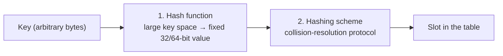

# 02 — Hash table fundamentals and design goals

## Where data structures are used inside a DBMS

Four places, all covered in the course [`7:00`](https://www.youtube.com/watch?v=VkP_yLM5KBU&t=420):

1. **Internal metadata** — e.g. the page directory that maps a page ID to its location.
2. **Core data storage** — index-organized tables, where leaf nodes hold the tuples themselves.
3. **Temporary data structures** — a query may build a large hash table, use it briefly, then throw it away, so build/teardown must be cheap [`7:41`](https://www.youtube.com/watch?v=VkP_yLM5KBU&t=461).
4. **Table indexes** — map a primary or secondary key to a tuple. The value stored may be a **record ID** (jump straight to the page), or, as in MySQL secondary indexes, the **primary key** (forcing a second lookup in the primary index) [`8:03`](https://www.youtube.com/watch?v=VkP_yLM5KBU&t=483).

## Two design goals for every DBMS data structure

- **Data organization** — how to lay out the structure in memory or in disk pages for efficient access; avoid NP-complete solutions [`8:50`](https://www.youtube.com/watch?v=VkP_yLM5KBU&t=530). A structure that is suboptimal in memory can still be the right choice if it maximizes sequential disk access — the B+ Tree is called out as the spoiler that wins on both [`9:07`](https://www.youtube.com/watch?v=VkP_yLM5KBU&t=547).
- **Concurrency** — letting multiple threads access the structure safely. Two problem classes [`9:30`](https://www.youtube.com/watch?v=VkP_yLM5KBU&t=570):
  - **Physical integrity**: concurrent writes corrupt pointers → dangling pointer → segfault.
  - **Logical integrity**: two threads insert the same key; or a key is deleted between one thread's write and read [`10:01`](https://www.youtube.com/watch?v=VkP_yLM5KBU&t=601). Deferred to a dedicated latching lecture two weeks out [`10:16`](https://www.youtube.com/watch?v=VkP_yLM5KBU&t=616).

## What a hash table is

- An **unordered associative array** mapping keys to values; keys and values vary with the context in which it is used [`10:34`](https://www.youtube.com/watch?v=VkP_yLM5KBU&t=634).
- A hash function computes an offset into the table — either the exact slot for the key, or somewhere close enough to search from [`11:07`](https://www.youtube.com/watch?v=VkP_yLM5KBU&t=667).
- Because the hash turns an arbitrary byte array into an essentially random number, access is **completely random I/O**, unlike an ordered structure you can scan in key order [`11:38`](https://www.youtube.com/watch?v=VkP_yLM5KBU&t=698). The upside: randomness spreads data evenly and helps absorb **skew** [`11:55`](https://www.youtube.com/watch?v=VkP_yLM5KBU&t=715).

### Complexity

| Measure | Value |
|---|---|
| Space | **O(n)** in the number of keys [`12:29`](https://www.youtube.com/watch?v=VkP_yLM5KBU&t=749) |
| Time (average) | **O(1)** [`12:29`](https://www.youtube.com/watch?v=VkP_yLM5KBU&t=749) |
| Time (worst case) | **O(n)** — scan every key to find it or prove it absent [`12:29`](https://www.youtube.com/watch?v=VkP_yLM5KBU&t=749) |

- Constants matter in practice, unlike in an algorithms course: an O(1) lookup with a 100 ms hash function is worthless — 100 ms is "a couple disk I/Os" [`13:01`](https://www.youtube.com/watch?v=VkP_yLM5KBU&t=781) [`13:21`](https://www.youtube.com/watch?v=VkP_yLM5KBU&t=801). Framing: **"constants equal money"** on expensive hardware [`13:39`](https://www.youtube.com/watch?v=VkP_yLM5KBU&t=819).

## Why the naive "giant array" table fails

The strawman: one array slot per possible key, each holding a pointer to the data [`13:39`](https://www.youtube.com/watch?v=VkP_yLM5KBU&t=819). It technically works, but rests on three unrealistic assumptions [`15:57`](https://www.youtube.com/watch?v=VkP_yLM5KBU&t=957):

1. **You know the number of keys ahead of time** — rarely true, and resizing means redistributing everything [`16:41`](https://www.youtube.com/watch?v=VkP_yLM5KBU&t=1001).
2. **Keys are unique** — false for e.g. a lookup on "all students in 15-445/645" [`16:57`](https://www.youtube.com/watch?v=VkP_yLM5KBU&t=1017) [`17:21`](https://www.youtube.com/watch?v=VkP_yLM5KBU&t=1041). Also breaks the one-value-per-slot model: a user with multiple phone numbers has nowhere to put the second [`18:35`](https://www.youtube.com/watch?v=VkP_yLM5KBU&t=1115).
3. **A perfect (identity) hash function exists** — trivial for integers, but not for variable-length strings. A **perfect hash function** maps every unique key to a unique hash; it needs extra metadata, is never truly perfect, and **no system implements it** [`17:34`](https://www.youtube.com/watch?v=VkP_yLM5KBU&t=1054) [`18:01`](https://www.youtube.com/watch?v=VkP_yLM5KBU&t=1081).

Additional objection raised in class: following a pointer out of the slot array is **cache-unfriendly** — and this problem is unavoidable across all hash tables [`15:57`](https://www.youtube.com/watch?v=VkP_yLM5KBU&t=957).

## The two components of a real hash table

- **Hash function** — maps a large key domain to a small one, producing a fixed-length value (32 or 64 bits). Trade-off: **speed vs. collision rate** [`19:01`](https://www.youtube.com/watch?v=VkP_yLM5KBU&t=1141) [`19:40`](https://www.youtube.com/watch?v=VkP_yLM5KBU&t=1180). The fastest possible hash returns a constant like `0` — instant, but with a catastrophic collision rate [`20:00`](https://www.youtube.com/watch?v=VkP_yLM5KBU&t=1200) [`20:17`](https://www.youtube.com/watch?v=VkP_yLM5KBU&t=1217).
- **Hashing scheme** — the protocol for resolving collisions. Trade-off: **storage vs. compute**. A huge table makes collisions unlikely but wastes memory/disk; a one-slot table is tiny but pushes all cost into compute [`20:17`](https://www.youtube.com/watch?v=VkP_yLM5KBU&t=1217) [`20:56`](https://www.youtube.com/watch?v=VkP_yLM5KBU&t=1256).
