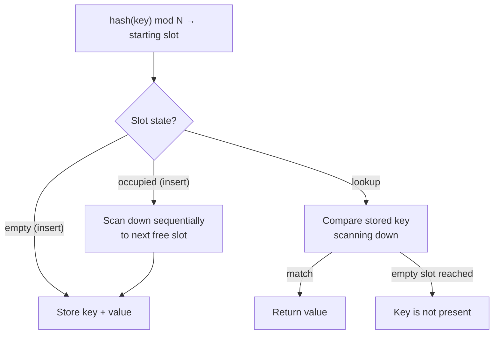

# 04 — Static hashing: linear probe hashing

## Static schemes and open addressing

- Two static schemes are covered: **linear probe hashing** and **cuckoo hashing**, both **open addressing** tables — the location of a key is "open," it need not always be the same slot [`24:33`](https://www.youtube.com/watch?v=VkP_yLM5KBU&t=1473) [`24:51`](https://www.youtube.com/watch?v=VkP_yLM5KBU&t=1491).
- Named-but-skipped variants (reserved for the advanced course): **Robin Hood hashing**, **hopscotch hashing**, **Swiss Tables** (Google). All differ only in what to do on a collision — evict the occupant, or look elsewhere [`25:10`](https://www.youtube.com/watch?v=VkP_yLM5KBU&t=1510).
- Terminology warning: **linear probe hashing** (static, this topic) is a different thing from **linear hashing** (dynamic, covered at the end of the lecture) [`25:53`](https://www.youtube.com/watch?v=VkP_yLM5KBU&t=1553).

## The algorithm

A single giant array of fixed-length slots holding key/value pairs [`26:08`](https://www.youtube.com/watch?v=VkP_yLM5KBU&t=1568):

- **Insert**: hash, mod N, scan down sequentially to the first free slot [`26:39`](https://www.youtube.com/watch?v=VkP_yLM5KBU&t=1599).
- **Lookup**: hash, mod N, compare each key while scanning down until a match, or an empty slot which proves absence [`27:04`](https://www.youtube.com/watch?v=VkP_yLM5KBU&t=1624).
- The array behaves as a **circular buffer** — wrap around at the bottom, tracking the start slot to avoid an infinite loop [`30:28`](https://www.youtube.com/watch?v=VkP_yLM5KBU&t=1828).
- **The original key must be stored in the slot**, otherwise you cannot tell whether a scanned entry is the one you want [`29:14`](https://www.youtube.com/watch?v=VkP_yLM5KBU&t=1754) [`31:09`](https://www.youtube.com/watch?v=VkP_yLM5KBU&t=1869).

## Where it shows up

- Believed to be Python's dictionary implementation, and widely used for **hash joins** because it is simple and genuinely fast [`27:18`](https://www.youtube.com/watch?v=VkP_yLM5KBU&t=1638).
- Defense against "worst case is terrible": a reasonably sized table with a decent load factor means only a few hops, and **simplicity is itself the advantage** [`32:29`](https://www.youtube.com/watch?v=VkP_yLM5KBU&t=1949). If backed by disk pages, the probe is a sequential scan over contiguous pages [`32:48`](https://www.youtube.com/watch?v=VkP_yLM5KBU&t=1968).
- Robin Hood hashing swaps entries so keys stay closer to their ideal slot — "seems like a clever idea, it actually is often slower, because simplicity makes a huge difference" [`33:03`](https://www.youtube.com/watch?v=VkP_yLM5KBU&t=1983) [`33:28`](https://www.youtube.com/watch?v=VkP_yLM5KBU&t=2008).

## Load factor and resizing

- The **load factor** is the percentage of occupied slots; each system sets its own threshold, e.g. **70%** [`27:18`](https://www.youtube.com/watch?v=VkP_yLM5KBU&t=1638) [`27:47`](https://www.youtube.com/watch?v=VkP_yLM5KBU&t=1667). 70–80% is also cited as the guard against infinite probe loops [`30:28`](https://www.youtube.com/watch?v=VkP_yLM5KBU&t=1828).
- On exceeding it: stop work, allocate a **double-sized** table, rehash every key into it [`27:47`](https://www.youtube.com/watch?v=VkP_yLM5KBU&t=1667).
- This blocks all threads during the rebuild — the exact pain dynamic hashing schemes exist to avoid [`28:15`](https://www.youtube.com/watch?v=VkP_yLM5KBU&t=1695).
- **PostgreSQL** avoids it by estimating the tuple count coming from the bottom of the query plan and sizing the hash-join table accordingly; a wrong estimate forces the doubling [`28:32`](https://www.youtube.com/watch?v=VkP_yLM5KBU&t=1712). Sizing must be neither too conservative (resize) nor too generous (wasted memory) [`29:01`](https://www.youtube.com/watch?v=VkP_yLM5KBU&t=1741).

## What lives in a slot

- **Fixed-length key + fixed-length value** is the easy case — the mod-N offset always lands exactly right [`33:28`](https://www.youtube.com/watch?v=VkP_yLM5KBU&t=2008).
- Optionally **store the computed hash alongside the key**: comparing a 32-bit hash is far cheaper than comparing 128-byte strings. Non-matching hashes are skipped instantly; matching hashes still require a full key comparison [`33:28`](https://www.youtube.com/watch?v=VkP_yLM5KBU&t=2008) [`34:23`](https://www.youtube.com/watch?v=VkP_yLM5KBU&t=2063). Classic compute-for-storage trade [`34:41`](https://www.youtube.com/watch?v=VkP_yLM5KBU&t=2081).
- **Variable-length keys** need a separate temp table holding the real values; being query-private, it skips the recovery machinery of regular tables [`34:41`](https://www.youtube.com/watch?v=VkP_yLM5KBU&t=2081) [`34:58`](https://www.youtube.com/watch?v=VkP_yLM5KBU&t=2098).
- Optimized variant: store **hash as the key, record ID as the value** — both fixed length. The pointer is only followed when hashes match, which is rare enough that it "is not that bad in practice." Not usable for joins [`35:13`](https://www.youtube.com/watch?v=VkP_yLM5KBU&t=2113) [`35:24`](https://www.youtube.com/watch?v=VkP_yLM5KBU&t=2124) [`35:48`](https://www.youtube.com/watch?v=VkP_yLM5KBU&t=2148).

## Deletions

Deleting in place breaks lookups: the resulting empty slot terminates a probe early, so a key that sits just below the hole becomes invisible [`36:09`](https://www.youtube.com/watch?v=VkP_yLM5KBU&t=2169) [`36:36`](https://www.youtube.com/watch?v=VkP_yLM5KBU&t=2196).

| Approach | How it works | Verdict |
|---|---|---|
| **Movement / shifting** | Rehash and slide up every key below the deleted entry | Correct but "super expensive"; the blast radius can be huge. **No known system does this** [`37:20`](https://www.youtube.com/watch?v=VkP_yLM5KBU&t=2240) [`37:35`](https://www.youtube.com/watch?v=VkP_yLM5KBU&t=2255) [`38:11`](https://www.youtube.com/watch?v=VkP_yLM5KBU&t=2291) |
| **Tombstones** | Mark the slot as logically deleted; probes treat it as "not my key, keep scanning," inserts treat it as free | **The common, correct approach** [`38:11`](https://www.youtube.com/watch?v=VkP_yLM5KBU&t=2291) [`38:33`](https://www.youtube.com/watch?v=VkP_yLM5KBU&t=2313) [`39:00`](https://www.youtube.com/watch?v=VkP_yLM5KBU&t=2340) [`39:15`](https://www.youtube.com/watch?v=VkP_yLM5KBU&t=2355) |

- Some systems with linear probe tables simply **do not implement deletes**, because their use cases (e.g. hash joins) never need them [`39:15`](https://www.youtube.com/watch?v=VkP_yLM5KBU&t=2355) [`31:59`](https://www.youtube.com/watch?v=VkP_yLM5KBU&t=1919).
- Tombstones probably **count as occupied** for load-factor purposes, since probes still have to step over them [`39:33`](https://www.youtube.com/watch?v=VkP_yLM5KBU&t=2373).
- Storing the tombstone bit inside the entry breaks alignment, so it usually lives in a **separate bitmap** in the page or in global hash-table metadata, checked first [`39:52`](https://www.youtube.com/watch?v=VkP_yLM5KBU&t=2392).
- Long-lived tables need **garbage collection** to reclaim tombstoned space and compact entries [`40:31`](https://www.youtube.com/watch?v=VkP_yLM5KBU&t=2431).

## Non-unique keys

Two records with the same key but different values — common in secondary indexes [`41:02`](https://www.youtube.com/watch?v=VkP_yLM5KBU&t=2462):

- **Separate linked lists / value lists**: the slot's value points to a value list, scanned sequentially or binary-searched if pre-sorted. Stores the key **once**, but requires extra page infrastructure to maintain, so it is **not common** [`41:02`](https://www.youtube.com/watch?v=VkP_yLM5KBU&t=2462) [`41:27`](https://www.youtube.com/watch?v=VkP_yLM5KBU&t=2487) [`41:51`](https://www.youtube.com/watch?v=VkP_yLM5KBU&t=2511).
- **Redundant keys**: treat every duplicate as a fresh insert with a collision. Reading "all values for key XYZ" means scanning until the first empty slot [`41:51`](https://www.youtube.com/watch?v=VkP_yLM5KBU&t=2511) [`42:36`](https://www.youtube.com/watch?v=VkP_yLM5KBU&t=2556). Wasteful — a billion entries means a billion copies of the key — but avoids the extra machinery [`42:51`](https://www.youtube.com/watch?v=VkP_yLM5KBU&t=2571).

## Implementation optimizations

1. **Specialized tables per key/value type** — via C++ templates or hand-rolled code, packing or compressing pages differently for known types. **ClickHouse ships ~20 different hash table implementations**, versus roughly two in PostgreSQL [`43:47`](https://www.youtube.com/watch?v=VkP_yLM5KBU&t=2627) [`44:04`](https://www.youtube.com/watch?v=VkP_yLM5KBU&t=2644) [`45:39`](https://www.youtube.com/watch?v=VkP_yLM5KBU&t=2739).
2. **Metadata in a separate array/table** — check it first; a miss there guarantees a miss in the full table [`44:30`](https://www.youtube.com/watch?v=VkP_yLM5KBU&t=2670).
3. **Version-number reuse instead of reallocation** — ClickHouse tags the table (and its pages/slots) with a version counter. Incrementing the table version logically zeroes the whole structure: any slot whose version doesn't match is treated as empty, so the table can be reused across queries without rewriting memory [`44:54`](https://www.youtube.com/watch?v=VkP_yLM5KBU&t=2694) [`45:17`](https://www.youtube.com/watch?v=VkP_yLM5KBU&t=2717).

ClickHouse is named as the system that publicly documents the most hash-table optimization work, via a blog article by one of its engineers [`45:39`](https://www.youtube.com/watch?v=VkP_yLM5KBU&t=2739).
