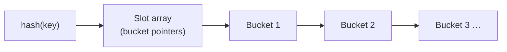

# 06 — Dynamic hashing: chained hashing

## Why dynamic schemes exist

- Static tables require knowing the key count in advance; dynamic tables **resize incrementally without rehashing everything into a second table** [`51:40`](https://www.youtube.com/watch?v=VkP_yLM5KBU&t=3100) [`52:11`](https://www.youtube.com/watch?v=VkP_yLM5KBU&t=3131).
- Three dynamic schemes: **chained hashing** (the familiar one, believed to be Java's `HashMap` in the JDK), plus the more advanced **extendible hashing** and **linear hashing** [`52:11`](https://www.youtube.com/watch?v=VkP_yLM5KBU&t=3131).

## How chained hashing works

- Each slot points to the head of a **linked list of buckets** holding key/value pairs [`52:29`](https://www.youtube.com/watch?v=VkP_yLM5KBU&t=3149).
- **Lookup**: hash into the slot array, follow the pointer, scan the chain sequentially [`52:29`](https://www.youtube.com/watch?v=VkP_yLM5KBU&t=3149).
- **Insert**: if the current bucket is full, allocate a new bucket and append it to the chain — so the chain grows indefinitely [`52:56`](https://www.youtube.com/watch?v=VkP_yLM5KBU&t=3176) [`53:22`](https://www.youtube.com/watch?v=VkP_yLM5KBU&t=3202).

## Cost profile vs. cuckoo hashing

- Chaining **penalizes inserts and lookups equally**, because both follow pointers — unlike cuckoo hashing, which shifts cost onto inserts to make lookups fast. "Everyone has to pay the same cost" [`53:59`](https://www.youtube.com/watch?v=VkP_yLM5KBU&t=3239).

## Optimization: a filter in front of each chain

- Put a **filter data structure** in front of each bucket pointer that answers "does this key exist in this chain?" — yes/no, not where [`53:59`](https://www.youtube.com/watch?v=VkP_yLM5KBU&t=3239) [`54:34`](https://www.youtube.com/watch?v=VkP_yLM5KBU&t=3274).
- A negative answer means the pointer is never followed at all [`54:34`](https://www.youtube.com/watch?v=VkP_yLM5KBU&t=3274).
- The filter is essentially a **Bloom filter** — a probabilistic existence test — covered in a later lecture, and reused when discussing hash joins [`55:02`](https://www.youtube.com/watch?v=VkP_yLM5KBU&t=3302).

## The weakness that motivates the next schemes

- Chains have **no growth limit**. Under high skew, everything hashes into one chain and lookups degrade to a linear scan — the O(n) worst case [`55:19`](https://www.youtube.com/watch?v=VkP_yLM5KBU&t=3319).
- **Extendible hashing** and **linear hashing** fix this by splitting buckets incrementally and rebalancing without a global rehash [`55:19`](https://www.youtube.com/watch?v=VkP_yLM5KBU&t=3319) [`55:57`](https://www.youtube.com/watch?v=VkP_yLM5KBU&t=3357).
