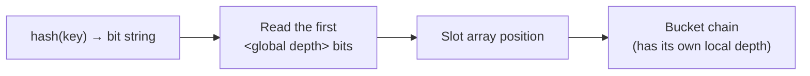

# 07 — Dynamic hashing: extendible hashing

## Goal

Split an overflowing bucket **locally**, rebalancing only that part of the table, instead of rehashing everything [`55:19`](https://www.youtube.com/watch?v=VkP_yLM5KBU&t=3319) [`59:01`](https://www.youtube.com/watch?v=VkP_yLM5KBU&t=3541).

## Adoption

- Dates back to roughly the **1980s** and is **not common** today [`55:57`](https://www.youtube.com/watch?v=VkP_yLM5KBU&t=3357).
- Only two known implementations: **GNU DBM** (an embedded key/value store, comparable to RocksDB) and **AsterixDB** (a big-data / HDFS-era system from UC Irvine, now used by Couchbase per its documentation) [`55:57`](https://www.youtube.com/watch?v=VkP_yLM5KBU&t=3357).

## The metadata: global and local depth counters

- A **global bit counter** records the maximum number of hash bits that may need examining to locate a slot [`56:32`](https://www.youtube.com/watch?v=VkP_yLM5KBU&t=3392).
- Each bucket chain carries a **local counter** — how many bits were needed to reach it [`56:59`](https://www.youtube.com/watch?v=VkP_yLM5KBU&t=3419).
- Consequence: **multiple slot-array entries may point at the same bucket**, and that is fine — a bucket with local depth 1 is reached by every slot sharing that first bit [`57:44`](https://www.youtube.com/watch?v=VkP_yLM5KBU&t=3464) [`59:50`](https://www.youtube.com/watch?v=VkP_yLM5KBU&t=3590).

## Operations

- **Lookup**: hash the key, read the number of leading bits given by the global counter, use them as the slot-array position, follow the pointer to the bucket chain [`58:05`](https://www.youtube.com/watch?v=VkP_yLM5KBU&t=3485).
- **Insert**: same addressing, then place the entry in the bucket [`58:30`](https://www.youtube.com/watch?v=VkP_yLM5KBU&t=3510) [`58:48`](https://www.youtube.com/watch?v=VkP_yLM5KBU&t=3528).
- **Insert into a full bucket** [`59:01`](https://www.youtube.com/watch?v=VkP_yLM5KBU&t=3541) [`59:16`](https://www.youtube.com/watch?v=VkP_yLM5KBU&t=3556):
  1. Increment the global counter (e.g. 2 → 3) and expand the slot array. This is cheap — it is just an array of 32/64-bit pointers, so resizing and copying is not a big deal.
  2. Allocate the new bucket and **split the overflowing bucket's keys into two**, rehashing only the entries in that bucket.
  3. Repoint the affected slot-array entries; all other chains are untouched.
- Splitting a bucket whose local depth is 1 raises its local counter to 2, sending `00` to one bucket and `01` to the other [`1:01:34`](https://www.youtube.com/watch?v=VkP_yLM5KBU&t=3694) [`1:01:54`](https://www.youtube.com/watch?v=VkP_yLM5KBU&t=3714).

## Key property

- A split rehashes only the contents of one bucket, and buckets are bounded rather than arbitrarily long, so it is **not a major operation** — the rebalancing cost is **amortized across many queries** [`1:01:54`](https://www.youtube.com/watch?v=VkP_yLM5KBU&t=3714).
- Contrast with chained hashing: instead of appending another bucket to the chain, the bucket is **split** and only the slot array is updated [`1:00:24`](https://www.youtube.com/watch?v=VkP_yLM5KBU&t=3624).

> Note: a slide error was caught in class — `00` and `01` should both point to the top (local-depth-1) bucket, and `11` to the bottom one, with `10`/`10x` distinguishing the two split chains [`1:00:53`](https://www.youtube.com/watch?v=VkP_yLM5KBU&t=3653).
