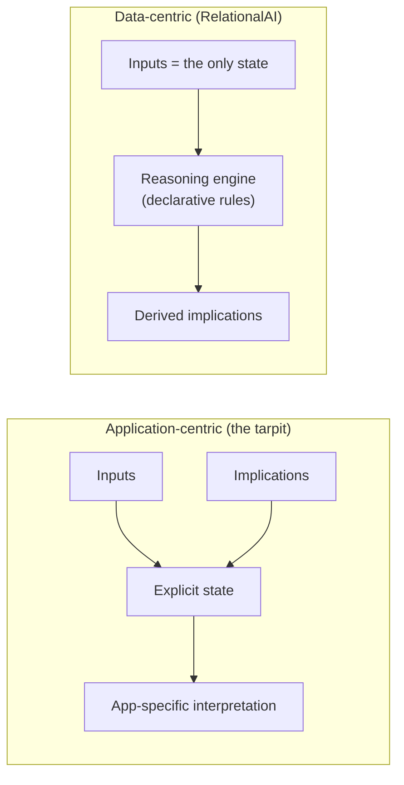

# 10 — Guest talk: RelationalAI

**Speaker:** Nico, lead of the backend team at RelationalAI — query optimization, materialized views, incremental view maintenance [`1:10:23`](https://www.youtube.com/watch?v=VkP_yLM5KBU&t=4223).

## The thesis: intelligent applications

- The next generation of enterprise apps will be **intelligent**: they apply **models of the real world to data** to improve decision-making and **take action automatically** [`1:10:23`](https://www.youtube.com/watch?v=VkP_yLM5KBU&t=4223) [`1:10:55`](https://www.youtube.com/watch?v=VkP_yLM5KBU&t=4255).
- This distinguishes them from BI and reporting, which are backward-looking [`1:10:55`](https://www.youtube.com/watch?v=VkP_yLM5KBU&t=4255).
- Example decisions: which users are committing fraud; should I open a new warehouse and where; what is the optimal maintenance schedule [`1:11:38`](https://www.youtube.com/watch?v=VkP_yLM5KBU&t=4298).

## The obstacle: software complexity

Not asymptotic Big-O complexity, but **what makes a system hard to understand** [`1:11:56`](https://www.youtube.com/watch?v=VkP_yLM5KBU&t=4316). It grows with three things [`1:12:25`](https://www.youtube.com/watch?v=VkP_yLM5KBU&t=4345):

1. **State** — more state means more scenarios to reason about.
2. **Explicit control logic** — more paths through the state space.
3. **Code volume** — compounds both; a million lines is worse than 100,000.

Framing is credited to the paper **"Out of the Tar Pit"** [`1:12:56`](https://www.youtube.com/watch?v=VkP_yLM5KBU&t=4376).

### The tarpit: application-centric architectures

- The trap is architectures where **both the inputs and their implications are part of system state, managed explicitly** [`1:12:56`](https://www.youtube.com/watch?v=VkP_yLM5KBU&t=4376).
- Canonical example: a chat app storing messages **and** a separate unread-message counter. Every new message forces updating two pieces of state, "causes all kinds of fun things in web applications," and doesn't scale to real applications [`1:13:28`](https://www.youtube.com/watch?v=VkP_yLM5KBU&t=4408) [`1:13:51`](https://www.youtube.com/watch?v=VkP_yLM5KBU&t=4431).
- Business logic ends up buried under layers of boilerplate and JavaScript APIs; each app derives its own **slightly divergent interpretation of the same business data** [`1:13:51`](https://www.youtube.com/watch?v=VkP_yLM5KBU&t=4431).

### The way out: data-centric architectures

- Only the **actual inputs** form state; all implications are **automatically derived by the system through reasoning** — the principled application of rules and models to derive new information [`1:14:30`](https://www.youtube.com/watch?v=VkP_yLM5KBU&t=4470).
- Business logic should be **declarative**, describing *what is true about the business*, not how to compute it [`1:14:30`](https://www.youtube.com/watch?v=VkP_yLM5KBU&t=4470).
- Key property: **data and its semantics stay close together**. Colleagues have built such systems at Amazon and Intuit [`1:15:01`](https://www.youtube.com/watch?v=VkP_yLM5KBU&t=4501).

## Deployment: data has gravity

- In a data-centric world **data doesn't like to move** — it accumulates workloads, governance and budgeting processes. A problem if you are starting a database company [`1:15:25`](https://www.youtube.com/watch?v=VkP_yLM5KBU&t=4525).
- Answer: **build where the customer's data already is — Snowflake**. RelationalAI runs inside **Snowflake Container Services**, inheriting security, governance, billing and infrastructure that a startup cannot replicate [`1:15:25`](https://www.youtube.com/watch?v=VkP_yLM5KBU&t=4525) [`1:15:57`](https://www.youtube.com/watch?v=VkP_yLM5KBU&t=4557).

## Where database theory pays off: query classes

- Users throw arbitrary, complex real-world business logic at the system, not simple SQL. **Query classes** — derived from the query's variables and the relations tying them together — provide a framework for handling it [`1:16:32`](https://www.youtube.com/watch?v=VkP_yLM5KBU&t=4592) [`1:16:46`](https://www.youtube.com/watch?v=VkP_yLM5KBU&t=4606).
- Each class is backed by theoretical results, so knowing the class immediately answers: **can it be parallelized? will it scale? can it be incrementally maintained without blowing up?** [`1:16:46`](https://www.youtube.com/watch?v=VkP_yLM5KBU&t=4606).

### Use 1 — evaluation strategy at terabyte scale

- Decompose a query into subqueries from simpler classes until reaching one known to scale [`1:17:13`](https://www.youtube.com/watch?v=VkP_yLM5KBU&t=4633).
- Everything is boiled down to **prefix joins**, connected by a **distributed sorting algorithm** [`1:17:37`](https://www.youtube.com/watch?v=VkP_yLM5KBU&t=4657).
- Both primitives are **highly scalable and latency tolerant** — critical for a cloud-native database working against blob storage [`1:17:37`](https://www.youtube.com/watch?v=VkP_yLM5KBU&t=4657).

### Use 2 — keeping optimization tractable

- The optimization problem goes far beyond join ordering and cardinalities: asymptotics vs. optimization time, best plan for one query vs. a reusable plan, from-scratch evaluation vs. incremental maintenance [`1:18:08`](https://www.youtube.com/watch?v=VkP_yLM5KBU&t=4688) [`1:18:33`](https://www.youtube.com/watch?v=VkP_yLM5KBU&t=4713).
- Given the query's class, the system **deterministically picks a canonically good plan** — not necessarily optimal, but known-good under a well-considered cost model — and offers it to the optimizer, which may overrule it [`1:19:11`](https://www.youtube.com/watch?v=VkP_yLM5KBU&t=4751).
- Benefits: less optimizer effort, **more robust decisions**, and **explainability** — why a query performs as it does, or why the optimizer chose a plan [`1:19:11`](https://www.youtube.com/watch?v=VkP_yLM5KBU&t=4751) [`1:19:36`](https://www.youtube.com/watch?v=VkP_yLM5KBU&t=4776).

## The three stated takeaways

1. **Software complexity is holding back intelligent applications.** Fight it with data-centric architectures: semantics next to the data, the system derives implications, declarative languages cut code volume, the system picks the algorithm [`1:20:03`](https://www.youtube.com/watch?v=VkP_yLM5KBU&t=4803).
2. **Data has gravity** — "we found that out the hard way." It won't come to you; go to where it already is [`1:20:03`](https://www.youtube.com/watch?v=VkP_yLM5KBU&t=4803).
3. **Systems and theory need each other.** Systems engineers chase unconnected benchmarks; theorists drift into abstraction. Guiding principle: *an architecture efficient under some possibly unrealistic cost model usually beats an architecture efficient under no cost model* [`1:20:47`](https://www.youtube.com/watch?v=VkP_yLM5KBU&t=4847) [`1:21:18`](https://www.youtube.com/watch?v=VkP_yLM5KBU&t=4878).

## Q&A: the actual stack

- **Not SQL-based.** RelationalAI has its own declarative language, **Rel**, with front ends on top — including **PyRel**, the Python interface. SQL is treated as just another interface language, not a compilation target [`1:21:44`](https://www.youtube.com/watch?v=VkP_yLM5KBU&t=4904).
- **Written in Julia.** No longer an exclusively compiled evaluator — it also interprets [`1:22:16`](https://www.youtube.com/watch?v=VkP_yLM5KBU&t=4936).
- **Datalog** is not exposed to users, but once Rel's higher-order features are compiled away, the internal target language **is essentially Datalog with aggregations and recursion** [`1:22:16`](https://www.youtube.com/watch?v=VkP_yLM5KBU&t=4936).
- Pointer for more depth: a longer talk given at CMU about two years earlier by former colleague Martin, available on YouTube [`1:21:18`](https://www.youtube.com/watch?v=VkP_yLM5KBU&t=4878).
