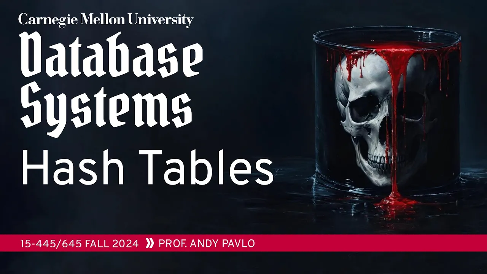
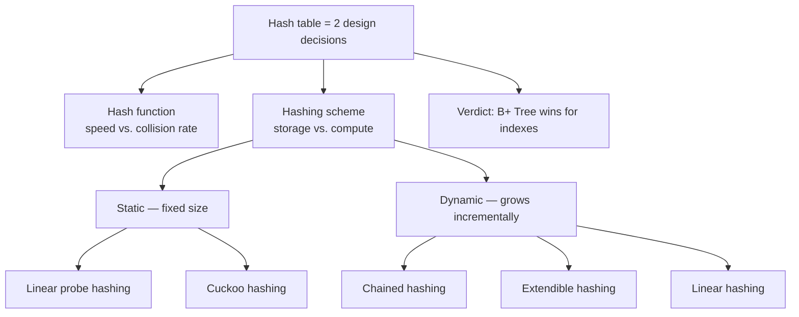

# #07 - Hash Tables ✸ RelationalAI Database Talk (CMU Intro to Database Systems)

*CMU Database Group · 1:23:43 · [Watch on YouTube](https://www.youtube.com/watch?v=VkP_yLM5KBU)*

## Summary

Lecture 7 of CMU 15-445/645 (Fall 2024) opens the **access methods** stretch of the course: with disk management and the buffer pool already built, Andy Pavlo turns to the data structures the execution engine will use, starting with the unordered one — the hash table. The lecture decomposes a hash table into two independent design decisions, the **hash function** (pick XXHash, don't write your own) and the **hashing scheme** (how collisions are resolved), then walks through five schemes in increasing sophistication: linear probe and cuckoo hashing for static tables, and chained, extendible and linear hashing for dynamic ones — each with its worked example, failure mode, and real-system sightings (ClickHouse, PostgreSQL, IBM DB2 BLU, Berkeley DB). It closes by explaining why, despite O(1) lookups, `CREATE INDEX` almost never gives you a hash table, and hands the last ten minutes to Nico from **RelationalAI**, who argues for data-centric architectures where the system derives implications from inputs by reasoning, and shows how **query classes** from database theory keep their optimizer tractable.

## Topics

1. [Course logistics and roadmap](./01-course-logistics-and-roadmap.md) — administrivia, and where access methods sit in the bottom-up build of the system.
2. [Hash table fundamentals and design goals](./02-hash-table-fundamentals.md) — where DBMSs use data structures, complexity, and why the naive giant array fails.
3. [Hash functions](./03-hash-functions.md) — speed over cryptography, XXHash, and the SMHasher benchmark.
4. [Linear probe hashing](./04-linear-probe-hashing.md) — probing, load factors, tombstones, non-unique keys, and ClickHouse optimizations.
5. [Cuckoo hashing](./05-cuckoo-hashing.md) — multiple hash functions, eviction, and trading insert cost for O(1) lookups.
6. [Chained hashing](./06-chained-hashing.md) — bucket chains, Bloom filters in front, and the skew problem.
7. [Extendible hashing](./07-extendible-hashing.md) — global/local depth bits and localized bucket splits.
8. [Linear hashing](./08-linear-hashing.md) — the split pointer, two hash functions, and PostgreSQL's `dynahash`.
9. [Wrap-up: hash indexes in practice](./09-hash-indexes-in-practice.md) — no range queries, no partial keys, plus a comparison table of all five schemes.
10. [Guest talk: RelationalAI](./10-relationalai-guest-talk.md) — the tarpit of software complexity, data-centric architecture, and query classes.

## Key takeaways

- A hash table is not one design but **two orthogonal ones**: a hash function trading speed against collision rate, and a hashing scheme trading storage against compute [`19:01`](https://www.youtube.com/watch?v=VkP_yLM5KBU&t=1141) [`20:17`](https://www.youtube.com/watch?v=VkP_yLM5KBU&t=1217).
- **Do not write your own hash function.** Use **XXHash** (state of the art, from the Zstandard author); PostgreSQL rolling its own is a historical accident, not a model. SMHasher ranks the alternatives — RabbitHash fastest, XXH3 second [`22:35`](https://www.youtube.com/watch?v=VkP_yLM5KBU&t=1355) [`23:36`](https://www.youtube.com/watch?v=VkP_yLM5KBU&t=1416) [`24:19`](https://www.youtube.com/watch?v=VkP_yLM5KBU&t=1459).
- Cryptographic hashes (SHA-1/SHA-256) are **explicitly the wrong choice** internally: too slow, and there is nothing to protect since the DBMS already owns the user's data [`21:51`](https://www.youtube.com/watch?v=VkP_yLM5KBU&t=1311) [`22:18`](https://www.youtube.com/watch?v=VkP_yLM5KBU&t=1338).
- Deleting from a linear probe table **must use tombstones, not entry movement** — rehashing-and-sliding is so expensive that no known system implements it [`37:35`](https://www.youtube.com/watch?v=VkP_yLM5KBU&t=2255) [`38:11`](https://www.youtube.com/watch?v=VkP_yLM5KBU&t=2291).
- **Simplicity beats cleverness** in probing: Robin Hood hashing keeps keys nearer their ideal slot yet is often *slower* than plain linear probing [`33:28`](https://www.youtube.com/watch?v=VkP_yLM5KBU&t=2008).
- **ClickHouse ships ~20 specialized hash table implementations** versus roughly two in PostgreSQL, including a version-counter trick that logically clears a table without rewriting memory [`44:54`](https://www.youtube.com/watch?v=VkP_yLM5KBU&t=2694) [`45:39`](https://www.youtube.com/watch?v=VkP_yLM5KBU&t=2739).
- Cuckoo hashing buys **guaranteed O(1) lookups and deletes** at the price of eviction-cascading inserts; it is rare in practice (IBM DB2 BLU), and the best open-source implementation came out of CMU and is used inside Google [`46:20`](https://www.youtube.com/watch?v=VkP_yLM5KBU&t=2780) [`47:02`](https://www.youtube.com/watch?v=VkP_yLM5KBU&t=2822).
- Extendible and linear hashing both **amortize resizing across queries** by splitting one bucket at a time; linear hashing counterintuitively splits whatever its split pointer targets, not the bucket that overflowed, and still balances out over time — this is what **PostgreSQL's `dynahash`** does, inherited from the same author's Berkeley DB [`1:01:54`](https://www.youtube.com/watch?v=VkP_yLM5KBU&t=3714) [`1:03:23`](https://www.youtube.com/watch?v=VkP_yLM5KBU&t=3803) [`1:02:28`](https://www.youtube.com/watch?v=VkP_yLM5KBU&t=3748).
- **Hash tables are the wrong choice for table indexes**: no range queries and no partial-key lookups, so `CREATE INDEX` yields a B+ Tree ~99% of the time (PostgreSQL's `USING HASH` being the opt-out) [`1:08:49`](https://www.youtube.com/watch?v=VkP_yLM5KBU&t=4129) [`1:09:31`](https://www.youtube.com/watch?v=VkP_yLM5KBU&t=4171).
- RelationalAI's position: software complexity grows with **state, control logic and code volume**, so their system keeps only inputs as state and derives everything else by reasoning over declarative Rel code — compiled down to what is essentially Datalog, written in Julia, deployed inside Snowflake Container Services because **data has gravity** [`1:12:25`](https://www.youtube.com/watch?v=VkP_yLM5KBU&t=4345) [`1:14:30`](https://www.youtube.com/watch?v=VkP_yLM5KBU&t=4470) [`1:15:25`](https://www.youtube.com/watch?v=VkP_yLM5KBU&t=4525) [`1:22:16`](https://www.youtube.com/watch?v=VkP_yLM5KBU&t=4936).
- Their concrete theory-to-practice win: classify every query, decompose it into **prefix joins connected by distributed sorting** (both scalable and latency-tolerant for blob storage), and hand the optimizer a deterministic canonically-good plan — improving robustness and explainability rather than plan quality [`1:17:37`](https://www.youtube.com/watch?v=VkP_yLM5KBU&t=4657) [`1:19:11`](https://www.youtube.com/watch?v=VkP_yLM5KBU&t=4751).

---

The full [transcript](./transcript.md) is included in this folder.
