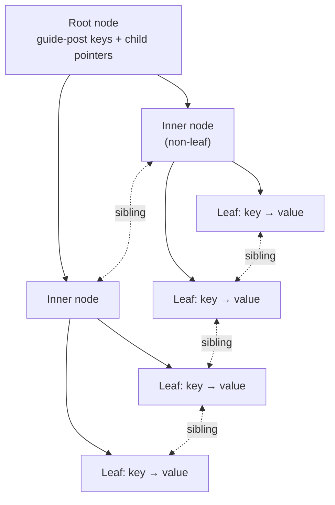

# 03 — B+Tree fundamentals

## Definition

- A **self-balancing, ordered, M-way tree** supporting search, sequential access, insertion and deletion in **O(log n)** [`11:41`](https://www.youtube.com/watch?v=scUtG_6M_lU&t=701).
- **M = fan-out** = number of branches/pointers coming out of a node. M = 2 would be binary [`12:09`](https://www.youtube.com/watch?v=scUtG_6M_lU&t=729).
- Real systems use fan-outs in the **hundreds** of keys per node — an 8 KB Postgres page holds a lot of 64-bit integer pairs [`12:29`](https://www.youtube.com/watch?v=scUtG_6M_lU&t=749).
- Consequence: typical B+Tree height is **3, maybe 4; 5 is extreme** [`12:48`](https://www.youtube.com/watch?v=scUtG_6M_lU&t=768).
- Key/pointer relationship: a node with 4 pointers (degree M) holds **3 keys**, i.e. **M−1 keys** [`40:26`](https://www.youtube.com/watch?v=scUtG_6M_lU&t=2426) [`40:46`](https://www.youtube.com/watch?v=scUtG_6M_lU&t=2446).

## Textbook properties

1. **Perfectly balanced** — every leaf node is the same distance from the root, so every traversal costs the same [`12:48`](https://www.youtube.com/watch?v=scUtG_6M_lU&t=768).
2. **Every node except the root is at least half full** — key count between ⌈M/2⌉−1 and M−1 [`13:29`](https://www.youtube.com/watch?v=scUtG_6M_lU&t=809).
3. Optimized for reading and writing **large blocks**, because sequential access is cheaper than random access [`13:29`](https://www.youtube.com/watch?v=scUtG_6M_lU&t=809) [`13:59`](https://www.youtube.com/watch?v=scUtG_6M_lU&t=839).

Why "at least half full"? So that a lookup for *any* key is asymptotically the same cost regardless of the key [`35:58`](https://www.youtube.com/watch?v=scUtG_6M_lU&t=2158) [`36:21`](https://www.youtube.com/watch?v=scUtG_6M_lU&t=2181).

> Real implementations break these rules deliberately. The Postgres source path is `src/backend/access/nbtree` — **"n" for non-balanced** — because they violate some requirements to gain performance [`13:59`](https://www.youtube.com/watch?v=scUtG_6M_lU&t=839).

Because the tree is sorted and the split protocol is fixed, the resulting structure ends up essentially the same **no matter what insertion order** you use — unlike a trie [`36:21`](https://www.youtube.com/watch?v=scUtG_6M_lU&t=2181).

## Node types and contents

- **Root / inner nodes**: alternating `node-pointer, key, node-pointer, key, ...`. The keys are **separator bars / guide posts**, not real data. Their "values" are the child pointers [`15:18`](https://www.youtube.com/watch?v=scUtG_6M_lU&t=918) [`18:39`](https://www.youtube.com/watch?v=scUtG_6M_lU&t=1119).
- **Leaf nodes**: real `key → value` pairs; the value may be a record ID or anything else the system tracks [`15:37`](https://www.youtube.com/watch?v=scUtG_6M_lU&t=937).
- Traversal rule at a guide post key K: keys **< K** go left, keys **≥ K** go right [`15:51`](https://www.youtube.com/watch?v=scUtG_6M_lU&t=951) [`16:15`](https://www.youtube.com/watch?v=scUtG_6M_lU&t=975).
- Unused slots are null; occupancy is tracked in node metadata (an entry count or a null bitmap) [`19:04`](https://www.youtube.com/watch?v=scUtG_6M_lU&t=1144) [`19:17`](https://www.youtube.com/watch?v=scUtG_6M_lU&t=1157).
- Arrays are usually (not necessarily) sorted by key; NULL keys are placed either at the beginning or the end since they cannot be compared [`19:45`](https://www.youtube.com/watch?v=scUtG_6M_lU&t=1185) [`20:14`](https://www.youtube.com/watch?v=scUtG_6M_lU&t=1214).

## The key mental model

> **The leaf level is a linked list. The B+Tree is just scaffolding on top of it** that lets you jump into the right place without a sequential scan [`18:21`](https://www.youtube.com/watch?v=scUtG_6M_lU&t=1101).

Skip lists (next lecture) are the same idea: a linked list with structure built on top [`19:17`](https://www.youtube.com/watch?v=scUtG_6M_lU&t=1157).

## Sibling pointers

- The original B+Tree had sibling pointers only at the **leaf** level; the **B-link tree added them for inner nodes too** [`16:30`](https://www.youtube.com/watch?v=scUtG_6M_lU&t=990).
- Leaf siblings enable range scans; inner-node siblings help with concurrent splits/merges by letting you jump laterally instead of returning to the root [`16:50`](https://www.youtube.com/watch?v=scUtG_6M_lU&t=1010).
- Siblings link **node to node**, not key to key, and follow lexicographic order — a node points only to its immediate neighbour [`17:13`](https://www.youtube.com/watch?v=scUtG_6M_lU&t=1033) [`17:59`](https://www.youtube.com/watch?v=scUtG_6M_lU&t=1079).
- A sibling pointer is only a **page ID** (32 or 64 bits), not a full record ID with slot number [`17:29`](https://www.youtube.com/watch?v=scUtG_6M_lU&t=1049).

## No parent pointers — and why

- Children do **not** store pointers back to their parents [`20:32`](https://www.youtube.com/watch?v=scUtG_6M_lU&t=1232).
- Everyone traverses in **one direction, top to bottom**, so **deadlock is impossible** — nobody comes up from the bottom [`20:32`](https://www.youtube.com/watch?v=scUtG_6M_lU&t=1232).
- Sibling pointers reintroduce lateral movement and therefore complications. Some systems make the leaf list **singly linked** to preserve one-directional traversal; **Postgres uses a doubly linked list** [`21:09`](https://www.youtube.com/watch?v=scUtG_6M_lU&t=1269).
- Trade-off: more pointers mean fewer re-descents from the root, but more maintenance cost and contention. "There's no free lunch" [`21:09`](https://www.youtube.com/watch?v=scUtG_6M_lU&t=1269) [`21:38`](https://www.youtube.com/watch?v=scUtG_6M_lU&t=1298).
