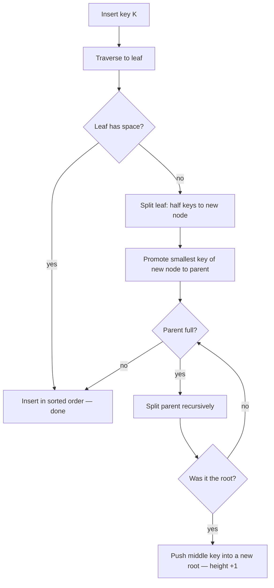

# 06 — Insert and node splits

## Algorithm

1. Traverse as if doing a lookup to find the target **leaf node** [`29:28`](https://www.youtube.com/watch?v=scUtG_6M_lU&t=1768) [`29:48`](https://www.youtube.com/watch?v=scUtG_6M_lU&t=1788).
2. If the leaf has space → insert in sorted order. Done [`29:48`](https://www.youtube.com/watch?v=scUtG_6M_lU&t=1788).
3. If it is full → **split**: create a new node, move half the keys there, keep half [`29:48`](https://www.youtube.com/watch?v=scUtG_6M_lU&t=1788) [`30:43`](https://www.youtube.com/watch?v=scUtG_6M_lU&t=1843).
4. **Promote** the smallest key of the new right node into the parent as a new guide post [`31:07`](https://www.youtube.com/watch?v=scUtG_6M_lU&t=1867).
5. If the parent is now full → split it too, **recursively up the tree** [`30:17`](https://www.youtube.com/watch?v=scUtG_6M_lU&t=1817) [`32:35`](https://www.youtube.com/watch?v=scUtG_6M_lU&t=1955).
6. If the **root** splits → pick its middle key, push it into a **brand-new root one level above**. This is the only way the tree grows in height [`33:10`](https://www.youtube.com/watch?v=scUtG_6M_lU&t=1990) [`34:01`](https://www.youtube.com/watch?v=scUtG_6M_lU&t=2041).

## Worked examples from the lecture

- **Insert 6** into a full leaf holding 5, 9, 10 → split, keep 5 (and now 6) on the left, move 9 and 10 right, then promote **9** to the inner node as the new separator [`30:43`](https://www.youtube.com/watch?v=scUtG_6M_lU&t=1843) [`31:07`](https://www.youtube.com/watch?v=scUtG_6M_lU&t=1867).
- **Insert 8** → 8 < 9, lands in the left leaf, plenty of room, done. No structural change [`31:39`](https://www.youtube.com/watch?v=scUtG_6M_lU&t=1899).
- **Insert 17** into a larger tree → fits, no issue. **Insert 16** → leaf full → split → parent full → split parent → root full → promote **13** into a new root, creating a new level [`31:58`](https://www.youtube.com/watch?v=scUtG_6M_lU&t=1918) [`32:21`](https://www.youtube.com/watch?v=scUtG_6M_lU&t=1941) [`33:10`](https://www.youtube.com/watch?v=scUtG_6M_lU&t=1990) [`33:30`](https://www.youtube.com/watch?v=scUtG_6M_lU&t=2010).

## Details worth remembering

- **Where do you split?** In the middle. "There's no magic to it" [`34:42`](https://www.youtube.com/watch?v=scUtG_6M_lU&t=2082).
- Because leaves have **no parent pointers**, a split never has to touch the untouched side of the tree — those children don't know or care who their parent is [`34:18`](https://www.youtube.com/watch?v=scUtG_6M_lU&t=2058).
