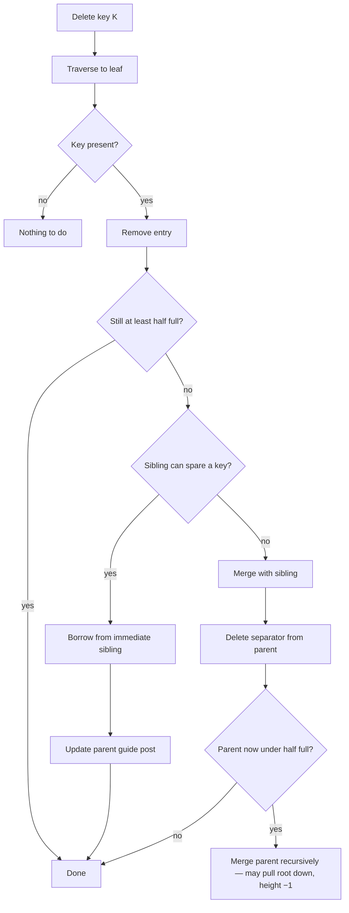

# 07 — Delete: borrowing and merging

## Algorithm — the reverse of insert

1. Traverse to the leaf holding the key. Not there → nothing to do [`34:42`](https://www.youtube.com/watch?v=scUtG_6M_lU&t=2082).
2. Remove the entry. If the node is still **at least half full** → done.
3. If it fell below half full → **borrow (steal) a key from an immediate sibling** using the sibling pointers [`35:17`](https://www.youtube.com/watch?v=scUtG_6M_lU&t=2117).
4. If borrowing would push the sibling below half full → **merge** the two nodes instead [`35:17`](https://www.youtube.com/watch?v=scUtG_6M_lU&t=2117) [`35:44`](https://www.youtube.com/watch?v=scUtG_6M_lU&t=2144).
5. Recurse merges **up the tree** until everything is balanced [`35:58`](https://www.youtube.com/watch?v=scUtG_6M_lU&t=2158).
6. Either way, **update the guide post** in the parent to reflect the new key range [`37:11`](https://www.youtube.com/watch?v=scUtG_6M_lU&t=2231).

A delete can reduce the tree height by **at most one** [`39:37`](https://www.youtube.com/watch?v=scUtG_6M_lU&t=2377).

## Worked examples

- **Delete 6** → leaf underflows; the right neighbour has 3 keys, so **steal 9**; then update the parent guide post by pulling up the new lowest key, 12 [`36:48`](https://www.youtube.com/watch?v=scUtG_6M_lU&t=2208) [`37:11`](https://www.youtube.com/watch?v=scUtG_6M_lU&t=2231).
- **Delete 15** → borrow 17 from the sibling, update the separator to 19 [`37:51`](https://www.youtube.com/watch?v=scUtG_6M_lU&t=2271) [`38:14`](https://www.youtube.com/watch?v=scUtG_6M_lU&t=2294).
- **Delete 19** → no sibling can spare a key → **merge**, drop the separator, and then the parent itself underflows → pull down the root key 13, split it across, and collapse into a new root [`38:14`](https://www.youtube.com/watch?v=scUtG_6M_lU&t=2294) [`38:37`](https://www.youtube.com/watch?v=scUtG_6M_lU&t=2317) [`39:14`](https://www.youtube.com/watch?v=scUtG_6M_lU&t=2354).

## Rules and rationale from the Q&A

- **Only immediate siblings are borrowed from.** You *could* rebalance from a distant node, but nobody does: it is expensive, and you hold latches the whole time, blocking everyone behind you [`39:37`](https://www.youtube.com/watch?v=scUtG_6M_lU&t=2377) [`39:59`](https://www.youtube.com/watch?v=scUtG_6M_lU&t=2399).
- **Don't borrow across parents.** Sibling pointers do span parents, but the rule is: if you don't share a parent, you don't steal — it would require extra latches and more complexity [`42:45`](https://www.youtube.com/watch?v=scUtG_6M_lU&t=2565) [`44:19`](https://www.youtube.com/watch?v=scUtG_6M_lU&t=2659).
  - How do you know you share a parent? The straightforward way is to **maintain a stack while descending**, so you know whether you were the leftmost/rightmost child [`45:18`](https://www.youtube.com/watch?v=scUtG_6M_lU&t=2718).
- **Stale keys in inner nodes are fine.** After deleting 19, the separator 19 stays: everything < 19 is still left, everything ≥ 19 is still right. It's correct, so leave it. This is only possible in a B+Tree, not a B-Tree [`41:38`](https://www.youtube.com/watch?v=scUtG_6M_lU&t=2498) [`42:06`](https://www.youtube.com/watch?v=scUtG_6M_lU&t=2526).
- **Why pull the root down instead of merging into a one-node level?** A chain of single-node levels is still technically correct, but it costs an extra hop per lookup — more than log n. "Constants matter" [`43:21`](https://www.youtube.com/watch?v=scUtG_6M_lU&t=2601) [`43:50`](https://www.youtube.com/watch?v=scUtG_6M_lU&t=2630).
- **Subtrees can never have different heights** — the tree must stay balanced [`46:24`](https://www.youtube.com/watch?v=scUtG_6M_lU&t=2784).
- Different systems choose differently *which* direction to steal or merge from; the high-level protocol is the same [`38:37`](https://www.youtube.com/watch?v=scUtG_6M_lU&t=2317).
- Concurrency preview: on the way down you **hold latches on nodes that might need merging**, because you can't know until you reach the leaf whether the delete will be absorbed locally [`47:24`](https://www.youtube.com/watch?v=scUtG_6M_lU&t=2844) [`47:56`](https://www.youtube.com/watch?v=scUtG_6M_lU&t=2876).
