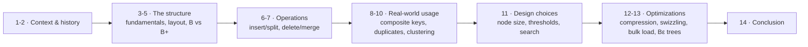

# #08 - Tree Indexes: B+Trees (CMU Intro to Database Systems)

*CMU Database Group · 1:22:14 · [Watch on YouTube](https://www.youtube.com/watch?v=scUtG_6M_lU)*

## Summary

Lecture 8 of CMU 15-445/645 (Fall 2024) is a full treatment of the **B+Tree**, the data structure behind virtually every `CREATE INDEX` in a real database system. It starts by separating **indexes** (find where a key is) from **filters** (guess whether a key exists), walks through the history of the B-Tree family — Bayer & McCreight 1970, the 1979 "Ubiquitous B-Tree" survey, and the 1981 Lehman & Yao B-link tree whose sibling pointers everyone actually ships — and then builds the structure up from first principles: node anatomy, guide-post keys, leaf linked lists, insert-with-splits, and delete-with-borrow-or-merge, each illustrated with worked examples and a long Q&A.

The second half is about what real systems do differently from the textbook: composite indexes and partial-key lookups, two strategies for duplicate keys, clustered indexes and bitmap heap scans, and then the tuning knobs — node size, merge threshold, variable-length key storage, and intra-node search (linear, SIMD, binary, interpolation). It closes with the optimization catalogue (prefix compression, deduplication, suffix truncation, pointer swizzling, bulk loading) and the write-optimized **Bε / fractal tree** variant that buffers updates in per-node mod logs.

The through-line is that the B+Tree has been the correct answer for 50 years and remains so; the interesting engineering is in deliberately *breaking* its textbook properties for performance — which is exactly why Postgres calls its implementation "nbtree", for *non-balanced*.

## Topics

1. [Lecture context: indexes vs. filters](./01-lecture-context-indexes-and-filters.md)
2. [History and the B-Tree family](./02-history-b-tree-family.md)
3. [B+Tree fundamentals](./03-b-plus-tree-fundamentals.md)
4. [Physical node layout and what leaf values hold](./04-node-layout-and-leaf-values.md)
5. [B-Tree vs. B+Tree](./05-b-tree-vs-b-plus-tree.md)
6. [Insert and node splits](./06-insert-and-node-splits.md)
7. [Delete: borrowing and merging](./07-delete-borrow-and-merge.md)
8. [Composite indexes and partial-key lookups](./08-composite-indexes-and-partial-keys.md)
9. [Handling duplicate keys](./09-duplicate-keys.md)
10. [Clustered indexes and index-scan optimization](./10-clustered-indexes-and-scan-optimization.md)
11. [Design choices when building a B+Tree](./11-design-choices.md)
12. [B+Tree optimizations](./12-optimizations.md)
13. [Write-optimized B+Trees (Bε / fractal trees)](./13-write-optimized-b-plus-trees.md)
14. [Conclusion and what comes next](./14-conclusion.md)

Full transcript: [transcript.md](./transcript.md)

## Key takeaways

- **The leaf level is just a linked list; the B+Tree is scaffolding that lets you jump into it without a sequential scan.** That reframing is the central insight of the lecture, and it also explains skip lists [`18:21`](https://www.youtube.com/watch?v=scUtG_6M_lU&t=1101) [`19:17`](https://www.youtube.com/watch?v=scUtG_6M_lU&t=1157).
- **Real fan-outs are in the hundreds, so real B+Trees are 3–4 levels deep; 5 is extreme.** An 8 KB page holds a large number of 64-bit key/pointer pairs, which is why the structure is so efficient on block storage [`12:29`](https://www.youtube.com/watch?v=scUtG_6M_lU&t=749) [`12:48`](https://www.youtube.com/watch?v=scUtG_6M_lU&t=768).
- **The B+Tree beats the B-Tree specifically on sequential access**: values live only in leaves, so a range scan descends once and rips across the leaf list instead of bouncing up and down levels. The cost is that a deleted key can linger as a guide post in an inner node — which is fine, because it still routes correctly, so nobody pays to clean it up [`26:03`](https://www.youtube.com/watch?v=scUtG_6M_lU&t=1563) [`25:31`](https://www.youtube.com/watch?v=scUtG_6M_lU&t=1531) [`41:38`](https://www.youtube.com/watch?v=scUtG_6M_lU&t=2498).
- **Production systems deliberately violate the textbook properties.** Postgres names its module `nbtree` — *non-balanced* — and relaxes the "merge below half full" rule to avoid split/merge thrashing under alternating inserts and deletes [`13:59`](https://www.youtube.com/watch?v=scUtG_6M_lU&t=839) [`1:00:44`](https://www.youtube.com/watch?v=scUtG_6M_lU&t=3644) [`1:01:23`](https://www.youtube.com/watch?v=scUtG_6M_lU&t=3683).
- **For duplicate keys, append the record ID to the key; do not use overflow leaf nodes.** The overflow-chain approach breaks sequential leaf scans *and* the O(log n) guarantee under skew — stated outright as "don't do this". Postgres appends record IDs invisibly [`52:14`](https://www.youtube.com/watch?v=scUtG_6M_lU&t=3134) [`55:32`](https://www.youtube.com/watch?v=scUtG_6M_lU&t=3332) [`52:39`](https://www.youtube.com/watch?v=scUtG_6M_lU&t=3159).
- **Pointer swizzling — storing raw memory addresses in pages instead of page IDs — is a "huge win"** because repeated page-ID→address translation turns the buffer pool into a bottleneck; the price is pinning, hierarchical eviction, and never flushing an address to disk [`1:12:55`](https://www.youtube.com/watch?v=scUtG_6M_lU&t=4375) [`1:14:06`](https://www.youtube.com/watch?v=scUtG_6M_lU&t=4446).
- **Bulk-load, don't incrementally insert**: drop indexes, load, then `CREATE INDEX`, building bottom-up from pre-sorted keys and packing pages 100% full when updates are rare. Some systems even build a throwaway B+Tree for one query because it beats a sequential scan [`1:15:04`](https://www.youtube.com/watch?v=scUtG_6M_lU&t=4504) [`1:15:45`](https://www.youtube.com/watch?v=scUtG_6M_lU&t=4545).
- **Intra-node search should be binary search or SIMD-accelerated linear search.** Interpolation search is theoretically fastest but exists only in academic papers; no system implements it [`1:07:03`](https://www.youtube.com/watch?v=scUtG_6M_lU&t=4023).
- **Storing pointers instead of keys inside nodes is a proven dead end**: T-Trees forced a tuple fetch per comparison, and Oracle TimesTen abandoned them for B+Trees [`1:02:31`](https://www.youtube.com/watch?v=scUtG_6M_lU&t=3751).
- **Bε / fractal trees buffer updates in per-node mod logs and are much faster for write-heavy workloads, at the cost of significant complexity** — TokuDB died, but SplinterDB (VMware) carries the idea forward [`1:19:12`](https://www.youtube.com/watch?v=scUtG_6M_lU&t=4752) [`1:19:57`](https://www.youtube.com/watch?v=scUtG_6M_lU&t=4797).
