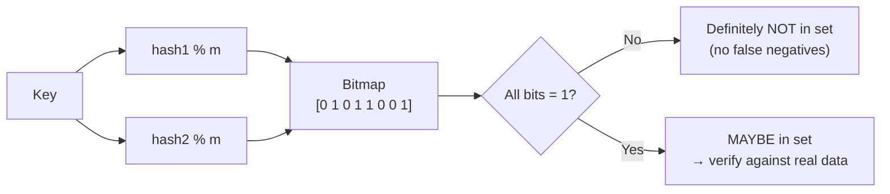

# 02 — Bloom Filters and Filter Variants

## What a Bloom filter is

- A **probabilistic** data structure answering set-membership queries [`4:01`](https://www.youtube.com/watch?v=foMMYyycRgk&t=241).
- Guarantees, contrasted with a B+Tree's exact answer [`4:01`](https://www.youtube.com/watch?v=foMMYyycRgk&t=241):
  - **No false negatives** — if it says a key is absent, it is absent.
  - **False positives are possible** — it can claim a key exists when it does not.
- On a positive answer you must go read the real data to confirm [`4:43`](https://www.youtube.com/watch?v=foMMYyycRgk&t=283).
- Invented in the 1970s; capitalized because Bloom is the inventor's surname [`5:16`](https://www.youtube.com/watch?v=foMMYyycRgk&t=316).

### Motivating example

In a chained hash table, put a Bloom filter in the bucket pointer array. Hash the key, land on the bucket, check the filter: if it says no, skip scanning the chain entirely; if yes, scan and possibly find nothing [`4:43`](https://www.youtube.com/watch?v=foMMYyycRgk&t=283).

## Mechanics

- Only two operations: **insert** and **lookup**. No deletes in the original design [`5:16`](https://www.youtube.com/watch?v=foMMYyycRgk&t=316).
- The structure is just a **bitmap**; the toy example uses 8 bits, real ones are larger but not enormously so [`5:16`](https://www.youtube.com/watch?v=foMMYyycRgk&t=316).
- **Insert**: hash the key with *k* hash functions (can be one algorithm such as xxHash with different seeds), mod by the number of bits, set each resulting bit to 1 [`6:12`](https://www.youtube.com/watch?v=foMMYyycRgk&t=372).
- **Lookup**: hash the same way; the key *may* exist only if **all** landed bits are 1. Any 0 proves absence [`7:05`](https://www.youtube.com/watch?v=foMMYyycRgk&t=425).
- Walked example: a lookup that hits one 1-bit and one 0-bit is a definite "not in set" [`7:31`](https://www.youtube.com/watch?v=foMMYyycRgk&t=451); a never-inserted key whose bits happen to both be set returns true — a false positive [`7:57`](https://www.youtube.com/watch?v=foMMYyycRgk&t=477).

### The core trade-off

Bigger bitmap + more hash functions → lower false-positive rate, but more space and more compute time hashing [`5:16`](https://www.youtube.com/watch?v=foMMYyycRgk&t=316), [`8:13`](https://www.youtube.com/watch?v=foMMYyycRgk&t=493), [`8:30`](https://www.youtube.com/watch?v=foMMYyycRgk&t=510).

## Variants

### Counting Bloom filter

- Stores an **integer counter** per slot instead of a single bit; insert increments, delete decrements [`8:30`](https://www.youtube.com/watch?v=foMMYyycRgk&t=510).
- This is what enables deletes [`8:56`](https://www.youtube.com/watch?v=foMMYyycRgk&t=536).
- Caller's responsibility not to delete a key that was never inserted — acceptable because this is internal DBMS code, not adversarial code [`9:16`](https://www.youtube.com/watch?v=foMMYyycRgk&t=556).
- Still no false negatives; still false positives, and counters can overcount [`9:16`](https://www.youtube.com/watch?v=foMMYyycRgk&t=556).

### Cuckoo filter

- Same idea as the cuckoo hash table, but stores a **fingerprint** rather than the full key — a compact representation using fewer bits [`9:51`](https://www.youtube.com/watch?v=foMMYyycRgk&t=591).
- Advantages over hashing [`10:18`](https://www.youtube.com/watch?v=foMMYyycRgk&t=618):
  - Potentially cheaper to compute than a full hash.
  - Does not randomly permute bits, so similar keys retain some resemblance and can overlap usefully.
- Supports both insert and remove, since it is just moving entries in and out of a hash table [`10:18`](https://www.youtube.com/watch?v=foMMYyycRgk&t=618).
- Invented at CMU by Dave Andersen [`11:52`](https://www.youtube.com/watch?v=foMMYyycRgk&t=712).
- Redis exposes a cuckoo filter as an explicit value type you can create by command [`11:52`](https://www.youtube.com/watch?v=foMMYyycRgk&t=712).

### SuRF — Succinct Range Filter

- A very compact version of a trie [`10:50`](https://www.youtube.com/watch?v=foMMYyycRgk&t=650).
- **Immutable**: all keys must be known ahead of time, then the structure is frozen [`10:50`](https://www.youtube.com/watch?v=foMMYyycRgk&t=650).
- Unique capability: supports **range** filters ("does any key exist in this range?"), not just exact-match membership [`10:50`](https://www.youtube.com/watch?v=foMMYyycRgk&t=650).
- Natural fit: **LSM-tree SSTables** — during compaction you have all keys, so you build the range filter once and read it many times [`11:34`](https://www.youtube.com/watch?v=foMMYyycRgk&t=694).
- Also from CMU, by a PhD student co-advised by the lecturer and Dave Andersen [`11:52`](https://www.youtube.com/watch?v=foMMYyycRgk&t=712).
- They swapped SuRF in for the Bloom filter in RocksDB's SSTables, but abandoned upstreaming it after hitting Facebook's merge bureaucracy — the code still exists [`11:52`](https://www.youtube.com/watch?v=foMMYyycRgk&t=712).

## Comparison

| Filter | Mutable? | Deletes | Extra capability |
|---|---|---|---|
| Bloom [`5:16`](https://www.youtube.com/watch?v=foMMYyycRgk&t=316) | Insert only | No | — |
| Counting Bloom [`8:30`](https://www.youtube.com/watch?v=foMMYyycRgk&t=510) | Yes | Yes (decrement) | — |
| Cuckoo [`9:51`](https://www.youtube.com/watch?v=foMMYyycRgk&t=591) | Yes | Yes | Cheaper fingerprints, key locality |
| SuRF [`10:50`](https://www.youtube.com/watch?v=foMMYyycRgk&t=650) | No (immutable) | No | Range filtering |
