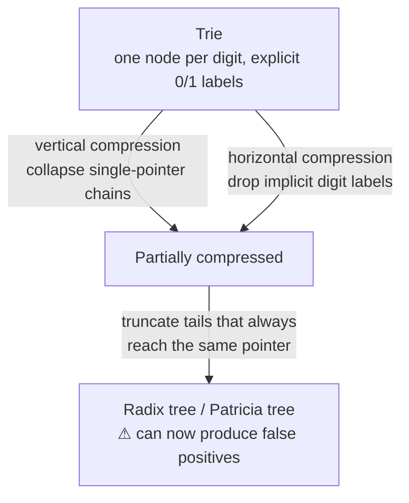

# 04 — Tries and Radix Trees

## Why not just a B+Tree?

- B+Tree inner nodes are only **guideposts** telling you to go left or right; seeing a key in an inner node tells you nothing about whether that key actually exists [`28:33`](https://www.youtube.com/watch?v=foMMYyycRgk&t=1713), [`28:51`](https://www.youtube.com/watch?v=foMMYyycRgk&t=1731).
- Worst case: with a tiny buffer pool you take a buffer pool miss at every level of the descent, only to discover at the leaf that the key does not exist [`29:02`](https://www.youtube.com/watch?v=foMMYyycRgk&t=1742), [`29:28`](https://www.youtube.com/watch?v=foMMYyycRgk&t=1768).

## What a trie is

- Older than the B+Tree: invented **1959** by a French researcher, vs. B+Tree in 1970–71 [`29:28`](https://www.youtube.com/watch?v=foMMYyycRgk&t=1768).
- The key is **not** stored at any single node. It is split into **digits** — one atomic unit such as a byte, not necessarily an Arabic numeral — and the key is reconstructed by the **path from root to leaf** [`29:42`](https://www.youtube.com/watch?v=foMMYyycRgk&t=1782), [`30:03`](https://www.youtube.com/watch?v=foMMYyycRgk&t=1803).
- Also known as **digital search trees** or **prefix trees**; "trie" comes from re**trie**val and was coined by Edward Fredkin, who was CMU faculty [`30:17`](https://www.youtube.com/watch?v=foMMYyycRgk&t=1817), [`30:50`](https://www.youtube.com/watch?v=foMMYyycRgk&t=1850).
- **Complexity: O(k)** where *k* is the length of the key — not a function of the number of keys stored [`30:50`](https://www.youtube.com/watch?v=foMMYyycRgk&t=1850).

### Span

- The **span** is the number of bits used per digit [`31:10`](https://www.youtube.com/watch?v=foMMYyycRgk&t=1870).
- Span determines both the **fan-out** of each node and the **height** of the tree — long keys give a tall trie [`31:54`](https://www.youtube.com/watch?v=foMMYyycRgk&t=1914).
- If a digit has an entry, there is a pointer to the next level; otherwise a null, which lets a lookup stop early knowing nothing below can exist [`31:28`](https://www.youtube.com/watch?v=foMMYyycRgk&t=1888).

## Worked example: 1-bit span trie

- Insert keys 10, 25, 31 as 16-bit integers. Every level corresponds to one bit [`32:21`](https://www.youtube.com/watch?v=foMMYyycRgk&t=1941), [`32:44`](https://www.youtube.com/watch?v=foMMYyycRgk&t=1964).
- A real system would use a byte or larger chunk, not one bit per level [`32:21`](https://www.youtube.com/watch?v=foMMYyycRgk&t=1941).
- The resulting shape: ten identical single-pointer levels (all leading bits zero), then the first **discriminating bit** where paths branch, then alternating single-pointer levels down to the record ID or tuple pointer at the bottom [`33:34`](https://www.youtube.com/watch?v=foMMYyycRgk&t=2014), [`34:01`](https://www.youtube.com/watch?v=foMMYyycRgk&t=2041).

## Two compression optimizations → radix tree

Both were volunteered by students in class:

1. **Vertical compression** — collapse chains where a level has exactly one outgoing pointer (the "repeat 10 times" run is the obvious case) [`34:48`](https://www.youtube.com/watch?v=foMMYyycRgk&t=2088).
2. **Horizontal compression** — stop storing the 0/1 labels; the position implicitly encodes which bit it is [`35:12`](https://www.youtube.com/watch?v=foMMYyycRgk&t=2112).
3. Additionally, cut off trailing paths that lead unconditionally to the same outbound pointer [`35:52`](https://www.youtube.com/watch?v=foMMYyycRgk&t=2152).

Apply these and you get a **radix tree**, sometimes called a **Patricia tree**; a radix tree is just a specialized, compressed form of the general trie [`35:28`](https://www.youtube.com/watch?v=foMMYyycRgk&t=2128), [`35:52`](https://www.youtube.com/watch?v=foMMYyycRgk&t=2152). Smaller structure = less CPU spent per lookup [`34:30`](https://www.youtube.com/watch?v=foMMYyycRgk&t=2070).

### Compression introduces false positives

Once the tail is cut off, the surviving prefix path points straight at the tuple. Keys like `000` and `0001` land on the same pointer, so — as with a Bloom filter — you must fetch the tuple and verify the key really matches [`36:29`](https://www.youtube.com/watch?v=foMMYyycRgk&t=2189), [`39:49`](https://www.youtube.com/watch?v=foMMYyycRgk&t=2389), [`40:27`](https://www.youtube.com/watch?v=foMMYyycRgk&t=2427), [`40:44`](https://www.youtube.com/watch?v=foMMYyycRgk&t=2444). You are only matching the **prefix** of the key, which may be acceptable — a classic compute-versus-storage trade-off [`41:04`](https://www.youtube.com/watch?v=foMMYyycRgk&t=2464).

## Modifications (tries are not necessarily immutable)

- **Insert** `hair`: follow `h`→`a`, then append `ir` at the node if there is space, with an outgoing pointer to the tuple [`38:13`](https://www.youtube.com/watch?v=foMMYyycRgk&t=2293).
- **Delete** `hat`: follow `h`→`a`→`t`, remove the entry; you may leave the gap or merge [`38:13`](https://www.youtube.com/watch?v=foMMYyycRgk&t=2293).
- Unlike the B+Tree's "less than half full → must merge" rule, there is **no fixed threshold** — merging is optional and driven by whether you are willing to pay the performance penalty. When you do merge, slide the survivor up and append it to the discriminating character above [`38:59`](https://www.youtube.com/watch?v=foMMYyycRgk&t=2339), [`39:28`](https://www.youtube.com/watch?v=foMMYyycRgk&t=2368).
- Tries are often **more compact than a B+Tree** because keys are not repeated — each key effectively exists only once [`39:28`](https://www.youtube.com/watch?v=foMMYyycRgk&t=2368), [`39:49`](https://www.youtube.com/watch?v=foMMYyycRgk&t=2389).

## Systems using tries / radix trees

- **Cassandra** — switched its LSM MemTable from a skip list to a trie [`36:48`](https://www.youtube.com/watch?v=foMMYyycRgk&t=2208).
- **ART (Adaptive Radix Tree)** — originated in **HyPer** (TU Munich, highly influential) [`37:10`](https://www.youtube.com/watch?v=foMMYyycRgk&t=2230).
- **DuckDB** — borrowed heavily from HyPer; has a radix tree and, as far as the lecturer knows, no B+Tree at all [`37:10`](https://www.youtube.com/watch?v=foMMYyycRgk&t=2230).
- **Umbra** — the HyPer follow-up, after HyPer was acquired by Tableau (later acquired by Salesforce); Tableau's in-memory cache runs HyPer. **CedarDB** is the commercial incarnation of Umbra [`37:10`](https://www.youtube.com/watch?v=foMMYyycRgk&t=2230), [`37:45`](https://www.youtube.com/watch?v=foMMYyycRgk&t=2265), [`38:13`](https://www.youtube.com/watch?v=foMMYyycRgk&t=2293).
- **solidDB** and others use plain radix trees rather than the German ART variant [`37:45`](https://www.youtube.com/watch?v=foMMYyycRgk&t=2265).
