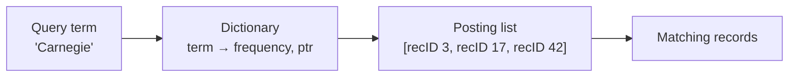

# 05 — Inverted Indexes (Full-Text Search)

## The gap ordinary indexes cannot fill

- Every index covered so far serves **point queries** (one discriminating key → tuple) and **range queries** (all orders in a date range) [`41:29`](https://www.youtube.com/watch?v=foMMYyycRgk&t=2489).
- They are useless for **keyword search** — looking *inside* an attribute's value at a portion of it rather than the whole thing [`41:57`](https://www.youtube.com/watch?v=foMMYyycRgk&t=2517).
- Example: store Wikipedia articles, then find every article containing the word "Pavlo". A B+Tree on `revisions.content` cannot serve `LIKE '%Pavlo%'` because B+Tree traversal requires the **entire** key [`42:23`](https://www.youtube.com/watch?v=foMMYyycRgk&t=2543), [`43:07`](https://www.youtube.com/watch?v=foMMYyycRgk&t=2587).
- Aside: the wildcard query is also semantically wrong — `%Pavlo%` would also match e.g. "Pavlov" [`43:07`](https://www.youtube.com/watch?v=foMMYyycRgk&t=2587).

## Structure: dictionary + posting list

An **inverted index** (a.k.a. full-text search index) maps **terms** — sub-elements of an attribute value — to the records containing them [`43:57`](https://www.youtube.com/watch?v=foMMYyycRgk&t=2637). Two pieces [`45:13`](https://www.youtube.com/watch?v=foMMYyycRgk&t=2713):

- **Dictionary** — all extracted terms (need not be words) plus the **frequency** of each, and a pointer into the posting list [`45:13`](https://www.youtube.com/watch?v=foMMYyycRgk&t=2713), [`45:32`](https://www.youtube.com/watch?v=foMMYyycRgk&t=2732).
- **Posting list** — for each term, the record IDs where it appears [`45:32`](https://www.youtube.com/watch?v=foMMYyycRgk&t=2732).

A lookup for a term is a fast dictionary probe, then a jump directly to the matching records — instead of a sequential scan that parses/splits every value [`45:57`](https://www.youtube.com/watch?v=foMMYyycRgk&t=2757), [`46:15`](https://www.youtube.com/watch?v=foMMYyycRgk&t=2775).

Historical note: before computing this was called a **concordance** — in the 1200s a man in Europe had 500 monks read the Bible to build what was effectively a full-text index [`44:23`](https://www.youtube.com/watch?v=foMMYyycRgk&t=2663).

## The ecosystem

**Libraries** [`46:15`](https://www.youtube.com/watch?v=foMMYyycRgk&t=2775):
- **Lucene** — the best-known, written in Java.
- **Xapian** — in C.
- **Tantivy** — the newer one, "Lucene but in Rust"; used by the ParadeDB team [`46:43`](https://www.youtube.com/watch?v=foMMYyycRgk&t=2803).

**Systems built on top** [`46:57`](https://www.youtube.com/watch?v=foMMYyycRgk&t=2817):
- **Elasticsearch**, **Solr**, and Sphinx — Solr and Elasticsearch both sit on Lucene.
- **OpenSearch** — Amazon's hard fork of Elasticsearch, created after Elastic changed its license to be less cloud-vendor friendly. Elastic reverted the license about two weeks before this lecture, but by then OpenSearch had gained real traction [`46:57`](https://www.youtube.com/watch?v=foMMYyycRgk&t=2817), [`47:22`](https://www.youtube.com/watch?v=foMMYyycRgk&t=2842).
- **Splunk** — much older and very expensive; common in enterprise, acquired by Cisco that summer [`47:39`](https://www.youtube.com/watch?v=foMMYyycRgk&t=2859).

## Implementation 1 — Lucene: FST dictionary

- The dictionary is a **Finite State Transducer (FST)**, essentially a trie over key digits — except the **weights on the edges** tell you how to compute the offset to jump to, instead of storing a pointer at the leaf [`48:08`](https://www.youtube.com/watch?v=foMMYyycRgk&t=2888).
- Lookup keeps a **rolling tally** of edge weights along the traversal; on reaching a terminating node, that accumulated offset says where to go [`48:34`](https://www.youtube.com/watch?v=foMMYyycRgk&t=2914), [`49:19`](https://www.youtube.com/watch?v=foMMYyycRgk&t=2959), [`49:35`](https://www.youtube.com/watch?v=foMMYyycRgk&t=2975). Edge weights of zero are allowed [`49:35`](https://www.youtube.com/watch?v=foMMYyycRgk&t=2975).
- Dictionaries are built **incrementally per batch of records**, each localized to a subset of documents, then merged in the background by compaction — the same idea as an LSM tree — to build larger dictionaries and cut redundancy [`48:34`](https://www.youtube.com/watch?v=foMMYyycRgk&t=2914).
- Because segments are **immutable and sorted**, Lucene can apply all the column-store compression tricks: the posting list is just a column of integers, so **delta compression** and **bit packing** apply [`50:11`](https://www.youtube.com/watch?v=foMMYyycRgk&t=3011).
- Extra: **precomputed aggregations** per term (rolling counts), so a "how many times does this term appear" query reads the frequency list instead of visiting every segment [`50:36`](https://www.youtube.com/watch?v=foMMYyycRgk&t=3036).

## Implementation 2 — PostgreSQL GIN

**GIN = Generalized Inverted Index**, built as a *forest of trees* [`50:57`](https://www.youtube.com/watch?v=foMMYyycRgk&t=3057):

- A **B+Tree over the terms** serves as the dictionary — terms, not whole documents [`50:57`](https://www.youtube.com/watch?v=foMMYyycRgk&t=3057), [`51:24`](https://www.youtube.com/watch?v=foMMYyycRgk&t=3084).
- The value form depends on posting-list size [`51:24`](https://www.youtube.com/watch?v=foMMYyycRgk&t=3084), [`51:54`](https://www.youtube.com/watch?v=foMMYyycRgk&t=3114):
  - Few records → a plain **array** on a page.
  - Past a configurable threshold → a **second B+Tree** of record IDs, so you avoid scanning/binary-searching a very long list.
- **Pending list**: like the Mod Log in a Bε-tree from the previous lecture, inserts land in a side buffer instead of immediately splitting the dictionary for every term of a large document [`52:13`](https://www.youtube.com/watch?v=foMMYyycRgk&t=3133), [`52:42`](https://www.youtube.com/watch?v=foMMYyycRgk&t=3162).
  - When it fills, a **compaction** applies everything into the dictionary, using a sorted bottom-up bulk insert [`52:53`](https://www.youtube.com/watch?v=foMMYyycRgk&t=3173).
  - Every lookup must therefore check the pending list first, then the full dictionary — exactly like checking the MemTable first [`53:10`](https://www.youtube.com/watch?v=foMMYyycRgk&t=3190).

## Beyond the data structure: text normalization

Production engines do much more than split on whitespace — CMU covers this in a separate course (LTI 11-642) [`53:10`](https://www.youtube.com/watch?v=foMMYyycRgk&t=3190), [`53:42`](https://www.youtube.com/watch?v=foMMYyycRgk&t=3222):

- **Normalization for fuzzy matching**: "Wu-Tang" with and without the hyphen, "USA" with and without periods, should map to the same term [`53:42`](https://www.youtube.com/watch?v=foMMYyycRgk&t=3222).
- **Stop-word removal** — discard common words like "the", "no" [`54:24`](https://www.youtube.com/watch?v=foMMYyycRgk&t=3264).

## The limit of inverted indexes

They search on **content** — does this term appear in my data [`54:24`](https://www.youtube.com/watch?v=foMMYyycRgk&t=3264), [`54:42`](https://www.youtube.com/watch?v=foMMYyycRgk&t=3282). They cannot search on **semantics**. Query "find lyrics about hip-hop groups slinging rocks": the DBMS has no idea what "slinging rocks" maps to, so an exact keyword search returns **nothing** [`55:03`](https://www.youtube.com/watch?v=foMMYyycRgk&t=3303). That is the motivation for vector indexes.
