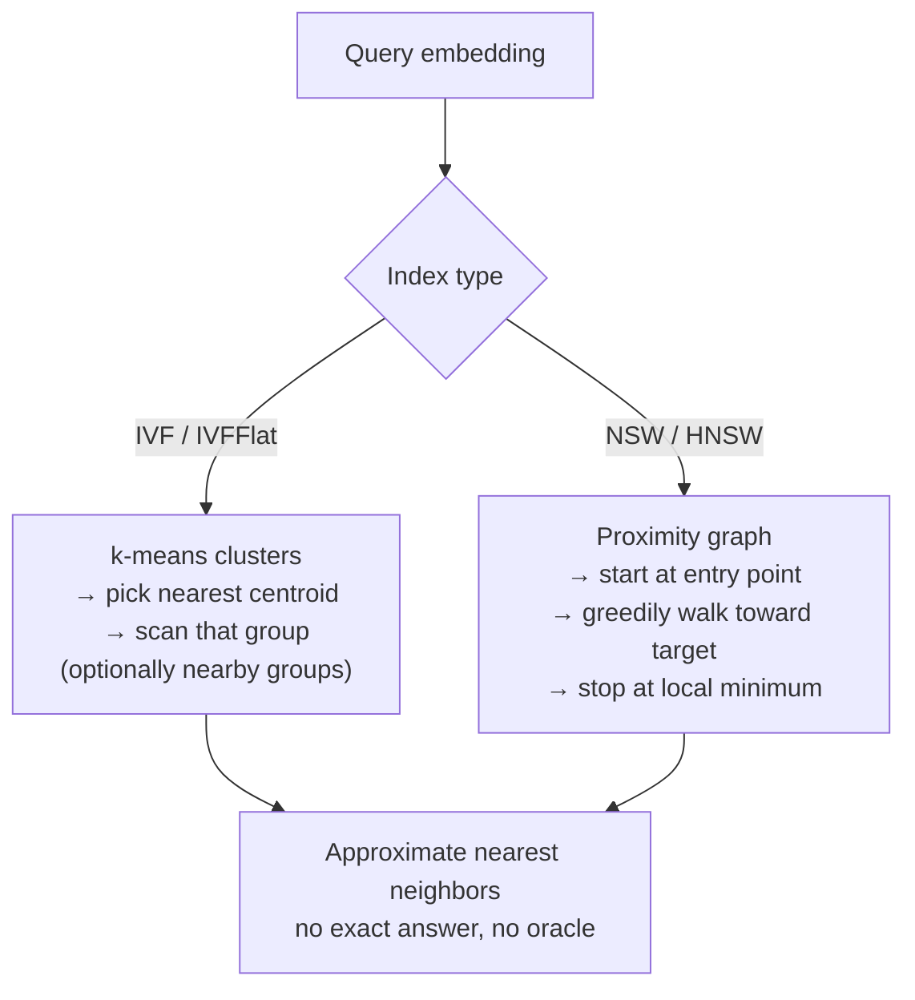

# 06 — Vector Indexes

## The idea

- Use **embeddings** produced by transformer models (OpenAI's, Google's BERT) that turn arbitrary text or data into arrays of floating-point numbers encoding a higher-level *meaning* [`55:28`](https://www.youtube.com/watch?v=foMMYyycRgk&t=3328), [`55:39`](https://www.youtube.com/watch?v=foMMYyycRgk&t=3339).
- A query embedding is compared against stored embeddings so that semantically similar content matches, even with zero keyword overlap [`55:39`](https://www.youtube.com/watch?v=foMMYyycRgk&t=3339).

## Why this is fundamentally different from every other index

- Matching is never exact. You rely on **nearest neighbor** or **approximate nearest neighbor (ANN)** search — find embeddings close to mine [`56:15`](https://www.youtube.com/watch?v=foMMYyycRgk&t=3375).
- There is **no correct answer and no oracle**: embeddings are not meant to be deciphered by humans, so with billions of records you cannot verify that the returned result is the one you wanted. Correctness collapses into "what feels right" [`56:15`](https://www.youtube.com/watch?v=foMMYyycRgk&t=3375), [`57:00`](https://www.youtube.com/watch?v=foMMYyycRgk&t=3420).
- Dedicated vector databases exist, but many relational systems now ship their own vector indexes, and nearly all of them stand on shared third-party libraries [`57:00`](https://www.youtube.com/watch?v=foMMYyycRgk&t=3420).

## The big open challenge: filtered vector search

The vector index only knows the embedding, but real `WHERE` clauses carry extra predicates. Example: "lyrics about slinging rocks **written after 2015**" — the year is not in the embedding [`57:42`](https://www.youtube.com/watch?v=foMMYyycRgk&t=3462), [`58:00`](https://www.youtube.com/watch?v=foMMYyycRgk&t=3480).

Two orderings, neither free [`58:00`](https://www.youtube.com/watch?v=foMMYyycRgk&t=3480):

1. **Pre-filter** — apply `year > 2015` first, then do nearest-neighbor search on the survivors.
2. **Post-filter** — fetch a batch of nearest vectors, then check the year; if you discard too many you must go back for more.

Pinecone and Weaviate both claim to have solved this; Weaviate is the more vocal. Weaviate's approach stores the **metadata inside the graph nodes** of the small-world structure, avoiding a round trip to a separate index [`58:24`](https://www.youtube.com/watch?v=foMMYyycRgk&t=3504), [`58:43`](https://www.youtube.com/watch?v=foMMYyycRgk&t=3523).

## Approach 1 — Inverted File (IVF / IVFFlat)

- **Divide and conquer**: cluster the vectors into groups with an algorithm such as **k-means** [`58:43`](https://www.youtube.com/watch?v=foMMYyycRgk&t=3523).
- Query: land in the group whose centroid is nearest, then sequentially scan that group for nearest neighbors [`58:43`](https://www.youtube.com/watch?v=foMMYyycRgk&t=3523), [`59:12`](https://www.youtube.com/watch?v=foMMYyycRgk&t=3552).
- Optionally probe **nearby groups too**, trading time for accuracy [`59:12`](https://www.youtube.com/watch?v=foMMYyycRgk&t=3552).
- Optional preprocessing: **quantize** vectors to lower dimensions inside the index for faster lookups while keeping the originals — the goal is speed without meaningfully reducing accuracy [`59:52`](https://www.youtube.com/watch?v=foMMYyycRgk&t=3592).

## Approach 2 — Navigable Small Worlds (NSW / HNSW)

- A **graph** where each node has a specified number of edges to its nearest neighbors [`1:00:14`](https://www.youtube.com/watch?v=foMMYyycRgk&t=3614).
- A designated **entry point** starts the search; you greedily follow edges that move you closer to the target vector, stopping when no neighbor is closer [`1:00:14`](https://www.youtube.com/watch?v=foMMYyycRgk&t=3614), [`1:00:40`](https://www.youtube.com/watch?v=foMMYyycRgk&t=3640), [`1:01:06`](https://www.youtube.com/watch?v=foMMYyycRgk&t=3666).
- The lecture shows the single-level version; it extends to **multiple levels** (HNSW) [`1:00:14`](https://www.youtube.com/watch?v=foMMYyycRgk&t=3614), [`1:01:06`](https://www.youtube.com/watch?v=foMMYyycRgk&t=3666).
- Implementations: Facebook's **FAISS** is the best-known and actively maintained; the original authors also publish **hnswlib**. Many DBMSs use FAISS — Pinecone included [`1:01:06`](https://www.youtube.com/watch?v=foMMYyycRgk&t=3666), [`1:01:30`](https://www.youtube.com/watch?v=foMMYyycRgk&t=3690).

## Comparison

| | IVF / IVFFlat | Navigable Small Worlds |
|---|---|---|
| Structure | Clusters + centroids [`58:43`](https://www.youtube.com/watch?v=foMMYyycRgk&t=3523) | Proximity graph [`1:00:14`](https://www.youtube.com/watch?v=foMMYyycRgk&t=3614) |
| Search | Land in a group, scan it [`59:12`](https://www.youtube.com/watch?v=foMMYyycRgk&t=3552) | Greedy walk from an entry point [`1:00:40`](https://www.youtube.com/watch?v=foMMYyycRgk&t=3640) |
| Accuracy knob | Number of nearby groups probed [`59:12`](https://www.youtube.com/watch?v=foMMYyycRgk&t=3552) | Edges per node, number of levels [`1:00:14`](https://www.youtube.com/watch?v=foMMYyycRgk&t=3614) |
| Notable impl. | Quantization for speed [`59:52`](https://www.youtube.com/watch?v=foMMYyycRgk&t=3592) | FAISS, hnswlib [`1:01:06`](https://www.youtube.com/watch?v=foMMYyycRgk&t=3666) |
