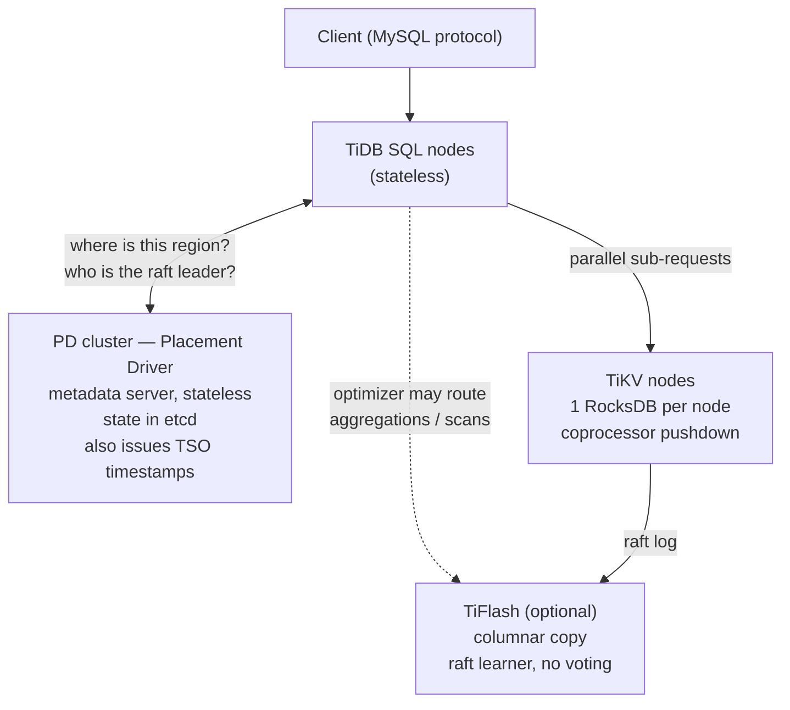

# 08 — Guest Talk: TiDB (Sunny Bains)

Speaker introduced as someone who **ran MySQL/InnoDB for 20 years** and is now at TiDB [`1:03:52`](https://www.youtube.com/watch?v=foMMYyycRgk&t=3832), [`1:04:18`](https://www.youtube.com/watch?v=foMMYyycRgk&t=3858).

> The one takeaway he asks for: **how TiDB handles scale, and what the core idea is** — the rest you can figure out [`1:04:18`](https://www.youtube.com/watch?v=foMMYyycRgk&t=3858).

## Origin story

- TiDB is general purpose, handles **petabytes**, and is used by major companies and banks [`1:04:40`](https://www.youtube.com/watch?v=foMMYyycRgk&t=3880).
- **2014**: the founders worked at a fast-growing company with hundreds of terabytes. The only solution then was **manual sharding and resharding** — it took whole weekends — and keeping consistency across shards was very hard with only MySQL replication [`1:05:10`](https://www.youtube.com/watch?v=foMMYyycRgk&t=3910).
- Then they discovered **Google Spanner**: split data into chunks, move them around, run a Paxos-style consensus protocol over them [`1:05:56`](https://www.youtube.com/watch?v=foMMYyycRgk&t=3956).
- But Spanner was **proprietary and required special hardware**. The founders wanted commodity hardware and standard SQL, so they adopted the **MySQL protocol** because of its popularity [`1:05:56`](https://www.youtube.com/watch?v=foMMYyycRgk&t=3956).

## Design philosophy

- **Shared-nothing** architecture [`1:05:56`](https://www.youtube.com/watch?v=foMMYyycRgk&t=3956).
- Developers should not be concerned with shard details, yet should keep the flexibility to control data placement — TiDB does it automatically but also exposes SQL to place data on a rack, host, or region [`1:06:44`](https://www.youtube.com/watch?v=foMMYyycRgk&t=4004).
- Standard SQL, no specialized interface [`1:06:44`](https://www.youtube.com/watch?v=foMMYyycRgk&t=4004).
- **Strong transactional consistency out of the box**, plus flexible read-consistency policies. Highly available **but not at the cost of strong consistency** — consistency makes the system easier to reason about and reduces corruption risk [`1:07:14`](https://www.youtube.com/watch?v=foMMYyycRgk&t=4034).

## Architecture

### PD — Placement Driver [`1:07:45`](https://www.youtube.com/watch?v=foMMYyycRgk&t=4065)

- Really a **metadata server**, run as a cluster; the instances are stateless with state kept in an accompanying **etcd** instance.
- The "brains" behind TiKV: a query arriving at a SQL node asks PD where a region/tablet lives and which host holds the current raft-group leader [`1:07:45`](https://www.youtube.com/watch?v=foMMYyycRgk&t=4065), [`1:08:33`](https://www.youtube.com/watch?v=foMMYyycRgk&t=4113).
- Monitors **hotspots, RAM, I/O, free space** and rebalances so load spreads evenly — machines need not be the same size, so placement decisions use all these metrics [`1:11:56`](https://www.youtube.com/watch?v=foMMYyycRgk&t=4316), [`1:12:27`](https://www.youtube.com/watch?v=foMMYyycRgk&t=4347).
- Also **hands out transaction timestamps** required for MVCC — hence "it does more than one job" [`1:13:36`](https://www.youtube.com/watch?v=foMMYyycRgk&t=4416), [`1:14:20`](https://www.youtube.com/watch?v=foMMYyycRgk&t=4460).

### TiDB SQL nodes

- Stateless (in practice they keep a little non-permanent state to optimize distributed transactions) [`1:07:45`](https://www.youtube.com/watch?v=foMMYyycRgk&t=4065), [`1:14:20`](https://www.youtube.com/watch?v=foMMYyycRgk&t=4460).
- Enable **distributed execution**: a query spanning *n* regions issues requests to the different TiKV nodes **in parallel** [`1:08:33`](https://www.youtube.com/watch?v=foMMYyycRgk&t=4113).

### TiFlash (optional) [`1:08:33`](https://www.youtube.com/watch?v=foMMYyycRgk&t=4113), [`1:09:07`](https://www.youtube.com/watch?v=foMMYyycRgk&t=4147)

- A **columnar copy** of the same data.
- **Learner nodes** — they do not participate in raft elections; they read raft log messages and convert them into a column store.
- The optimizer can push sub-queries to it when an aggregation or file scan is cheaper columnar.

### TiKV [`1:09:07`](https://www.youtube.com/watch?v=foMMYyycRgk&t=4147)

- Think "distributed RocksDB": key-value API, **one RocksDB instance per TiKV node**, raft for region distribution.
- Transaction model is a **modified Percolator** (also from Google).
- **Coprocessor** for query pushdown: aggregations and scans execute close to the physical data, reducing network traffic; only summaries return to the SQL node that issued the request [`1:09:53`](https://www.youtube.com/watch?v=foMMYyycRgk&t=4193), [`1:10:08`](https://www.youtube.com/watch?v=foMMYyycRgk&t=4208).

## Regions — the core scaling idea

- Model the whole database as **one giant ordered table**, with special key encoding separating tables and indexes [`1:10:08`](https://www.youtube.com/watch?v=foMMYyycRgk&t=4208).
- Chop that ordered space into **regions of 96 MB by default** (configurable) [`1:10:48`](https://www.youtube.com/watch?v=foMMYyycRgk&t=4248).
- **Each region is its own raft group** — hence "**multi-raft**" — and regions spread across the TiKV cluster [`1:10:48`](https://www.youtube.com/watch?v=foMMYyycRgk&t=4248), [`1:12:59`](https://www.youtube.com/watch?v=foMMYyycRgk&t=4379).
- Reads always go to the **leader**: followers may still be catching up since consensus only requires a majority. Reading from followers is technically possible but not done — "**better to be correct than to be faster**" [`1:11:28`](https://www.youtube.com/watch?v=foMMYyycRgk&t=4288), [`1:11:41`](https://www.youtube.com/watch?v=foMMYyycRgk&t=4301).
- A region is the **logical scale unit**: load balance, scale out and scale in all operate on regions; regions **merge** when data is deleted [`1:12:59`](https://www.youtube.com/watch?v=foMMYyycRgk&t=4379).
- A node failure triggers elections only for the regions that were leaders there — **failure is localized**, the rest of the cluster keeps going [`1:12:27`](https://www.youtube.com/watch?v=foMMYyycRgk&t=4347).
- Rows within a region are **ordered**; TiDB does **not** support hash partitioning [`1:13:36`](https://www.youtube.com/watch?v=foMMYyycRgk&t=4416).

## Distributed transactions

- Based on **Percolator**; supports **read committed** and **snapshot isolation**, with snapshot isolation mapped to InnoDB's repeatable read for MySQL protocol compatibility (minor differences exist) [`1:13:36`](https://www.youtube.com/watch?v=foMMYyycRgk&t=4416).
- Needs start and end timestamps for MVCC, issued by PD [`1:13:36`](https://www.youtube.com/watch?v=foMMYyycRgk&t=4416).
- **Async commit** with **two-phase commit**: SQL nodes coordinate, TiKV nodes are the participants. Works extremely well when the write set is small and phase-two time dominates [`1:14:20`](https://www.youtube.com/watch?v=foMMYyycRgk&t=4460), [`1:14:49`](https://www.youtube.com/watch?v=foMMYyycRgk&t=4489).
- **Single-phase commit optimization**: if the write touches only one region — e.g. an insert with no secondary index, or a small batch fitting in a page — it commits in one phase. The **raft log provides durability** [`1:15:27`](https://www.youtube.com/watch?v=foMMYyycRgk&t=4527), [`1:15:52`](https://www.youtube.com/watch?v=foMMYyycRgk&t=4552).

## Current pain points and where they are going

**Problems at scale** [`1:15:52`](https://www.youtube.com/watch?v=foMMYyycRgk&t=4552), [`1:16:21`](https://www.youtube.com/watch?v=foMMYyycRgk&t=4581):
- **Copying data is expensive**: adding a node means moving data before it can serve requests, which can take a long time.
- **LSM compaction is a huge problem** when data is large — there is one LSM per node.

**What customers now ask for** [`1:16:21`](https://www.youtube.com/watch?v=foMMYyycRgk&t=4581), [`1:16:38`](https://www.youtube.com/watch?v=foMMYyycRgk&t=4598):
- **200 PB clusters** — the speaker calls this "ridiculous in my mind, but that's what people are asking".
- **Multi-tenancy / cost reduction**: one cluster shared across applications to avoid management complexity and cost.
- Fewer tuning knobs — design trade-offs turn into knobs operators must constantly fiddle with [`1:16:38`](https://www.youtube.com/watch?v=foMMYyycRgk&t=4598).
- **True elasticity, including scaling down**: capacity planning targets peak traffic (Black Friday sales), but traffic is low most of the time and nobody wants to pay for idle instances. Ideally an idle instance costs **storage only** [`1:17:06`](https://www.youtube.com/watch?v=foMMYyycRgk&t=4626), [`1:19:02`](https://www.youtube.com/watch?v=foMMYyycRgk&t=4742).

**The cloud direction — leveraging S3** [`1:17:48`](https://www.youtube.com/watch?v=foMMYyycRgk&t=4668), [`1:18:03`](https://www.youtube.com/watch?v=foMMYyycRgk&t=4683):
- S3 pricing is counterintuitive: the **volume of data is not the problem, the number of requests is**. A database sending every request to S3 becomes extremely expensive, so the two must be balanced.
- S3 is described as "a fantastic system" — very resilient — and worth leveraging for elasticity and resilience.
- The complexity must stay hidden: connect to one endpoint, run queries, and it scales up and down automatically [`1:18:03`](https://www.youtube.com/watch?v=foMMYyycRgk&t=4683), [`1:18:45`](https://www.youtube.com/watch?v=foMMYyycRgk&t=4725).
- The talk ran out of time on the final slide: a **new storage engine** [`1:19:02`](https://www.youtube.com/watch?v=foMMYyycRgk&t=4742), [`1:19:17`](https://www.youtube.com/watch?v=foMMYyycRgk&t=4757).

## Closing Q&A

- **"Who actually has 200 petabytes?"** — the answer offered from the room: intelligence agencies, because "they keep everything" [`1:19:17`](https://www.youtube.com/watch?v=foMMYyycRgk&t=4757), [`1:19:37`](https://www.youtube.com/watch?v=foMMYyycRgk&t=4777).
- The lecturer's closing rule of thumb: **it takes 10 years before a database becomes good, useful and safe**. TiDB started in 2014; it is 2024 — do the math [`1:19:37`](https://www.youtube.com/watch?v=foMMYyycRgk&t=4777), [`1:20:00`](https://www.youtube.com/watch?v=foMMYyycRgk&t=4800).
