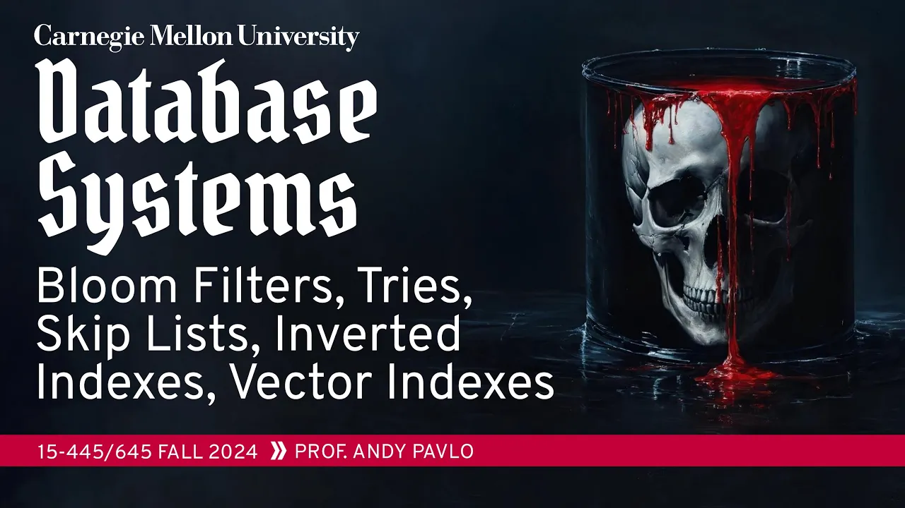
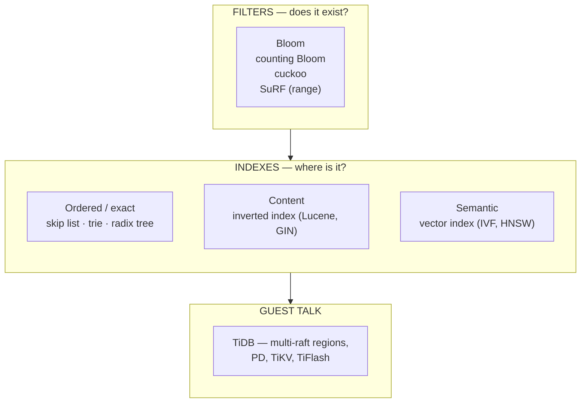

# #09 - Vector Indexes, Inverted Indexes, Filters, Tries ✸ TiDB Talk (CMU Intro to Database Systems)

*CMU Database Group · 1:21:10 · [Watch on YouTube](https://www.youtube.com/watch?v=foMMYyycRgk)*

## Summary

Lecture 9 of CMU 15-445/645 (Fall 2024) is deliberately a **brain dump** of the index and filter data structures a database engineer should know beyond the B+Tree [`0:27`](https://www.youtube.com/watch?v=foMMYyycRgk&t=27). Andy Pavlo opens by separating **filters** (does this key exist?) from **indexes** (it exists, and here is where) [`2:34`](https://www.youtube.com/watch?v=foMMYyycRgk&t=154), then walks through Bloom filters and their variants, skip lists, tries and radix trees, inverted indexes for full-text search, and vector indexes for semantic similarity search. The last ~17 minutes are a guest talk by Sunny Bains (formerly 20 years on MySQL/InnoDB, now at TiDB) on how TiDB achieves horizontal scale through raft-replicated 96 MB regions [`1:03:52`](https://www.youtube.com/watch?v=foMMYyycRgk&t=3832), [`1:10:48`](https://www.youtube.com/watch?v=foMMYyycRgk&t=4248).

## Topics

1. [Introduction and Course Logistics](./01-introduction-and-course-logistics.md) — announcements, and the filter-vs-index distinction that frames the lecture [`0:27`](https://www.youtube.com/watch?v=foMMYyycRgk&t=27)
2. [Bloom Filters and Filter Variants](./02-bloom-filters-and-variants.md) — Bloom, counting Bloom, cuckoo, SuRF [`4:01`](https://www.youtube.com/watch?v=foMMYyycRgk&t=241)
3. [Skip Lists](./03-skip-lists.md) — probabilistic multi-level linked lists for in-memory indexes [`12:40`](https://www.youtube.com/watch?v=foMMYyycRgk&t=760)
4. [Tries and Radix Trees](./04-tries-and-radix-trees.md) — digit-decomposed keys, compression, ART [`28:33`](https://www.youtube.com/watch?v=foMMYyycRgk&t=1713)
5. [Inverted Indexes (Full-Text Search)](./05-inverted-indexes.md) — dictionary + posting list, Lucene FST, Postgres GIN [`41:29`](https://www.youtube.com/watch?v=foMMYyycRgk&t=2489)
6. [Vector Indexes](./06-vector-indexes.md) — embeddings, ANN search, IVFFlat vs. navigable small worlds [`54:42`](https://www.youtube.com/watch?v=foMMYyycRgk&t=3282)
7. [Wrap-Up and What Was Not Covered](./07-wrap-up-and-not-covered.md) — the B+Tree verdict, multi-dimensional structures [`1:01:30`](https://www.youtube.com/watch?v=foMMYyycRgk&t=3690)
8. [Guest Talk: TiDB (Sunny Bains)](./08-tidb-guest-talk.md) — regions, multi-raft, PD, and the road to the cloud [`1:03:52`](https://www.youtube.com/watch?v=foMMYyycRgk&t=3832)

## Key takeaways

- **A filter and an index answer different questions.** A filter says only whether a key exists in a set; an index also tells you where to find it — that distinction is what makes filters cheap enough to sit in front of everything else [`2:34`](https://www.youtube.com/watch?v=foMMYyycRgk&t=154).
- **Bloom filters trade space for certainty in exactly one direction:** no false negatives ever, false positives always possible, so a positive answer must be verified against the real data. Bigger bitmaps and more hash functions reduce false positives at the cost of space and hashing CPU [`4:01`](https://www.youtube.com/watch?v=foMMYyycRgk&t=241), [`5:16`](https://www.youtube.com/watch?v=foMMYyycRgk&t=316).
- **Two of the modern filters came out of CMU.** The cuckoo filter (Dave Andersen) is now a first-class Redis type; SuRF adds *range* filtering and was actually swapped into RocksDB's SSTables in place of the Bloom filter — the effort was abandoned not on technical grounds but because of Facebook's merge bureaucracy [`11:52`](https://www.youtube.com/watch?v=foMMYyycRgk&t=712).
- **Skip lists win on memory and lose on disk.** They use less memory than a B+Tree (no slack space for future inserts) and never split or merge, but block-structured storage makes them "terrible" on disk and they only support cheap ascending scans — which is why they show up as MemTables in RocksDB, WiredTiger and Couchbase, and nowhere else [`27:10`](https://www.youtube.com/watch?v=foMMYyycRgk&t=1630), [`27:36`](https://www.youtube.com/watch?v=foMMYyycRgk&t=1656), [`16:03`](https://www.youtube.com/watch?v=foMMYyycRgk&t=963).
- **Concurrency dictates the traversal order of skip-list mutations:** insert links bottom-up so no reader descends into a half-built node, delete unlinks top-down so no reader descends into a freed one; both are compare-and-swap and therefore latch-free [`19:42`](https://www.youtube.com/watch?v=foMMYyycRgk&t=1182), [`26:34`](https://www.youtube.com/watch?v=foMMYyycRgk&t=1594), [`20:41`](https://www.youtube.com/watch?v=foMMYyycRgk&t=1241).
- **A radix tree is just a trie after vertical and horizontal compression** — and that compression is what introduces false positives, because you end up matching only a prefix of the key and must verify against the tuple [`35:28`](https://www.youtube.com/watch?v=foMMYyycRgk&t=2128), [`36:29`](https://www.youtube.com/watch?v=foMMYyycRgk&t=2189), [`41:04`](https://www.youtube.com/watch?v=foMMYyycRgk&t=2464).
- **Trie lookup cost is O(k) in key length, independent of the number of keys**, and tries are usually more compact than a B+Tree since keys are never repeated. Real systems have moved: Cassandra swapped its MemTable from skip list to trie, and DuckDB (following HyPer's ART) has no B+Tree at all [`30:50`](https://www.youtube.com/watch?v=foMMYyycRgk&t=1850), [`39:28`](https://www.youtube.com/watch?v=foMMYyycRgk&t=2368), [`36:48`](https://www.youtube.com/watch?v=foMMYyycRgk&t=2208), [`37:10`](https://www.youtube.com/watch?v=foMMYyycRgk&t=2230).
- **Inverted indexes are dictionary + posting list**, and the two dominant implementations diverge sharply: Lucene uses an immutable finite state transducer whose edge weights accumulate into an offset, enabling column-store tricks like delta compression and bit packing; Postgres GIN uses a forest of B+Trees plus a "pending list" mod log that defers dictionary splits [`45:13`](https://www.youtube.com/watch?v=foMMYyycRgk&t=2713), [`48:08`](https://www.youtube.com/watch?v=foMMYyycRgk&t=2888), [`50:11`](https://www.youtube.com/watch?v=foMMYyycRgk&t=3011), [`50:57`](https://www.youtube.com/watch?v=foMMYyycRgk&t=3057), [`52:42`](https://www.youtube.com/watch?v=foMMYyycRgk&t=3162).
- **Vector search breaks the notion of a correct answer.** Embeddings are not human-decipherable, so with billions of records there is no oracle to confirm the returned neighbor is the right one — correctness degrades to "what feels right" [`56:15`](https://www.youtube.com/watch?v=foMMYyycRgk&t=3375), [`57:00`](https://www.youtube.com/watch?v=foMMYyycRgk&t=3420).
- **Filtered vector search is the unsolved engineering problem:** non-semantic predicates (e.g. `year > 2015`) are not in the embedding, forcing a pre-filter/post-filter choice. Weaviate's answer is storing metadata inside the small-world graph nodes to avoid a second index lookup [`57:42`](https://www.youtube.com/watch?v=foMMYyycRgk&t=3462), [`58:00`](https://www.youtube.com/watch?v=foMMYyycRgk&t=3480), [`58:43`](https://www.youtube.com/watch?v=foMMYyycRgk&t=3523).
- **After all of it, the B+Tree is still the default** — over tries, R-trees and definitely over skip lists; filters, by contrast, will keep reappearing throughout the course [`1:01:30`](https://www.youtube.com/watch?v=foMMYyycRgk&t=3690).
- **TiDB's entire scaling story is one idea:** treat the database as one ordered keyspace, chop it into 96 MB regions, make each region its own raft group (multi-raft), and let the Placement Driver track and rebalance them. Failure and elections stay localized to affected regions [`1:10:48`](https://www.youtube.com/watch?v=foMMYyycRgk&t=4248), [`1:12:59`](https://www.youtube.com/watch?v=foMMYyycRgk&t=4379), [`1:12:27`](https://www.youtube.com/watch?v=foMMYyycRgk&t=4347).
- **TiDB always reads from the raft leader**, never from lagging followers, on the explicit principle that it is "better to be correct than to be faster" [`1:11:41`](https://www.youtube.com/watch?v=foMMYyycRgk&t=4301).
- **TiDB's current scaling walls are data movement and LSM compaction**, while customers now request 200 PB clusters and true scale-to-zero elasticity. The proposed answer is leaning on S3 — where the cost driver is the *number of requests*, not the data volume [`1:15:52`](https://www.youtube.com/watch?v=foMMYyycRgk&t=4552), [`1:16:21`](https://www.youtube.com/watch?v=foMMYyycRgk&t=4581), [`1:18:03`](https://www.youtube.com/watch?v=foMMYyycRgk&t=4683).
- **The 10-year rule for databases:** a DBMS takes about a decade before it is genuinely good, useful and safe — TiDB started in 2014, and this lecture was in 2024 [`1:19:37`](https://www.youtube.com/watch?v=foMMYyycRgk&t=4777).
