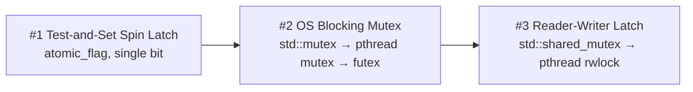

# 04 — Implementing Latches

## Design goals for a DBMS latch

Because latches are inlined in the data structure itself [`14:23`](https://www.youtube.com/watch?v=lgUNTj0Q54M&t=863):

- **Small memory footprint** — you cannot spend a kilobyte per latch when that space could hold data [`14:23`](https://www.youtube.com/watch?v=lgUNTj0Q54M&t=863).
- **Fast path with no contention** — the common case is that the latch is free, so acquisition must be as fast as possible [`15:05`](https://www.youtube.com/watch?v=lgUNTj0Q54M&t=905).
- **Decentralized management** — no global table tracking who holds what; everything is inline [`15:19`](https://www.youtube.com/watch?v=lgUNTj0Q54M&t=919).
- **Avoid expensive system calls** — going down to the OS makes everything slower [`15:19`](https://www.youtube.com/watch?v=lgUNTj0Q54M&t=919).
- You never hold a latch on something being swapped out to disk, because that makes the hold time too long [`14:46`](https://www.youtube.com/watch?v=lgUNTj0Q54M&t=886).

## The Linus argument (and the rebuttal)

- Linus Torvalds' well-known post: do not use spin locks in user space unless you know what you're doing, and the likelihood that you do is "basically nil" [`15:40`](https://www.youtube.com/watch?v=lgUNTj0Q54M&t=940).
- The lecturer's position: that warning is for the general population; people building a database system know what they're doing, "and he's actually wrong" [`15:40`](https://www.youtube.com/watch?v=lgUNTj0Q54M&t=940) [`16:19`](https://www.youtube.com/watch?v=lgUNTj0Q54M&t=979).

## Evidence that custom latches pay off — WebKit's ParkingLot

From an Apple blog post (~8–10 years old), on their **ParkingLot** locking mechanism, described as the best still-open-source implementation [`17:46`](https://www.youtube.com/watch?v=lgUNTj0Q54M&t=1066):

- **64× smaller** and **180× faster** than pthread mutex in a tight micro-benchmark [`17:46`](https://www.youtube.com/watch?v=lgUNTj0Q54M&t=1066).
- On fuller, more realistic workloads: roughly **5–10% faster** just from replacing the latch implementation [`18:11`](https://www.youtube.com/watch?v=lgUNTj0Q54M&t=1091).

## Three building blocks

### 1. Test-and-set spin latch

- Declare an `std::atomic_flag` — syntactic sugar for an atomic boolean, an 8-bit value you can test-and-set [`18:30`](https://www.youtube.com/watch?v=lgUNTj0Q54M&t=1110).
- Acquisition is a `while` loop that keeps trying test-and-set until it succeeds — hence "spin" [`18:30`](https://www.youtube.com/watch?v=lgUNTj0Q54M&t=1110) [`19:20`](https://www.youtube.com/watch?v=lgUNTj0Q54M&t=1160).
- **Not scalable**: a thread that can't acquire simply burns CPU cycles [`19:37`](https://www.youtube.com/watch?v=lgUNTj0Q54M&t=1177).
- Mitigations inside the loop: bail out after N attempts (e.g. a million) and return an error, or yield/sleep and retry [`19:37`](https://www.youtube.com/watch?v=lgUNTj0Q54M&t=1177).
- **NUMA problem**: on a multi-socket machine, spinning on a latch located in another socket's DRAM crosses the interconnect, which is roughly **2× slower** than local DRAM, and floods the interconnect with traffic [`20:11`](https://www.youtube.com/watch?v=lgUNTj0Q54M&t=1211) [`21:24`](https://www.youtube.com/watch?v=lgUNTj0Q54M&t=1284).

### Test-and-set / compare-and-swap in hardware

- Modern CPUs provide atomic instructions: give an address, the value you expect there, and a new value; the check-and-set happens in a **single instruction**, so nobody can slip in between [`21:46`](https://www.youtube.com/watch?v=lgUNTj0Q54M&t=1306).
- In C/C++ these appear as **intrinsics** (the double-underscore functions, e.g. GCC's compare-and-swap) — an alias for the underlying hardware instruction, used instead of writing assembly [`22:30`](https://www.youtube.com/watch?v=lgUNTj0Q54M&t=1350).
- Intel added this to x86 in the 1990s; ARM has its own version. Intrinsics hurt portability across x86 vs ARM [`23:05`](https://www.youtube.com/watch?v=lgUNTj0Q54M&t=1385).
- C++ atomics arrived in **C++11** [`23:05`](https://www.youtube.com/watch?v=lgUNTj0Q54M&t=1385).

### 2. OS blocking mutex

- `std::mutex` → **pthread mutex** → **futex** ("fast user mutex") on Linux [`24:20`](https://www.youtube.com/watch?v=lgUNTj0Q54M&t=1460).
- How a futex works: a user-space spin latch first, so you avoid the syscall entirely when uncontended. If two threads contend, the loser descends to the OS for a mutex/condition variable and waits [`24:20`](https://www.youtube.com/watch?v=lgUNTj0Q54M&t=1460) [`25:02`](https://www.youtube.com/watch?v=lgUNTj0Q54M&t=1502).
- Syscalls are expensive because of security permission checks and context copying [`25:02`](https://www.youtube.com/watch?v=lgUNTj0Q54M&t=1502).
- Going into the OS **scheduler** is worse still: Linux keeps its scheduling structures in its own hash table, protected by **its own latches** — so one latch acquisition turns into multiple latch acquisitions [`25:29`](https://www.youtube.com/watch?v=lgUNTj0Q54M&t=1529).

### 3. Reader-writer latch

- `std::shared_mutex` → a **pthread rwlock**, itself a combination of condition variables plus a pthread mutex (i.e. more futexes) [`26:40`](https://www.youtube.com/watch?v=lgUNTj0Q54M&t=1600). BusTub uses `std::shared_mutex` [`26:11`](https://www.youtube.com/watch?v=lgUNTj0Q54M&t=1571).
- User-space design: counters for how many workers hold the latch in each mode, plus how many are waiting [`26:40`](https://www.youtube.com/watch?v=lgUNTj0Q54M&t=1600).
- Walkthrough: reader 1 acquires (counter → 1); reader 2 acquires (counter → 2); a writer arrives, must block and gets queued; **a third reader also blocks**, even though the latch is compatible with read mode [`27:20`](https://www.youtube.com/watch?v=lgUNTj0Q54M&t=1640).
- **Why block the third reader? Fairness** — otherwise a steady stream of readers means the writer never gets in (writer starvation). This is a simple policy: an arriving writer gets higher priority [`28:22`](https://www.youtube.com/watch?v=lgUNTj0Q54M&t=1702).
- Choose weight by critical-section length: heavyweight machinery makes sense for sections of a few microseconds to a millisecond, not for very short ones [`28:01`](https://www.youtube.com/watch?v=lgUNTj0Q54M&t=1681).

## More advanced implementations (mentioned, not covered)

- Adaptive spin locks (Apple), queue-based **MCS locks**, and **optimistic lock coupling** with version information, used in the German systems [`16:19`](https://www.youtube.com/watch?v=lgUNTj0Q54M&t=979).
- Open-source systems like Postgres tend to have fairly primitive implementations; commercial ones are closed and often ship their own so behavior stays identical across FreeBSD, Linux, etc. [`17:01`](https://www.youtube.com/watch?v=lgUNTj0Q54M&t=1021).
