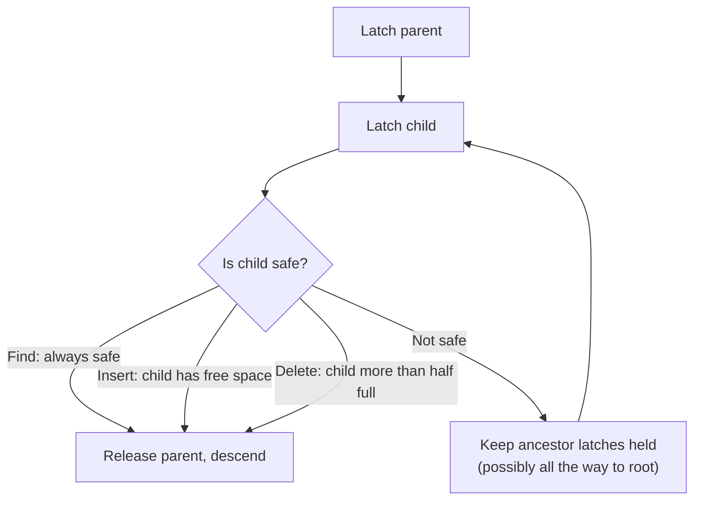

# 06 — B+ Tree Latch Crabbing (Coupling)

## The problem: splits and merges invalidate what you already read

Worked failure scenario [`34:38`](https://www.youtube.com/watch?v=lgUNTj0Q54M&t=2078) [`35:24`](https://www.youtube.com/watch?v=lgUNTj0Q54M&t=2124) [`35:55`](https://www.youtube.com/watch?v=lgUNTj0Q54M&t=2155):

1. T1 descends to leaf **I** and deletes key **44**; node I is now less than half full, so it must steal key **41** from a sibling.
2. T1 gets **descheduled** before performing the move.
3. T2 descends looking for **41**, reads inner node **D**, and decides 41 lives in leaf **H** (between 38 and 44).
4. T2 is descheduled; T1 wakes up and moves 41 over.
5. T2 wakes, follows the pointer it read — which was valid at the time — reaches H, and gets a **false negative**: the key exists, but T2 misses it.

- This is a physical-correctness violation, not just a dangling-pointer problem: **there is no global status telling a thread what other threads are doing** inside the structure; you can only observe the nodes you are connected to [`36:21`](https://www.youtube.com/watch?v=lgUNTj0Q54M&t=2181).

## The protocol: latch crabbing / latch coupling

The textbook and Wikipedia call it latch coupling [`36:43`](https://www.youtube.com/watch?v=lgUNTj0Q54M&t=2203).

1. Latch the parent.
2. Latch the child.
3. **If the child is "safe"** — it will not split or merge for the operation being performed — release the parent's latch [`36:43`](https://www.youtube.com/watch?v=lgUNTj0Q54M&t=2203).

- Named for a crab's walk; the monkey-bars analogy is offered as clearer: hold the current bar, grab the next, then let go [`37:38`](https://www.youtube.com/watch?v=lgUNTj0Q54M&t=2258).

## Safety definition per operation

| Operation | Latch mode | Safe means |
|---|---|---|
| **Find** | Read | Always safe — release parent immediately on arriving at child [`37:54`](https://www.youtube.com/watch?v=lgUNTj0Q54M&t=2274) |
| **Insert** | Write | Node has room to absorb a key percolating up from a split [`43:54`](https://www.youtube.com/watch?v=lgUNTj0Q54M&t=2634) |
| **Delete** | Write | Node can absorb losing a key without merging (stays at least half full) [`39:38`](https://www.youtube.com/watch?v=lgUNTj0Q54M&t=2378) |

- On insert/delete, once a child is deemed safe you release **all** ancestor latches at once; in the unsafe case you may have to hold the root's latch until you get deep enough [`37:54`](https://www.youtube.com/watch?v=lgUNTj0Q54M&t=2274).

## Worked examples

- **Find 38**: read-latch A, read-latch B, release A; read-latch D, release B; read-latch H, release D; read [`38:19`](https://www.youtube.com/watch?v=lgUNTj0Q54M&t=2299) [`38:46`](https://www.youtube.com/watch?v=lgUNTj0Q54M&t=2326).
- **Delete 38**: write-latch A, write-latch B — **cannot** release A yet, because a leaf merge could cause a chain reaction up the tree forcing B to merge too [`38:46`](https://www.youtube.com/watch?v=lgUNTj0Q54M&t=2326) [`39:16`](https://www.youtube.com/watch?v=lgUNTj0Q54M&t=2356). At D you see it can absorb one deleted key, so B and A can never be modified → release both [`39:38`](https://www.youtube.com/watch?v=lgUNTj0Q54M&t=2378) [`40:04`](https://www.youtube.com/watch?v=lgUNTj0Q54M&t=2404).
- **Insert 45**: write-latch A and B; B has space to accommodate a key percolating up, so release A. At D you *don't* know what the leaves will do, so keep B's latch; at the leaf you see no split is needed, so release B then D, then insert [`43:54`](https://www.youtube.com/watch?v=lgUNTj0Q54M&t=2634).
- **Insert 25 (split case)**: release A at B, release B at C — but leaf F must split. **Keep the write latch on C**, insert 25, create new leaf J, add the guide-post key into C [`45:10`](https://www.youtube.com/watch?v=lgUNTj0Q54M&t=2710).

## Release order: top-down, not bottom-up

- A student proposes releasing in reverse acquisition order (B before A) out of deadlock fear; the lecturer rejects the premise: **deadlocks can't happen here** because everyone starts from the root, so nobody can hold B without A [`40:18`](https://www.youtube.com/watch?v=lgUNTj0Q54M&t=2418) [`40:46`](https://www.youtube.com/watch?v=lgUNTj0Q54M&t=2446).
- Both orders are **correct**; top-down is **faster** because a latch on A implicitly write-latches everything below it, so releasing the most encompassing latch (the root) first unblocks the largest number of threads and maximizes parallelism [`41:02`](https://www.youtube.com/watch?v=lgUNTj0Q54M&t=2462) [`41:22`](https://www.youtube.com/watch?v=lgUNTj0Q54M&t=2482).
- Asked whether OS classes teach releasing in acquisition order: "they're wrong" [`43:08`](https://www.youtube.com/watch?v=lgUNTj0Q54M&t=2588).
- Thread-sanitizer false positives: the lecturer doesn't expect this pattern to trip LLVM/Google thread sanitizer, and notes Project 2 tweaks the sanitizer settings to avoid false positives [`42:16`](https://www.youtube.com/watch?v=lgUNTj0Q54M&t=2536) [`42:41`](https://www.youtube.com/watch?v=lgUNTj0Q54M&t=2561).

## Do you need to latch the newly created node?

- Effectively **no**: while you hold the write latch on the parent C, nobody can read through it, so the new leaf J is implicitly protected [`46:02`](https://www.youtube.com/watch?v=lgUNTj0Q54M&t=2762).
- Updating a **sibling pointer** on the left neighbor does need its own write latch, since you're modifying that node without touching its parent — covered in the leaf-scan section [`46:55`](https://www.youtube.com/watch?v=lgUNTj0Q54M&t=2815).
