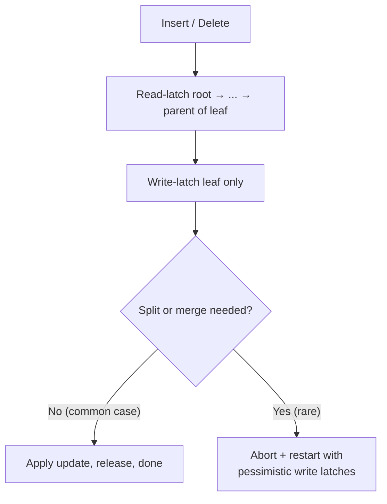

# 07 — Optimistic Latch Coupling (Better Latching)

## The problem with pessimistic crabbing

- Every update begins by taking a **write latch on the root**, which effectively puts the whole tree into single-threaded mode — nobody else can even take a read latch on the root [`47:15`](https://www.youtube.com/watch?v=lgUNTj0Q54M&t=2835) [`47:35`](https://www.youtube.com/watch?v=lgUNTj0Q54M&t=2855).

## The insight (Bayer–Schkolnick, ~1977–79)

- The root is **almost always safe**. Examples use 2 keys per node, but real nodes hold **hundreds** of keys, so the probability that any single insert/delete propagates to the root is very low [`47:35`](https://www.youtube.com/watch?v=lgUNTj0Q54M&t=2855) [`48:04`](https://www.youtube.com/watch?v=lgUNTj0Q54M&t=2884).

## The algorithm

| Operation | Protocol |
|---|---|
| **Find** | Read latches all the way down, releasing the parent on arriving at the child — unchanged [`50:03`](https://www.youtube.com/watch?v=lgUNTj0Q54M&t=3003) |
| **Insert / Delete** | **Read** latches down the whole path as if it were a find; take a **write** latch only on the leaf; then verify the assumption [`50:03`](https://www.youtube.com/watch?v=lgUNTj0Q54M&t=3003) [`50:28`](https://www.youtube.com/watch?v=lgUNTj0Q54M&t=3028) |

- If no split/merge is needed → do the update and you're done [`50:28`](https://www.youtube.com/watch?v=lgUNTj0Q54M&t=3028).
- If a split/merge **is** needed → **abort the operation, restart from the root, and redo it pessimistically** with write latches all the way down [`48:29`](https://www.youtube.com/watch?v=lgUNTj0Q54M&t=2909) [`50:28`](https://www.youtube.com/watch?v=lgUNTj0Q54M&t=3028).

## Worked examples

- **Delete 38**: read latches A → B → D → H, releasing each parent on arrival. At H the guess is confirmed — the node stays more than half full, so no merge — and the delete proceeds [`50:38`](https://www.youtube.com/watch?v=lgUNTj0Q54M&t=3038).
- **Insert into F**: read latches down to C, then at leaf F a split turns out to be required → **restart with write latches** [`51:29`](https://www.youtube.com/watch?v=lgUNTj0Q54M&t=3089).

## Why this wins

- The **write latch covers only one node at the bottom**, so descending readers on other branches are never pessimistically blocked — described as "a huge win" [`51:13`](https://www.youtube.com/watch?v=lgUNTj0Q54M&t=3073).

## Possible refinement (and its cost)

- You could track the last node that was potentially unsafe and take read latches only up to that point on retry, instead of blindly restarting — but maintaining that extra metadata could itself be slow [`51:43`](https://www.youtube.com/watch?v=lgUNTj0Q54M&t=3103).

## The same pattern elsewhere

- **Optimistic concurrency control** for transactions, invented at CMU: assume conflicts are rare, take the permissive fast path, verify at the end, fix yourself if wrong [`48:50`](https://www.youtube.com/watch?v=lgUNTj0Q54M&t=2930).
- **Intel TSX** (transactional memory, x86, 2010s): mark a block of C/C++ code transactional; on completion the hardware checks whether invariants were violated and rolls back to a single-threaded mode if so. Invented by Maurice Herlihy, formerly at CMU, who also invented linearizability. Intel later found a bug and **turned it off**, and as far as the lecturer knows it remains off [`49:14`](https://www.youtube.com/watch?v=lgUNTj0Q54M&t=2954).
- Most systems implement some variant of this optimistic algorithm [`52:10`](https://www.youtube.com/watch?v=lgUNTj0Q54M&t=3130).
