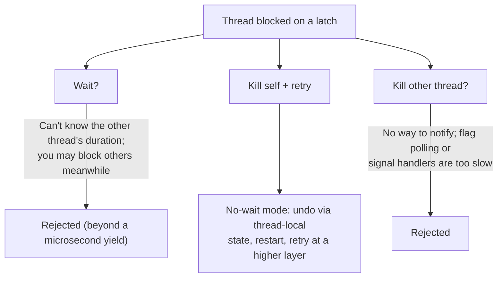

# 08 — Leaf Node Scans and Deadlock Handling

## Why deadlocks become possible

- Every traversal so far went **top-down only**, so no cycles were possible [`52:28`](https://www.youtube.com/watch?v=lgUNTj0Q54M&t=3148).
- Sibling pointers let threads move **left and right along the leaves**, so two threads can each hold the latch the other needs [`52:52`](https://www.youtube.com/watch?v=lgUNTj0Q54M&t=3172).
- (B-link trees add sibling pointers on inner nodes too; set aside here [`52:52`](https://www.youtube.com/watch?v=lgUNTj0Q54M&t=3172).)

## Sibling traversal still crabs

- Scanning `key > 4`: you do **not** release the latch on C until you hold the latch on the next leaf B, because you need to know the sibling pointer still points at the right node and nobody swapped it out [`53:18`](https://www.youtube.com/watch?v=lgUNTj0Q54M&t=3198) [`53:41`](https://www.youtube.com/watch?v=lgUNTj0Q54M&t=3221).
- **Two readers scanning in opposite directions is fine** — read latches are compatible, so they simply swap nodes [`53:41`](https://www.youtube.com/watch?v=lgUNTj0Q54M&t=3221) [`54:02`](https://www.youtube.com/watch?v=lgUNTj0Q54M&t=3242).
- **Reader vs writer is not**: T1 deletes 4 and holds leaf C in write mode; T2 scanning across cannot acquire C and is stuck [`54:37`](https://www.youtube.com/watch?v=lgUNTj0Q54M&t=3277) [`55:03`](https://www.youtube.com/watch?v=lgUNTj0Q54M&t=3303).

## The three options for a blocked thread

1. **Wait**
2. **Kill yourself** — abort the operation and retry, hoping the latch is free next time
3. **Kill the other thread** — take its latch [`55:03`](https://www.youtube.com/watch?v=lgUNTj0Q54M&t=3303) [`55:43`](https://www.youtube.com/watch?v=lgUNTj0Q54M&t=3343)

### Why "kill the other thread" is not viable

- You could reset the latch, but **how do you tell the other thread it no longer holds it?** [`56:00`](https://www.youtube.com/watch?v=lgUNTj0Q54M&t=3360)
- A global "kill yourself" flag doesn't work — you don't know when they'll check it, and checking before every line of code would be "impossibly slow" [`56:32`](https://www.youtube.com/watch?v=lgUNTj0Q54M&t=3392).
- Sending a signal requires an interrupt handler sprinkled through your code — "that's going to suck" [`56:32`](https://www.youtube.com/watch?v=lgUNTj0Q54M&t=3392).

### Why "wait" is not viable

- Students propose 100 ms, negotiated down to 1 ms — but the real problem is that **a thread has no idea what the other thread is doing** or how long it will take. With a billion keys, the other scan could be traversing leaves far away [`57:14`](https://www.youtube.com/watch?v=lgUNTj0Q54M&t=3434) [`58:38`](https://www.youtube.com/watch?v=lgUNTj0Q54M&t=3518) [`59:08`](https://www.youtube.com/watch?v=lgUNTj0Q54M&t=3548).
- Scale reference: **100 ms is roughly a round trip across the country; ~300 ms circles the globe** — enormous compared to the microsecond-scale node accesses in question. Don't do it [`1:04:00`](https://www.youtube.com/watch?v=lgUNTj0Q54M&t=3840).
- While you wait, you may be holding write latches on every node you already modified, blocking still more threads [`59:08`](https://www.youtube.com/watch?v=lgUNTj0Q54M&t=3548) [`1:00:05`](https://www.youtube.com/watch?v=lgUNTj0Q54M&t=3605).

## The answer: no-wait mode — kill yourself

- **The correct answer is to abort yourself and restart** [`59:08`](https://www.youtube.com/watch?v=lgUNTj0Q54M&t=3548) [`1:00:50`](https://www.youtube.com/watch?v=lgUNTj0Q54M&t=3650).
- A small sleep is acceptable — about **one round of scheduling / a thread yield, on the microsecond scale, never 100 ms** — before giving up [`1:00:24`](https://www.youtube.com/watch?v=lgUNTj0Q54M&t=3624) [`1:04:00`](https://www.youtube.com/watch?v=lgUNTj0Q54M&t=3840).
- Nuance: how long to tolerate can depend on how much work you've already done — a read-only scan throws away little, whereas a million updates is expensive to discard [`59:08`](https://www.youtube.com/watch?v=lgUNTj0Q54M&t=3548) [`1:00:50`](https://www.youtube.com/watch?v=lgUNTj0Q54M&t=3650).
- Contrast with transaction locks: there SQL is declarative, so the system knows what work each transaction has done and sometimes what it will do, enabling an informed choice of victim. At the nanosecond/microsecond scale of latches, that bookkeeping isn't affordable [`1:01:16`](https://www.youtube.com/watch?v=lgUNTj0Q54M&t=3676) [`1:01:52`](https://www.youtube.com/watch?v=lgUNTj0Q54M&t=3712).

## Rollback and retry mechanics

- A thread that kills itself undoes its own changes using **thread-local storage**: record each node modified and what was put in or taken out, then reverse it. The rollback must itself be atomic — no partial undo [`1:06:23`](https://www.youtube.com/watch?v=lgUNTj0Q54M&t=3983) [`1:06:54`](https://www.youtube.com/watch?v=lgUNTj0Q54M&t=4014).
- Retry lives **outside** the data structure: the code using the index has a while loop — retry on latch-acquisition failure, possibly with backoff; but do **not** retry unrecoverable errors like a unique-key violation, which is a high-level integrity error and gets reported [`1:03:00`](https://www.youtube.com/watch?v=lgUNTj0Q54M&t=3780).
- For chronic starvation, a **higher-level scheduler** notices a thread has failed a million times and deprioritizes other threads so it can finish. That logic must not live inside the data structure — otherwise every one of the hundreds of B+ trees in the system would replicate its own history tracking [`1:02:11`](https://www.youtube.com/watch?v=lgUNTj0Q54M&t=3731) [`1:06:12`](https://www.youtube.com/watch?v=lgUNTj0Q54M&t=3972).
- All of this is **transparent to the query**: the application never learns that a latch was retried 20 times — the query just runs slightly slower [`1:04:49`](https://www.youtube.com/watch?v=lgUNTj0Q54M&t=3889).
- Hard limit: if everyone updates the exact same key or page a billion times a second, **no scheduling magic fixes it** at the index level — that must be handled by transactions higher up. Cited example: the Taylor Swift ticket system crash, most likely from doing transactions the wrong way [`1:05:03`](https://www.youtube.com/watch?v=lgUNTj0Q54M&t=3903) [`1:05:21`](https://www.youtube.com/watch?v=lgUNTj0Q54M&t=3921).

## Scope caveat

- This lecture "barely scratched the surface" — enough for Project 2, but there are further optimizations such as **delaying updates** so splits/merges aren't done immediately (like the B-epsilon tree's per-node mod logs). Eventually reorganization is unavoidable, so latching is still required [`1:06:54`](https://www.youtube.com/watch?v=lgUNTj0Q54M&t=4014).
- The B+ tree techniques transfer to other structures — tries/ART, inverted indexes — though **skip lists are a different beast** [`1:06:54`](https://www.youtube.com/watch?v=lgUNTj0Q54M&t=4014).
