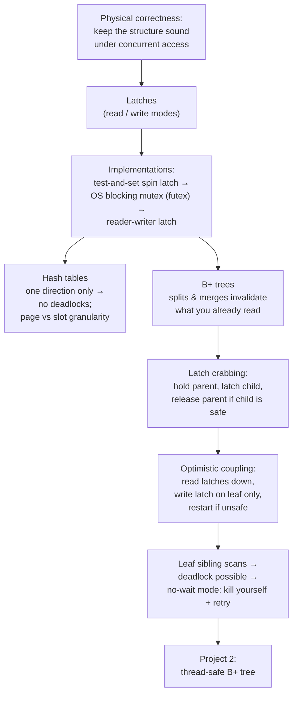

# #10 - Index Concurrency Control (CMU Intro to Database Systems)

*CMU Database Group · 1:16:42 · [Watch on YouTube](https://www.youtube.com/watch?v=lgUNTj0Q54M)*

## Summary

A university lecture (CMU 15-445/645, Fall 2024) that drops the single-threaded assumption made in all previous index lectures and shows how to make index data structures safe under concurrent access. It starts from first principles — locks vs latches, latch modes, and how latches are actually implemented on top of test-and-set spin locks, futexes and reader-writer locks — then applies them to hash tables (the easy case, where deadlock is impossible) and to B+ trees via **latch crabbing/coupling** and its **optimistic** variant. The final third covers what happens when leaf-node sibling scans make deadlock possible, arguing that the right answer is for a blocked thread to abort itself and retry, and closes with the requirements for Project 2, a thread-safe B+ tree.

## Topics

1. [Course Logistics and Announcements](01-course-logistics-and-announcements.md)
2. [Why Index Concurrency Control](02-why-index-concurrency-control.md)
3. [Locks vs Latches](03-locks-vs-latches.md)
4. [Implementing Latches](04-implementing-latches.md)
5. [Hash Table Latching](05-hash-table-latching.md)
6. [B+ Tree Latch Crabbing (Coupling)](06-bplus-tree-latch-crabbing.md)
7. [Optimistic Latch Coupling](07-optimistic-latch-coupling.md)
8. [Leaf Node Scans and Deadlock Handling](08-leaf-node-scans-and-deadlocks.md)
9. [Project 2: Thread-Safe B+ Tree Index](09-project-2-bplus-tree-index.md)

## Lecture structure

## Key takeaways

- This lecture is about **physical** correctness — a pointer must lead to a real page, not garbage — while **logical** correctness (can my thread see the data it should?) is deferred to the transactions material after the midterm [`6:44`](https://www.youtube.com/watch?v=lgUNTj0Q54M&t=404) [`7:15`](https://www.youtube.com/watch?v=lgUNTj0Q54M&t=435).
- Latches differ from locks on every axis: they protect workers rather than transactions, live inside the data structure's pages rather than a lock table, have only 2 modes instead of many, and handle deadlock **only by avoidance** — no background detector will bail you out [`12:18`](https://www.youtube.com/watch?v=lgUNTj0Q54M&t=738) [`11:36`](https://www.youtube.com/watch?v=lgUNTj0Q54M&t=696).
- Rolling your own latch measurably pays: WebKit's ParkingLot was reported **64× smaller and 180× faster** than pthread mutex in a micro-benchmark, and about **5–10% faster** on full workloads just from swapping the latch implementation [`17:46`](https://www.youtube.com/watch?v=lgUNTj0Q54M&t=1066) [`18:11`](https://www.youtube.com/watch?v=lgUNTj0Q54M&t=1091).
- Hash tables are the easy case: all threads probe in the same direction, so **deadlock is impossible** and a thread may release the previous latch *before* acquiring the next — precisely what B+ trees cannot do, since splits and merges can reorganize the path underneath a descending thread [`29:13`](https://www.youtube.com/watch?v=lgUNTj0Q54M&t=1753) [`32:37`](https://www.youtube.com/watch?v=lgUNTj0Q54M&t=1957).
- Without crabbing, a delete that steals a key from a sibling while a reader is descending produces a **false negative** — the reader follows a pointer that was valid when it read it and misses a key that exists [`35:55`](https://www.youtube.com/watch?v=lgUNTj0Q54M&t=2155).
- Ancestor latches should be released **top-down, not in reverse acquisition order**: both are correct, but releasing the root first frees the largest implicit subtree and maximizes parallelism — and deadlock isn't a concern since every traversal starts at the root [`41:02`](https://www.youtube.com/watch?v=lgUNTj0Q54M&t=2462) [`41:22`](https://www.youtube.com/watch?v=lgUNTj0Q54M&t=2482).
- Pessimistic crabbing write-latches the root on **every** update, effectively serializing the tree; optimistic coupling instead takes read latches down and a write latch on the leaf alone, restarting only when a split/merge is actually needed — safe because real nodes hold hundreds of keys, making root updates very rare [`47:35`](https://www.youtube.com/watch?v=lgUNTj0Q54M&t=2855) [`48:04`](https://www.youtube.com/watch?v=lgUNTj0Q54M&t=2884) [`51:13`](https://www.youtube.com/watch?v=lgUNTj0Q54M&t=3073).
- When leaf sibling scans create a genuine deadlock, the correct response is **no-wait mode: abort yourself and retry**. Killing the other thread is unimplementable (no cheap way to notify it), and waiting is wrong because you cannot know how long the other thread will take — 100 ms is a cross-country round trip against microsecond-scale node accesses [`1:00:50`](https://www.youtube.com/watch?v=lgUNTj0Q54M&t=3650) [`56:32`](https://www.youtube.com/watch?v=lgUNTj0Q54M&t=3392) [`1:04:00`](https://www.youtube.com/watch?v=lgUNTj0Q54M&t=3840).
- Retry logic and starvation handling belong **above** the index, not inside it — otherwise every one of the hundreds of B+ trees in the system would duplicate its own history tracking, and it's all invisible to the query [`1:02:11`](https://www.youtube.com/watch?v=lgUNTj0Q54M&t=3731) [`1:04:49`](https://www.youtube.com/watch?v=lgUNTj0Q54M&t=3889).
- Practical Project 2 guidance: use a **512-byte page size** to force splits/merges during testing, always protect the root page ID (a root split creates a new root), and follow the textbook over the slides when they disagree [`1:11:11`](https://www.youtube.com/watch?v=lgUNTj0Q54M&t=4271) [`1:11:32`](https://www.youtube.com/watch?v=lgUNTj0Q54M&t=4292) [`1:10:48`](https://www.youtube.com/watch?v=lgUNTj0Q54M&t=4248).
