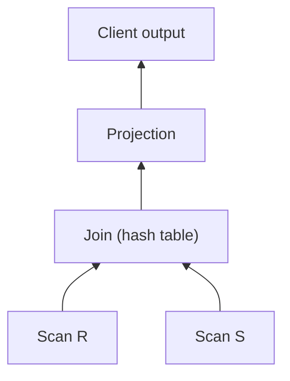

# 01 — Query Execution Context: Where Operators Fit

## Course logistics (skippable)

- Homework 3 due Sunday, solutions and graded responses out by the following Monday, ahead of the midterm the next Wednesday [`0:27`](https://www.youtube.com/watch?v=mM3sFwSuGNY&t=27).
- Project 2 comes after fall break (the 27th); an online study guide with a practice exam plus solutions and explanations is posted [`0:49`](https://www.youtube.com/watch?v=mM3sFwSuGNY&t=49).
- This lecture is on the midterm; Monday's class and everything after is not [`2:16`](https://www.youtube.com/watch?v=mM3sFwSuGNY&t=136).

## Where this lecture sits in the stack

- Storage, page layout and indexes are done; the next four lectures move up the stack to the low-level **operator algorithms** that execute queries [`1:14`](https://www.youtube.com/watch?v=mM3sFwSuGNY&t=74) [`1:41`](https://www.youtube.com/watch?v=mM3sFwSuGNY&t=101).
- The sequence: operator algorithms → how data moves between operators in a query plan → runtime architecture (multi-threaded vs multi-process). Single-node only for now; distributed execution comes later in the semester [`1:41`](https://www.youtube.com/watch?v=mM3sFwSuGNY&t=101).

## The query plan model

- SQL → parser → abstract syntax tree → query plan. The plan is usually a **tree** (a DAG would be better, but most systems don't do that) [`2:16`](https://www.youtube.com/watch?v=mM3sFwSuGNY&t=136).
- Leaf nodes read data from a source (table, file); data flows **upward** operator by operator; the root node's output is what the client receives [`2:16`](https://www.youtube.com/watch?v=mM3sFwSuGNY&t=136) [`3:01`](https://www.youtube.com/watch?v=mM3sFwSuGNY&t=181).
- The diagram deliberately says nothing about granularity, push vs pull, or batch size — those are covered after fall break [`3:01`](https://www.youtube.com/watch?v=mM3sFwSuGNY&t=181).

## The core constraint: intermediate results may not fit in memory

- Same assumption as the storage lectures: you cannot assume a table fits in RAM — and now you cannot assume **intermediate results** fit either [`3:54`](https://www.youtube.com/watch?v=mM3sFwSuGNY&t=234).
- Concrete example: 1 GB of memory but the join's hash table grows to 2 GB — the operator must spill [`4:17`](https://www.youtube.com/watch?v=mM3sFwSuGNY&t=257).
- The **buffer pool manager** (the same one built in Project 1) is reused to spill intermediate results to temp data on disk, preserving the illusion of more memory than exists [`4:17`](https://www.youtube.com/watch?v=mM3sFwSuGNY&t=257) [`4:40`](https://www.youtube.com/watch?v=mM3sFwSuGNY&t=280).

## The design rule that follows

- Because operators can spill, implementations prefer algorithms that **maximize sequential I/O and minimize random I/O** — random disk access is more expensive than reading a contiguous stride [`5:00`](https://www.youtube.com/watch?v=mM3sFwSuGNY&t=300) [`5:13`](https://www.youtube.com/watch?v=mM3sFwSuGNY&t=313).
- The DBMS manages memory itself rather than deferring to the OS, so it can deliberately pick sequential-friendly algorithms [`5:13`](https://www.youtube.com/watch?v=mM3sFwSuGNY&t=313).
