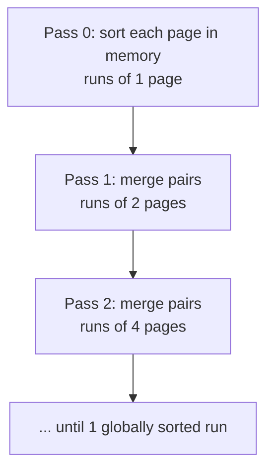

# 05 — Two-Way External Merge Sort

## Setup

- The "two" in **two-way** = the number of runs brought into memory and merged together to produce one new sorted run. A three-way merge brings in three pages [`19:52`](https://www.youtube.com/watch?v=mM3sFwSuGNY&t=1192).
- Memory budget must be declared up front — the example uses **3 buffer pool frames**: 2 for input, 1 for output [`21:19`](https://www.youtube.com/watch?v=mM3sFwSuGNY&t=1279) [`26:40`](https://www.youtube.com/watch?v=mM3sFwSuGNY&t=1600).
- Real systems want as much memory as possible (fewer passes), but a single sorting query must not thrash the buffer pool for everyone else — hence a **global knob**, overridable per query [`21:19`](https://www.youtube.com/watch?v=mM3sFwSuGNY&t=1279) [`22:15`](https://www.youtube.com/watch?v=mM3sFwSuGNY&t=1335).

## The passes

- **Pass 0**: read one page at a time, sort the keys within it, write the run back out. Repeat for every page [`22:15`](https://www.youtube.com/watch?v=mM3sFwSuGNY&t=1335). Result: runs of size 1 page [`25:21`](https://www.youtube.com/watch?v=mM3sFwSuGNY&t=1521).
- **Pass k**: recursively merge contiguous pairs of runs. Put a **cursor** on each input page, compare the two values under the cursors, write the smaller to the output buffer, advance that cursor [`22:43`](https://www.youtube.com/watch?v=mM3sFwSuGNY&t=1363) [`25:51`](https://www.youtube.com/watch?v=mM3sFwSuGNY&t=1551).
- When the output page fills, **write it to disk and immediately reuse the same frame** — the merge never reads back what it just wrote [`26:19`](https://www.youtube.com/watch?v=mM3sFwSuGNY&t=1579) [`32:30`](https://www.youtube.com/watch?v=mM3sFwSuGNY&t=1950).
- **Optimization**: an odd trailing run with no partner is already locally sorted — carry it straight to the next pass instead of reading and rewriting it [`26:40`](https://www.youtube.com/watch?v=mM3sFwSuGNY&t=1600) [`27:05`](https://www.youtube.com/watch?v=mM3sFwSuGNY&t=1625).
- Repeat until one globally sorted run remains [`27:29`](https://www.youtube.com/watch?v=mM3sFwSuGNY&t=1649).

## What is in memory at any moment

- Only **two input pages plus one output page**. Everything else lives on disk [`27:43`](https://www.youtube.com/watch?v=mM3sFwSuGNY&t=1663).

## Cost

- **Number of passes** = `1 + ⌈log₂ N⌉` — the `+1` is pass 0 producing size-1 runs; the `log₂ N` halves the work each pass, analogous to descending a B+Tree [`28:23`](https://www.youtube.com/watch?v=mM3sFwSuGNY&t=1703).
- **Total I/O cost** = `2N × (number of passes)`, where N is the number of pages — each page is read once and written once per pass [`28:54`](https://www.youtube.com/watch?v=mM3sFwSuGNY&t=1734).
- `log₂ N` sounds great in an algorithms class but is bad at a billion pages — the fix is to **raise the fan-in from 2 to B** so runs get bigger and passes fewer [`28:54`](https://www.youtube.com/watch?v=mM3sFwSuGNY&t=1734) [`29:25`](https://www.youtube.com/watch?v=mM3sFwSuGNY&t=1765).

## Q&A during the walkthrough

- **Can pass 0 be parallelized?** Yes — the per-page sorts are independent; the lecture just ignores workers/threads for simplicity [`23:08`](https://www.youtube.com/watch?v=mM3sFwSuGNY&t=1388).
- **Do you need extra disk pages?** Yes — scratch pages backed by the buffer pool, deallocated once a run is no longer needed [`23:26`](https://www.youtube.com/watch?v=mM3sFwSuGNY&t=1406).
- **How much extra disk?** Naively **3× the original table size** (sorted page + output page + original data), but discarding merged runs keeps it from becoming a storage problem [`23:54`](https://www.youtube.com/watch?v=mM3sFwSuGNY&t=1434).
- **Do you need double the disk for a very large table?** Yes — and the alternative, sorting in place, would be far slower. Disk is cheap; NVMe is fast and S3 storage costs are negligible for a one-time write [`24:18`](https://www.youtube.com/watch?v=mM3sFwSuGNY&t=1458) [`24:39`](https://www.youtube.com/watch?v=mM3sFwSuGNY&t=1479).
