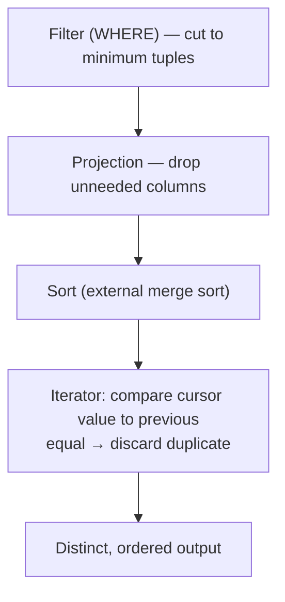

# 09 — Aggregations: Sorting vs Hashing

## What an aggregation needs

- Collapse a collection of values into a scalar: `COUNT`, `MIN`, `MAX`, `SUM`, etc. [`49:55`](https://www.youtube.com/watch?v=mM3sFwSuGNY&t=2995).
- The mechanical requirement: **quickly identify tuples that share the same group-by key** so they can be combined [`49:55`](https://www.youtube.com/watch?v=mM3sFwSuGNY&t=2995).
- Two implementation families: **sorting** and **hashing**. Hashing is covered in depth next class [`48:32`](https://www.youtube.com/watch?v=mM3sFwSuGNY&t=2912).

## The historical rivalry

- Called "a classic trade-off between these rival approaches." Over the last few decades the literature flipped repeatedly: sorting was faster, then hardware improved and hashing won, then sorting algorithms improved [`48:32`](https://www.youtube.com/watch?v=mM3sFwSuGNY&t=2912).
- **Current verdict: hashing is almost always better**, especially when the disk is slow [`48:32`](https://www.youtube.com/watch?v=mM3sFwSuGNY&t=2912) [`49:33`](https://www.youtube.com/watch?v=mM3sFwSuGNY&t=2973).
- **The exception**: when the query already has an `ORDER BY`, sorting the data once serves both the aggregation and the ordering — "you get the order by clause satisfied for free," a big combined win [`49:16`](https://www.youtube.com/watch?v=mM3sFwSuGNY&t=2956) [`49:33`](https://www.youtube.com/watch?v=mM3sFwSuGNY&t=2973).

## Sorting-based aggregation: the `DISTINCT` example

Query has both `ORDER BY` and `DISTINCT` on `cid`, so sorting kills two birds with one stone [`50:16`](https://www.youtube.com/watch?v=mM3sFwSuGNY&t=3016).

- Filter first, project away unneeded columns, then sort, then run a single iterator that drops a value whenever it equals the previous one [`50:16`](https://www.youtube.com/watch?v=mM3sFwSuGNY&t=3016) [`51:09`](https://www.youtube.com/watch?v=mM3sFwSuGNY&t=3069).

## Why hashing wins when order isn't required

- Hashing locates matching keys directly instead of scanning everything [`51:09`](https://www.youtube.com/watch?v=mM3sFwSuGNY&t=3069).
- The decisive property when spilling: **if a key hashed into a different bucket, it cannot be a match**, so you never have to fetch spilled pages back in to check for duplicates [`51:09`](https://www.youtube.com/watch?v=mM3sFwSuGNY&t=3069) [`51:50`](https://www.youtube.com/watch?v=mM3sFwSuGNY&t=3110) [`52:23`](https://www.youtube.com/watch?v=mM3sFwSuGNY&t=3143).
- Same divide-and-conquer shape as external merge sort, but "almost always going to be way cheaper than having to sort things ahead of time." The lecturer upgrades his own hedge: "not almost always — **always**", when the data doesn't need to be sorted [`51:50`](https://www.youtube.com/watch?v=mM3sFwSuGNY&t=3110) [`52:23`](https://www.youtube.com/watch?v=mM3sFwSuGNY&t=3143).
