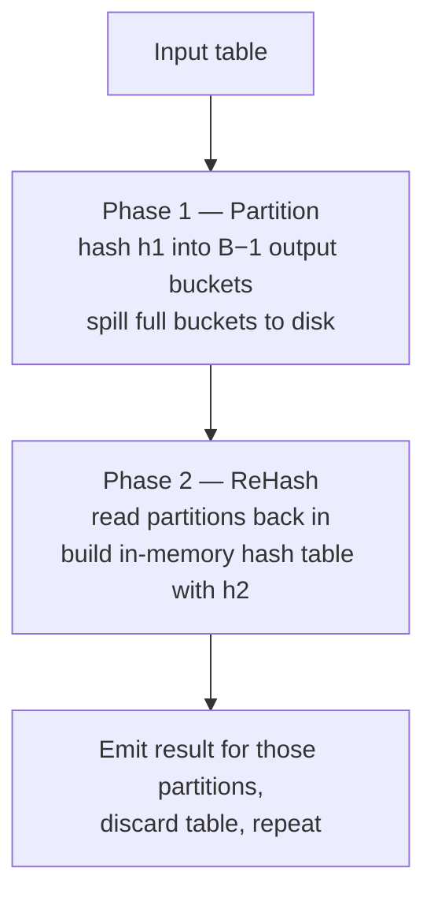

# 10 — External Hash Aggregation

## In-memory case

- Build a hash table keyed on the group-by key; the value is whatever the aggregate needs (running total, sum, min, max) [`52:36`](https://www.youtube.com/watch?v=mM3sFwSuGNY&t=3156).
- Scan the table once, probe the hash table, and act per aggregate — for `DISTINCT`, if the key already exists, throw the incoming key away [`52:36`](https://www.youtube.com/watch?v=mM3sFwSuGNY&t=3156).
- One scan, done. The problem is only when the hash table grows too large [`53:10`](https://www.youtube.com/watch?v=mM3sFwSuGNY&t=3190).

## The two-phase external algorithm

**Phase 1 — Partition** [`53:29`](https://www.youtube.com/watch?v=mM3sFwSuGNY&t=3209) [`53:56`](https://www.youtube.com/watch?v=mM3sFwSuGNY&t=3236) [`54:29`](https://www.youtube.com/watch?v=mM3sFwSuGNY&t=3269):
- Scan the data once, hash each tuple on the aggregation key with hash function **h1**, write into unordered buckets.
- When a bucket fills, spill it to disk and reuse the frame. Once written out, that data is never revisited during phase 1 [`56:02`](https://www.youtube.com/watch?v=mM3sFwSuGNY&t=3362).

**Phase 2 — ReHash** [`53:56`](https://www.youtube.com/watch?v=mM3sFwSuGNY&t=3236) [`56:16`](https://www.youtube.com/watch?v=mM3sFwSuGNY&t=3376) [`56:29`](https://www.youtube.com/watch?v=mM3sFwSuGNY&t=3389):
- Bring partitions back in one group at a time, hash them again with **h2** into an in-memory hash table sized to fit the available buffers.
- Emit that group's portion of the final result, discard the hash table, allocate a new one, and continue with the next partitions [`57:13`](https://www.youtube.com/watch?v=mM3sFwSuGNY&t=3433) [`57:50`](https://www.youtube.com/watch?v=mM3sFwSuGNY&t=3470).

## Buffer allocation is the mirror image of external merge sort

| | External merge sort | External hash aggregation |
|---|---|---|
| Input buffers | `B − 1` | 1 |
| Output buffers | 1 | `B − 1` |
| Data shape | Fan-**in**: many runs collapse to one stride | Fan-**out**: one stride splits into many partitions |

[`54:29`](https://www.youtube.com/watch?v=mM3sFwSuGNY&t=3269) [`54:54`](https://www.youtube.com/watch?v=mM3sFwSuGNY&t=3294) [`55:17`](https://www.youtube.com/watch?v=mM3sFwSuGNY&t=3317)

## The correctness guarantee

- Once a group of partitions is processed, it never needs revisiting: another matching key **cannot exist** on some other page, because h1 would have placed it in the same bucket. No stray record can corrupt the aggregate [`56:54`](https://www.youtube.com/watch?v=mM3sFwSuGNY&t=3414) [`58:59`](https://www.youtube.com/watch?v=mM3sFwSuGNY&t=3539) [`59:24`](https://www.youtube.com/watch?v=mM3sFwSuGNY&t=3564).
- The net effect: replace random I/O over a giant hash table with **sequential I/O over memory-sized chunks** [`58:28`](https://www.youtube.com/watch?v=mM3sFwSuGNY&t=3508).

## Aggregate values in the hash table

- For `DISTINCT` the hash table is effectively a **set** — the value is nothing, just "does this key exist" [`57:13`](https://www.youtube.com/watch?v=mM3sFwSuGNY&t=3433) [`58:28`](https://www.youtube.com/watch?v=mM3sFwSuGNY&t=3508).
- For real aggregates, the key points at a running value that gets updated on each probe, or installed if absent [`1:00:23`](https://www.youtube.com/watch?v=mM3sFwSuGNY&t=3623).
- Example — `AVG(GPA) GROUP BY cid`: store **(count, running sum)** per key, then divide sum by count at output time [`1:00:52`](https://www.youtube.com/watch?v=mM3sFwSuGNY&t=3652) [`1:01:15`](https://www.youtube.com/watch?v=mM3sFwSuGNY&t=3675).
- `MIN`/`MAX` keep the lowest/highest seen; `SUM` accumulates; `COUNT` increments by one. **All aggregations can be computed this way** [`1:01:40`](https://www.youtube.com/watch?v=mM3sFwSuGNY&t=3700).

## Q&A

- **Why throw away the phase-2 hash table and build a new one?** Because you no longer need that memory, and the table may be large [`59:24`](https://www.youtube.com/watch?v=mM3sFwSuGNY&t=3564).
- **Multiple rehashing rounds?** Yes — if many keys hash into the same buckets (data skew), pick another hash function and repartition again. This is **recursive hashing**, covered next class [`59:40`](https://www.youtube.com/watch?v=mM3sFwSuGNY&t=3580) [`1:00:08`](https://www.youtube.com/watch?v=mM3sFwSuGNY&t=3608).
- **Must phase-1 buckets hold one distinct key each?** No — collisions are fine in both phases. It's an ordinary linear-probe hash table (or cuckoo, or whatever you prefer); the hashing scheme handles collisions exactly as in earlier lectures [`1:02:50`](https://www.youtube.com/watch?v=mM3sFwSuGNY&t=3770) [`1:03:20`](https://www.youtube.com/watch?v=mM3sFwSuGNY&t=3800) [`1:04:00`](https://www.youtube.com/watch?v=mM3sFwSuGNY&t=3840).
- **Where does the final result live?** Not in the hash table — the client can't consume that. Each operator in the plan gets **output buffers**. Some systems stream results as soon as they're available, but **most block until the output buffer is full**, then return [`1:04:11`](https://www.youtube.com/watch?v=mM3sFwSuGNY&t=3851) [`1:04:44`](https://www.youtube.com/watch?v=mM3sFwSuGNY&t=3884).
- **`SELECT * FROM table` on a billion rows** will start paging as it writes buffers over the wire protocol — this is why systems ship built-in export functions that stream instead [`1:05:12`](https://www.youtube.com/watch?v=mM3sFwSuGNY&t=3912).

## Closing takeaway and what's next

- **Hashing beats sorting when you must spill**, because divide-and-conquer converts what would be random I/O into sequential I/O [`1:01:40`](https://www.youtube.com/watch?v=mM3sFwSuGNY&t=3700) [`1:02:09`](https://www.youtube.com/watch?v=mM3sFwSuGNY&t=3729).
- Next class: **joins**, where the sorting-vs-hashing distinction matters most — joins on very large tables are where databases spend most of their time [`1:02:09`](https://www.youtube.com/watch?v=mM3sFwSuGNY&t=3729).
- The optimizations from this lecture — chunking to amortize cost, double buffering — carry over to hashing, joins, and other computations [`1:02:34`](https://www.youtube.com/watch?v=mM3sFwSuGNY&t=3754).
