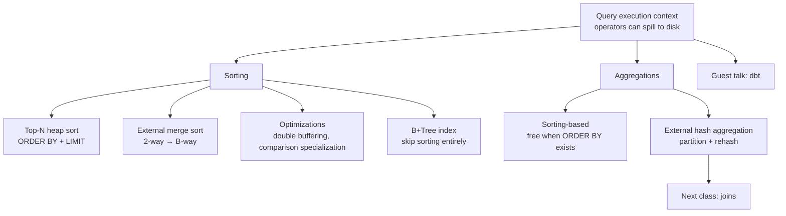

# #11 - Sorting & Aggregation Algorithms ✸ dbt Database Talk (CMU Intro to Database Systems)

*CMU Database Group · 1:17:56 · [Watch on YouTube](https://www.youtube.com/watch?v=mM3sFwSuGNY)*

## Summary

Lecture 11 of CMU 15-445/645 (Fall 2024) moves up the stack from storage and indexes into **query execution**, covering the operator algorithms a DBMS uses when intermediate results are too large to fit in memory. Andy Pavlo works through top-N heap sort, external merge sort (its two-way form, its generalized B-way cost model, double buffering, and comparison-specialization optimizations), when a B+Tree index can replace sorting entirely, and then applies the same divide-and-conquer thinking to aggregations — contrasting sorting-based aggregation with external hash aggregation. The lecture closes with a guest talk from Drew, co-founder of dbt Labs, on bringing software-engineering practice — version control, lineage, CI/CD, testing, documentation — to data teams.

**Type**: university lecture (educational) + guest industry talk.

## Topics

1. [Query Execution Context: Where Operators Fit](./01-query-execution-context.md) — [`0:27`](https://www.youtube.com/watch?v=mM3sFwSuGNY&t=27)
2. [Why Sorting Is a DBMS Backbone](./02-why-sorting-matters.md) — [`5:33`](https://www.youtube.com/watch?v=mM3sFwSuGNY&t=333)
3. [Top-N Heap Sort](./03-top-n-heap-sort.md) — [`10:18`](https://www.youtube.com/watch?v=mM3sFwSuGNY&t=618)
4. [External Merge Sort: Fundamentals and Materialization](./04-external-merge-sort-fundamentals.md) — [`14:13`](https://www.youtube.com/watch?v=mM3sFwSuGNY&t=853)
5. [Two-Way External Merge Sort](./05-two-way-external-merge-sort.md) — [`21:19`](https://www.youtube.com/watch?v=mM3sFwSuGNY&t=1279)
6. [General B-Way Merge Sort and Its Cost](./06-general-b-way-merge-sort-and-cost.md) — [`29:58`](https://www.youtube.com/watch?v=mM3sFwSuGNY&t=1798)
7. [Sort Optimizations: Double Buffering and Cheaper Comparisons](./07-sort-optimizations.md) — [`34:59`](https://www.youtube.com/watch?v=mM3sFwSuGNY&t=2099)
8. [Using B+Tree Indexes Instead of Sorting](./08-sorting-with-b-plus-tree-indexes.md) — [`41:44`](https://www.youtube.com/watch?v=mM3sFwSuGNY&t=2504)
9. [Aggregations: Sorting vs Hashing](./09-aggregations-sorting-vs-hashing.md) — [`48:32`](https://www.youtube.com/watch?v=mM3sFwSuGNY&t=2912)
10. [External Hash Aggregation](./10-external-hash-aggregation.md) — [`52:36`](https://www.youtube.com/watch?v=mM3sFwSuGNY&t=3156)
11. [Guest Talk: Drew from dbt Labs](./11-guest-talk-dbt.md) — [`1:05:39`](https://www.youtube.com/watch?v=mM3sFwSuGNY&t=3939)

## Key takeaways

- **Operators must assume intermediate results spill to disk**, so the DBMS reuses the buffer pool for temp data and deliberately picks algorithms that maximize sequential I/O and minimize random I/O — that single constraint drives every algorithm in this lecture [`4:17`](https://www.youtube.com/watch?v=mM3sFwSuGNY&t=257) [`5:00`](https://www.youtube.com/watch?v=mM3sFwSuGNY&t=300).
- **Top-N heap sort sorts nothing and needs ~2 buffer frames**: with `ORDER BY` + `LIMIT`, a single pass and a small priority queue produce the answer, skipping any value worse than the current heap maximum. Postgres implements it; leaderboards are the canonical workload [`12:50`](https://www.youtube.com/watch?v=mM3sFwSuGNY&t=770) [`13:17`](https://www.youtube.com/watch?v=mM3sFwSuGNY&t=797) [`13:42`](https://www.youtube.com/watch?v=mM3sFwSuGNY&t=822).
- **External merge sort costs `2N × passes`**, with `1 + ⌈log₂ N⌉` passes at fan-in 2; widening the fan-in to `B − 1` is what makes it viable at scale. Worked example: **108 pages with 5 buffers sorts in 4 passes** (22 runs → 6 → 2 → 1) [`28:23`](https://www.youtube.com/watch?v=mM3sFwSuGNY&t=1703) [`28:54`](https://www.youtube.com/watch?v=mM3sFwSuGNY&t=1734) [`33:37`](https://www.youtube.com/watch?v=mM3sFwSuGNY&t=2017) [`34:14`](https://www.youtube.com/watch?v=mM3sFwSuGNY&t=2054).
- **Fewer wide passes beat parallel narrow merges.** Running many two-way merges in parallel still incurs many passes of re-reading and re-writing; spending all memory on one wide merge shrinks the tree and wins even with parallel I/O [`31:35`](https://www.youtube.com/watch?v=mM3sFwSuGNY&t=1895) [`32:07`](https://www.youtube.com/watch?v=mM3sFwSuGNY&t=1927).
- **Double buffering halves usable memory to hide I/O latency** — a large win when disk writes take tens (or hundreds, on S3) of milliseconds, and much less useful on fast disks. It requires non-blocking I/O in the disk manager [`35:10`](https://www.youtube.com/watch?v=mM3sFwSuGNY&t=2110) [`36:50`](https://www.youtube.com/watch?v=mM3sFwSuGNY&t=2210) [`37:55`](https://www.youtube.com/watch?v=mM3sFwSuGNY&t=2275).
- **Comparison cost is a real optimization target**: function-pointer jumps executed a billion times are expensive. Postgres solves it at compile time with a **Perl script that duplicates its sort implementation per data type** — the C substitute for C++ templates; long strings can additionally be compared by prefix first [`38:59`](https://www.youtube.com/watch?v=mM3sFwSuGNY&t=2339) [`39:55`](https://www.youtube.com/watch?v=mM3sFwSuGNY&t=2395) [`40:49`](https://www.youtube.com/watch?v=mM3sFwSuGNY&t=2449).
- **An order-preserving index beats every sort algorithm, including top-N heap sort**, because it fetches exactly the minimum pages instead of scanning all of them — but only if the index is clustered (or index-organized); unclustered indexes turn ordered retrieval into random I/O, except for small top-N results. **Postgres requires an exact index match on the `ORDER BY` columns; Oracle and enterprise systems do not** [`42:07`](https://www.youtube.com/watch?v=mM3sFwSuGNY&t=2527) [`43:19`](https://www.youtube.com/watch?v=mM3sFwSuGNY&t=2599) [`44:58`](https://www.youtube.com/watch?v=mM3sFwSuGNY&t=2698).
- **Hashing beats sorting for aggregation whenever the data must spill** — the partition step guarantees matching keys land in the same bucket, so spilled data is never re-read to check for matches. The exception is a query that already has `ORDER BY`, where one sort satisfies both the aggregation and the ordering for free [`49:16`](https://www.youtube.com/watch?v=mM3sFwSuGNY&t=2956) [`51:50`](https://www.youtube.com/watch?v=mM3sFwSuGNY&t=3110) [`1:02:09`](https://www.youtube.com/watch?v=mM3sFwSuGNY&t=3729).
- **External hash aggregation is the exact buffer mirror of external merge sort**: 1 input buffer + `B − 1` output buffers (fan-out) versus `B − 1` inputs + 1 output (fan-in). Every aggregate — `AVG` as (count, sum), `MIN`/`MAX`, `SUM`, `COUNT` — reduces to a running value in the phase-2 hash table [`54:54`](https://www.youtube.com/watch?v=mM3sFwSuGNY&t=3294) [`55:17`](https://www.youtube.com/watch?v=mM3sFwSuGNY&t=3317) [`1:01:40`](https://www.youtube.com/watch?v=mM3sFwSuGNY&t=3700).
- **dbt's core insight**: Snowflake and most commercial data warehouses **do not enforce uniqueness or not-null constraints** — they only use them for query optimization — so dbt turns those into asserted, automatically run tests, and infers lineage automatically from Jinja `ref`/`source` calls rather than requiring manual declaration [`1:12:27`](https://www.youtube.com/watch?v=mM3sFwSuGNY&t=4347) [`1:13:26`](https://www.youtube.com/watch?v=mM3sFwSuGNY&t=4406).
- **Those tests run on your warehouse bill, not dbt's** — dbt executes the queries you tell it to, so inefficiency is expensive; mitigations like checking only the last seven days exist, and the justification is that bad data has cost companies millions to billions [`1:16:06`](https://www.youtube.com/watch?v=mM3sFwSuGNY&t=4566) [`1:16:28`](https://www.youtube.com/watch?v=mM3sFwSuGNY&t=4588).
