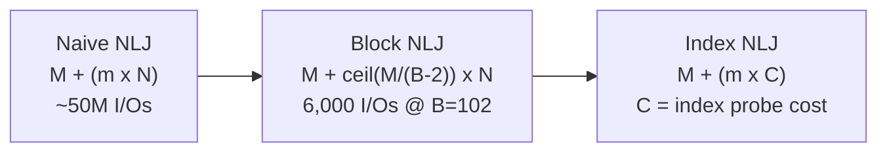

# 03 — Nested Loop Joins (Naive, Block, Index)

Shared example tables used for every cost calculation ([`22:33`](https://www.youtube.com/watch?v=MFazkaZKs1s&t=1353)):

- **R (outer)**: `M = 1,000` pages, `m = 100,000` tuples
- **S (inner)**: `N = 500` pages, `n = 40,000` tuples
- Assumed disk: **0.1 ms per I/O** (SSD) ([`23:04`](https://www.youtube.com/watch?v=MFazkaZKs1s&t=1384))

## 1. Naive nested loop join

- Two for-loops: for every tuple in R, scan every tuple in S; emit on match ([`19:48`](https://www.youtube.com/watch?v=MFazkaZKs1s&t=1188)).
- **Origin of the terminology**: the outer for-loop is the *outer table*, the inner loop the *inner table*; in most plans the left child is outer, right is inner (Snowflake flips it; SQL Server draws it horizontally) ([`20:24`](https://www.youtube.com/watch?v=MFazkaZKs1s&t=1224), [`20:55`](https://www.youtube.com/watch?v=MFazkaZKs1s&t=1255)).
- Andy's verdict: **"don't do this, this is stupid"** — it ignores that data is stored in pages, so the same page gets fetched over and over ([`21:17`](https://www.youtube.com/watch?v=MFazkaZKs1s&t=1277), [`21:39`](https://www.youtube.com/watch?v=MFazkaZKs1s&t=1299)).

**Cost = `M + (m × N)`** ([`21:55`](https://www.youtube.com/watch?v=MFazkaZKs1s&t=1315))

| Configuration | I/Os | Time |
|---|---|---|
| R outer, S inner | ~50,000,000 | **1.3 hours** ([`22:33`](https://www.youtube.com/watch?v=MFazkaZKs1s&t=1353), [`23:04`](https://www.youtube.com/watch?v=MFazkaZKs1s&t=1384)) |
| S outer (smaller first) | ~40,000,000 | **1.1 hours** ([`23:28`](https://www.youtube.com/watch?v=MFazkaZKs1s&t=1408)) |

- Reality check: at 4 KB pages, S is only ~6 MB — it would sit in L3 cache. The algorithm is catastrophic only because it works one tuple at a time ([`23:44`](https://www.youtube.com/watch?v=MFazkaZKs1s&t=1424)).

## 2. Block nested loop join

- Loop over **blocks (pages)** instead of tuples: outer loop over R's blocks, inner loop over S's blocks, then in-memory loops inside the two blocks ([`24:29`](https://www.youtube.com/watch?v=MFazkaZKs1s&t=1469), [`25:00`](https://www.youtube.com/watch?v=MFazkaZKs1s&t=1500)).
- **Block = page** — same thing, DB calls it a page, hardware calls it a block ([`25:43`](https://www.youtube.com/watch?v=MFazkaZKs1s&t=1543), [`27:30`](https://www.youtube.com/watch?v=MFazkaZKs1s&t=1650)).
- **Cost with one frame per side = `M + (M × N)`** — the inner table is now scanned `M` times instead of `m` times ([`25:00`](https://www.youtube.com/watch?v=MFazkaZKs1s&t=1500)).
- Cost is driven by **pages, not tuples**: a nearly empty page still costs a fetch ([`26:05`](https://www.youtube.com/watch?v=MFazkaZKs1s&t=1565), [`26:31`](https://www.youtube.com/watch?v=MFazkaZKs1s&t=1591)).

### Using the whole buffer pool

- Allocate `B − 2` frames to the outer table, 1 frame for the inner table, 1 frame for the output buffer ([`26:59`](https://www.youtube.com/watch?v=MFazkaZKs1s&t=1619), [`27:30`](https://www.youtube.com/watch?v=MFazkaZKs1s&t=1650)).
- **Cost = `M + (⌈M / (B − 2)⌉ × N)`** ([`27:45`](https://www.youtube.com/watch?v=MFazkaZKs1s&t=1665)).

| Buffers | I/Os | Notes |
|---|---|---|
| small `B` | ~1,500 quoted (~150 ms) | "reasonable, not great" ([`28:11`](https://www.youtube.com/watch?v=MFazkaZKs1s&t=1691), [`28:29`](https://www.youtube.com/watch?v=MFazkaZKs1s&t=1709)) |
| `B = 102` pages | **6,000** | R outer ([`28:29`](https://www.youtube.com/watch?v=MFazkaZKs1s&t=1709)) |
| `B = 102` pages | **5,500** | S outer (smaller table outer) ([`29:05`](https://www.youtube.com/watch?v=MFazkaZKs1s&t=1745)) |

- What this really does: **one sequential scan of the outer table, plus one sequential scan of the inner table per batch of outer pages** ([`29:05`](https://www.youtube.com/watch?v=MFazkaZKs1s&t=1745)).
- Good enough for small datasets, but usually still the wrong algorithm ([`29:22`](https://www.youtube.com/watch?v=MFazkaZKs1s&t=1762)).
- Core weakness: it is **blind needle-in-a-haystack searching** ([`29:41`](https://www.youtube.com/watch?v=MFazkaZKs1s&t=1781)).

## 3. Index nested loop join

- Replace the inner loop with a **probe into an index** on the inner table's join key ([`29:41`](https://www.youtube.com/watch?v=MFazkaZKs1s&t=1781), [`31:30`](https://www.youtube.com/watch?v=MFazkaZKs1s&t=1890)).
- The index type is unspecified — B+Tree, hash table, or trie; all that matters is point-query lookup ([`31:30`](https://www.youtube.com/watch?v=MFazkaZKs1s&t=1890)).
- After the probe, extra join predicates the index does not cover are evaluated on the fetched tuple before emitting ([`32:10`](https://www.youtube.com/watch?v=MFazkaZKs1s&t=1930)).
- **Cost = `M + (m × C)`**, where `C` is the constant cost of one index probe — `log n` for a B+Tree, ~O(1) for a hash table. It cannot be pinned down analytically because the index type is unknown ([`32:48`](https://www.youtube.com/watch?v=MFazkaZKs1s&t=1968), [`33:06`](https://www.youtube.com/watch?v=MFazkaZKs1s&t=1986)).

### Building the index on the fly

- **SQL Server "spool indexes"**: builds a B+Tree during the query, probes it, then throws it away; it can even hint that you should create the index permanently ([`30:08`](https://www.youtube.com/watch?v=MFazkaZKs1s&t=1808)).
- When is that worth it? The optimizer estimates the hypothetical build cost and compares it against hash join / sort-merge join — sometimes building the index still beats the naive or block scans ([`30:42`](https://www.youtube.com/watch?v=MFazkaZKs1s&t=1842)).

## Takeaways for nested loop joins ([`33:26`](https://www.youtube.com/watch?v=MFazkaZKs1s&t=2006))

- It is the **building block** for more complex joins.
- Always make the **smaller table the outer table**.
- Keep as much of the outer table in memory as possible to avoid re-scanning it ([`33:47`](https://www.youtube.com/watch?v=MFazkaZKs1s&t=2027)).

