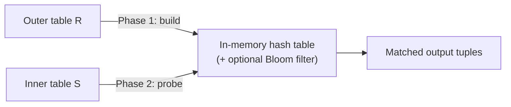

# 05 — Simple Hash Join and Bloom Filter Optimization

## Core idea

- Equal keys hash to the same location, so a hash table built on one side turns the join into lookups ([`45:17`](https://www.youtube.com/watch?v=MFazkaZKs1s&t=2717)).
- Conceptually identical to a B+Tree probe, but with a key difference in orientation: **build the hash table on the outer table, probe it with the inner table** — the reverse of index nested loop join, which probes an index on the inner table ([`45:56`](https://www.youtube.com/watch?v=MFazkaZKs1s&t=2756)).

## Two phases

1. **Build**: scan the outer table, hash the join key, insert into an in-memory hash table ([`46:15`](https://www.youtube.com/watch?v=MFazkaZKs1s&t=2775)).
2. **Probe**: scan the inner table, probe the hash table, emit matches ([`46:38`](https://www.youtube.com/watch?v=MFazkaZKs1s&t=2798)).

- Structurally two **non-nested** for-loops, unlike nested loop join ([`46:52`](https://www.youtube.com/watch?v=MFazkaZKs1s&t=2812)).
- Any hash table scheme works — cuckoo, chained, linear probing. **Linear probing is usually fastest because it is simplest** ([`46:15`](https://www.youtube.com/watch?v=MFazkaZKs1s&t=2775)).
- The hash table lives **in memory, deliberately not backed by the buffer pool**, because probing is random I/O ([`47:07`](https://www.youtube.com/watch?v=MFazkaZKs1s&t=2827)).

## Bloom filter optimization

- Build a **Bloom filter alongside the hash table** during the build phase; probe the filter first during the probe phase and skip the hash table entirely on a negative ([`47:27`](https://www.youtube.com/watch?v=MFazkaZKs1s&t=2847), [`47:59`](https://www.youtube.com/watch?v=MFazkaZKs1s&t=2879)).
- Rationale: a filter probe is **far cheaper than a hash table probe**, and Bloom filters usually **fit in CPU cache** ([`48:27`](https://www.youtube.com/watch?v=MFazkaZKs1s&t=2907), [`48:42`](https://www.youtube.com/watch?v=MFazkaZKs1s&t=2922)).
- **Biggest win when join keys rarely match** — you discard most inner tuples without ever touching the hash table ([`48:42`](https://www.youtube.com/watch?v=MFazkaZKs1s&t=2922)).
- This technique is called **sideways information passing**: one side of the join passes information to its sibling. It bends the tree-shaped dataflow but does **not** violate the relational model ([`52:39`](https://www.youtube.com/watch?v=MFazkaZKs1s&t=3159)).

## Q&A: why pay to hash at all?

- **Hash match is not enough** — you still perform a full byte-by-byte key comparison, because different keys can collide ([`49:41`](https://www.youtube.com/watch?v=MFazkaZKs1s&t=2981)).
- The real argument: without a hash table, finding a key on the build side means a **sequential scan of unsorted data — that is nested loop join, which sucks**. The hash table is **an index built on the fly** that lands you in the proximity of the match so you compare far fewer things ([`50:30`](https://www.youtube.com/watch?v=MFazkaZKs1s&t=3030), [`50:53`](https://www.youtube.com/watch?v=MFazkaZKs1s&t=3053), [`51:18`](https://www.youtube.com/watch?v=MFazkaZKs1s&t=3078)).
- **Versus index nested loop join**: yes, the difference is build-on-the-fly vs pre-existing index — but hash join can additionally **handle spilling to disk**, which index nested loop join cannot do well. For equality predicates the on-the-fly hash table is **almost always preferable to a B+Tree** ([`51:31`](https://www.youtube.com/watch?v=MFazkaZKs1s&t=3091), [`51:54`](https://www.youtube.com/watch?v=MFazkaZKs1s&t=3114)).
- No free lunch: to find matches you either sequentially scan, build a structure, or reuse an existing one ([`52:22`](https://www.youtube.com/watch?v=MFazkaZKs1s&t=3142)).

## Limitation that motivates the next topic

- Simple hash join only works when the **hash table fits in memory** ([`53:09`](https://www.youtube.com/watch?v=MFazkaZKs1s&t=3189)).
- If it does not, you must not let the buffer pool swap it: hashing randomizes locality, so probes scatter and the buffer pool **thrashes** ([`53:27`](https://www.youtube.com/watch?v=MFazkaZKs1s&t=3207), [`53:46`](https://www.youtube.com/watch?v=MFazkaZKs1s&t=3226)).
