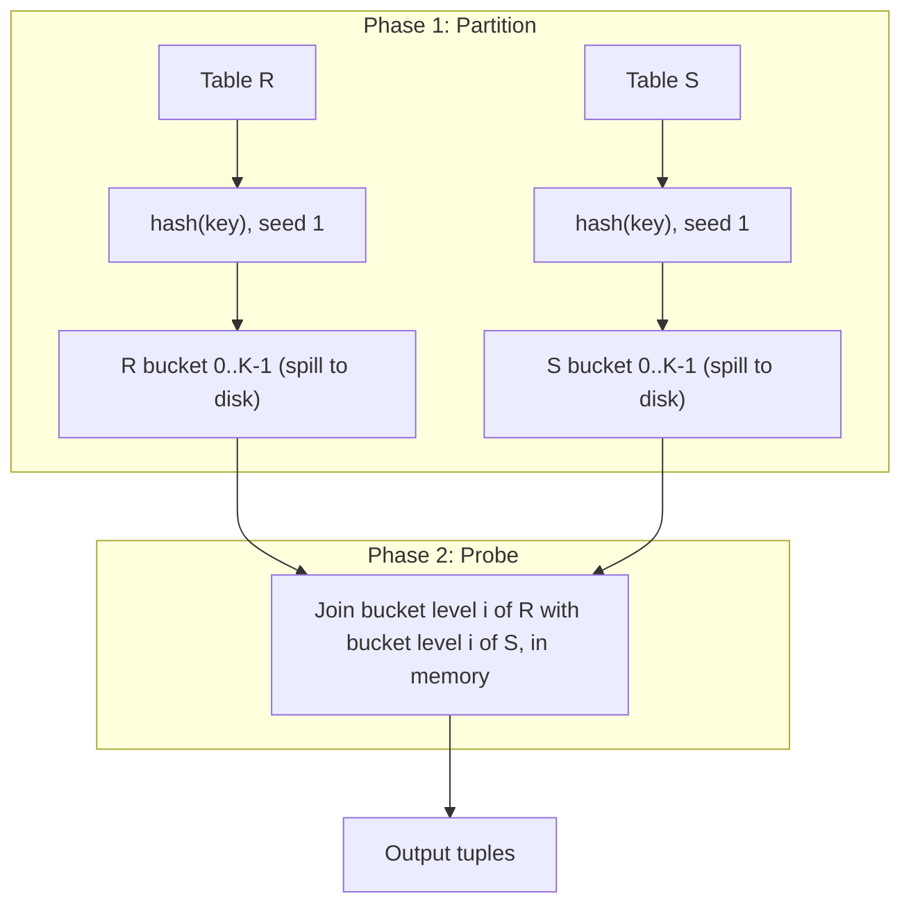

# 06 — Partitioned (Grace) Hash Join, Recursive Partitioning, Hybrid Hash Join

## Partitioned hash join

- Same divide-and-conquer trick used for hash aggregations last lecture: **partition both tables into K buckets, spill buckets to disk, then join bucket-by-bucket in memory** ([`53:57`](https://www.youtube.com/watch?v=MFazkaZKs1s&t=3237)).
- Correctness guarantee: a matching tuple **must land in the same bucket level on both sides**, so no cross-bucket comparisons are needed ([`53:57`](https://www.youtube.com/watch?v=MFazkaZKs1s&t=3237), [`58:24`](https://www.youtube.com/watch?v=MFazkaZKs1s&t=3504)).
- Also called **Grace hash join** — from the Japanese group that built the **GRACE database machine** in the 1980s; **essentially every system implements it** ([`54:28`](https://www.youtube.com/watch?v=MFazkaZKs1s&t=3268), [`54:28`](https://www.youtube.com/watch?v=MFazkaZKs1s&t=3268)).
- Within a bucket pair you can either build another in-memory hash table **or just run a block nested loop join** — everything is in memory, so it is fast either way ([`58:24`](https://www.youtube.com/watch?v=MFazkaZKs1s&t=3504)).

## Historical aside: database machines

- 1980s movement to build **specialized hardware accelerators** for databases, because general-purpose computing was too slow. GRACE was one of several; an earlier one came from IBM ([`55:08`](https://www.youtube.com/watch?v=MFazkaZKs1s&t=3308), [`55:22`](https://www.youtube.com/watch?v=MFazkaZKs1s&t=3322)).
- Rationale: a DBMS runs a bounded set of relational operators, so you can specialize the expensive ones instead of paying for a general-purpose CPU ([`55:42`](https://www.youtube.com/watch?v=MFazkaZKs1s&t=3342)).
- Modern descendants: **Teradata**, **Oracle Exadata** (most famous), **IBM Netezza** (FPGA doing scans/filtering in hardware), **Yellowbrick**. Boxes cost roughly **$5 million each** plus multi-million-dollar annual support ([`56:13`](https://www.youtube.com/watch?v=MFazkaZKs1s&t=3373), [`56:39`](https://www.youtube.com/watch?v=MFazkaZKs1s&t=3399)).
- **Why it historically fails**: by the time specialized hardware is designed, fabbed, and shipped, Intel/Motorola release a new CPU and Moore's-law gains evaporate the advantage ([`56:39`](https://www.youtube.com/watch?v=MFazkaZKs1s&t=3399)).
- People still try — GPU databases and FPGAs today; beating an x86 CPU would still be a huge win ([`57:22`](https://www.youtube.com/watch?v=MFazkaZKs1s&t=3442)).

## Handling skew: recursive partitioning

- Problem: skewed keys make one bucket too large to fit in memory ([`58:53`](https://www.youtube.com/watch?v=MFazkaZKs1s&t=3533), [`59:16`](https://www.youtube.com/watch?v=MFazkaZKs1s&t=3556)).
- Fix: **re-hash that oversized bucket with a different seed** into smaller buckets; buckets that already fit are simply carried forward without copying ([`59:16`](https://www.youtube.com/watch?v=MFazkaZKs1s&t=3556), [`1:00:31`](https://www.youtube.com/watch?v=MFazkaZKs1s&t=3631)).
- The probe side keeps **metadata about which buckets were recursively partitioned**, so a probe either jumps straight to a bucket offset or runs a second hash round ([`1:01:08`](https://www.youtube.com/watch?v=MFazkaZKs1s&t=3668), [`1:02:15`](https://www.youtube.com/watch?v=MFazkaZKs1s&t=3735)).
- Recursion can go infinitely deep in theory; **one extra round is usually enough in practice** ([`1:02:15`](https://www.youtube.com/watch?v=MFazkaZKs1s&t=3735)).
- **Degenerate case**: a single join key with a gajillion values — re-hashing never helps, so **fall back to block nested loop join for that one key** ([`59:16`](https://www.youtube.com/watch?v=MFazkaZKs1s&t=3556), [`59:48`](https://www.youtube.com/watch?v=MFazkaZKs1s&t=3588)).
  - Justification: block NLJ is slower than hash join, but it is **almost entirely sequential I/O**, which beats random I/O ([`1:00:08`](https://www.youtube.com/watch?v=MFazkaZKs1s&t=3608)).
  - Concrete scenario: one account with a million or a billion orders ([`1:00:08`](https://www.youtube.com/watch?v=MFazkaZKs1s&t=3608)).

## Cost

**Cost = 3 × (M + N)** with no recursive partitioning ([`1:01:41`](https://www.youtube.com/watch?v=MFazkaZKs1s&t=3701)):

- Partition phase: read both tables once + write both out once = `2 × (M + N)`
- Probe phase: read every page back once = `M + N`

On the running example: `3 × (1,000 + 500)` = **4,500 I/Os ≈ 0.45 s** ([`1:02:57`](https://www.youtube.com/watch?v=MFazkaZKs1s&t=3777), [`1:03:20`](https://www.youtube.com/watch?v=MFazkaZKs1s&t=3800)).

- **Beats sort-merge join's 7,500 I/Os**, and sort-merge suffers the same degeneracy when one key holds all the matches ([`1:03:20`](https://www.youtube.com/watch?v=MFazkaZKs1s&t=3800)).

## Hybrid hash join

- Idea: identify **hot keys** and keep their bucket **resident in memory**, joining them during the probe as they stream by, while all other buckets spill to disk and go through phase 2 normally ([`1:03:39`](https://www.youtube.com/watch?v=MFazkaZKs1s&t=3819), [`1:04:14`](https://www.youtube.com/watch?v=MFazkaZKs1s&t=3854)).
- **Nobody actually implements it** as far as Andy knows — it is very hard to get right ([`1:03:39`](https://www.youtube.com/watch?v=MFazkaZKs1s&t=3819)).
- Why it is hard: you need to know the hot key in advance. Systems track **heavy hitters per table**, but the hottest key in one table may not be the hot join key in the other, so you must combine statistics from two tables while having an **incomplete view of both** ([`1:04:56`](https://www.youtube.com/watch?v=MFazkaZKs1s&t=3896), [`1:05:32`](https://www.youtube.com/watch?v=MFazkaZKs1s&t=3932)).

## Hash table sizing

- The inner table can be any size; the ideal is the **outer table fitting entirely in memory** so nothing spills ([`1:05:32`](https://www.youtube.com/watch?v=MFazkaZKs1s&t=3932)).
- If the exact outer size is known ahead of time, use a **statically sized hash table** — exact fit, less overhead. Usually you do not know it ([`1:05:32`](https://www.youtube.com/watch?v=MFazkaZKs1s&t=3932)).
- Reality: a query is granted a memory budget for its hash tables; guessing wrong forces a **lock-the-whole-thing, double-the-size, reload resize — very slow, avoid it** ([`1:06:10`](https://www.youtube.com/watch?v=MFazkaZKs1s&t=3970)).
