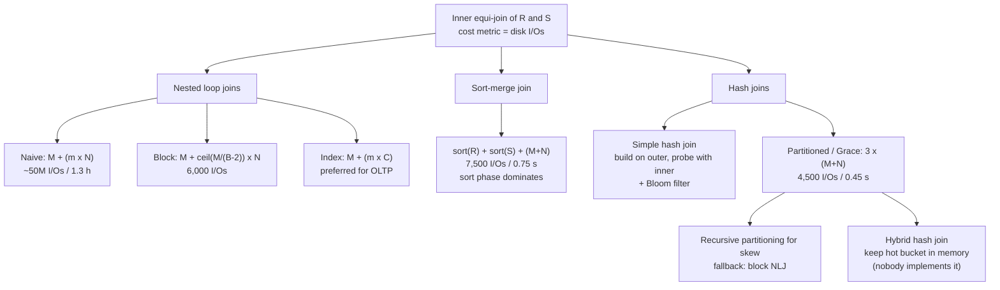

# #12 - Join Algorithms: Hash, Sort-Merge, Nested Loop Joins (CMU Intro to Database Systems)

*CMU Database Group · 1:14:22 · [Watch on YouTube](https://www.youtube.com/watch?v=MFazkaZKs1s)*

## Summary

Andy Pavlo walks through how a DBMS physically executes a join, restricting the discussion to **inner equi-joins between two tables** and using **number of disk I/Os** as the single cost metric. He builds up from the naive nested loop join (50 million I/Os, 1.3 hours on the running example) through block and index nested loop joins, then sort-merge join, then the hash-join family: simple hash join, Bloom-filter-accelerated probes, partitioned (Grace) hash join with recursive partitioning for skew, and hybrid hash join. The running example is a fixed pair of tables — R with 1,000 pages / 100,000 tuples and S with 500 pages / 40,000 tuples — so every algorithm can be compared on identical numbers, ending with the conclusion that hash joins are almost always the right choice for large datasets.

**Classification:** educational lecture (university course, CMU 15-445/645 Fall 2024).

## Topics

1. [Why Joins Exist and What This Lecture Covers](./01-why-joins-and-scope.md)
2. [Two Design Decisions: Output Format and Cost Model](./02-design-decisions-and-cost-model.md)
3. [Nested Loop Joins (Naive, Block, Index)](./03-nested-loop-joins.md)
4. [Sort-Merge Join](./04-sort-merge-join.md)
5. [Simple Hash Join and Bloom Filter Optimization](./05-simple-hash-join-and-bloom-filters.md)
6. [Partitioned (Grace) Hash Join, Recursive Partitioning, Hybrid Hash Join](./06-partitioned-grace-hash-join.md)
7. [Algorithm Comparison and Closing Q&A](./07-comparison-and-closing-qa.md)

## Key takeaways

- **Hash join wins on the numbers**: on the same tables, partitioned hash join costs `3 × (M + N)` = **4,500 I/Os (~0.45 s)** versus sort-merge join's **7,500 I/Os (~0.75 s)** and naive nested loop join's **~50,000,000 I/Os (1.3 hours)** ([`1:03:20`](https://www.youtube.com/watch?v=MFazkaZKs1s&t=3800), [`43:29`](https://www.youtube.com/watch?v=MFazkaZKs1s&t=2609), [`23:04`](https://www.youtube.com/watch?v=MFazkaZKs1s&t=1384)).
- **Batching by page is the single biggest algorithmic jump**: moving from tuple-at-a-time to block-at-a-time with `B = 102` buffers takes the same join from ~50 million I/Os down to **6,000 I/Os** — and to **5,500** when the smaller table is made the outer table ([`28:29`](https://www.youtube.com/watch?v=MFazkaZKs1s&t=1709), [`29:05`](https://www.youtube.com/watch?v=MFazkaZKs1s&t=1745)).
- **Sort-merge join's cost is almost entirely the sort**: 6,000 of its 7,500 I/Os are the two sorts, so it only becomes competitive when the data is already sorted on the join key or the query has a matching `ORDER BY` ([`44:51`](https://www.youtube.com/watch?v=MFazkaZKs1s&t=2691), [`44:30`](https://www.youtube.com/watch?v=MFazkaZKs1s&t=2670)).
- **Hash join's real advantage over an existing index is graceful spilling**: recursive partitioning (Grace hash join) lets it handle datasets larger than memory, which index nested loop join cannot do well; for skewed keys that resist re-hashing, the fallback is block nested loop join, trading speed for sequential I/O ([`51:54`](https://www.youtube.com/watch?v=MFazkaZKs1s&t=3114), [`59:48`](https://www.youtube.com/watch?v=MFazkaZKs1s&t=3588), [`1:00:08`](https://www.youtube.com/watch?v=MFazkaZKs1s&t=3608)).
- **The formulas are trustworthy; the inputs are not**: cost models break down in multi-join queries because each join's estimated output feeds the next, and every DBMS systematically **underestimates join output cardinality** by assuming uncorrelated predicates ([`1:09:14`](https://www.youtube.com/watch?v=MFazkaZKs1s&t=4154), [`1:09:46`](https://www.youtube.com/watch?v=MFazkaZKs1s&t=4186)).
- **Ideas that did not survive contact with reality**: multi-way joins shipped in SQL Server around 1998 and were removed in 2001 due to unpredictable performance, and hybrid hash join remains unimplemented because you cannot reliably know hot join keys across two tables in advance ([`7:14`](https://www.youtube.com/watch?v=MFazkaZKs1s&t=434), [`1:03:39`](https://www.youtube.com/watch?v=MFazkaZKs1s&t=3819), [`1:04:56`](https://www.youtube.com/watch?v=MFazkaZKs1s&t=3896)).
