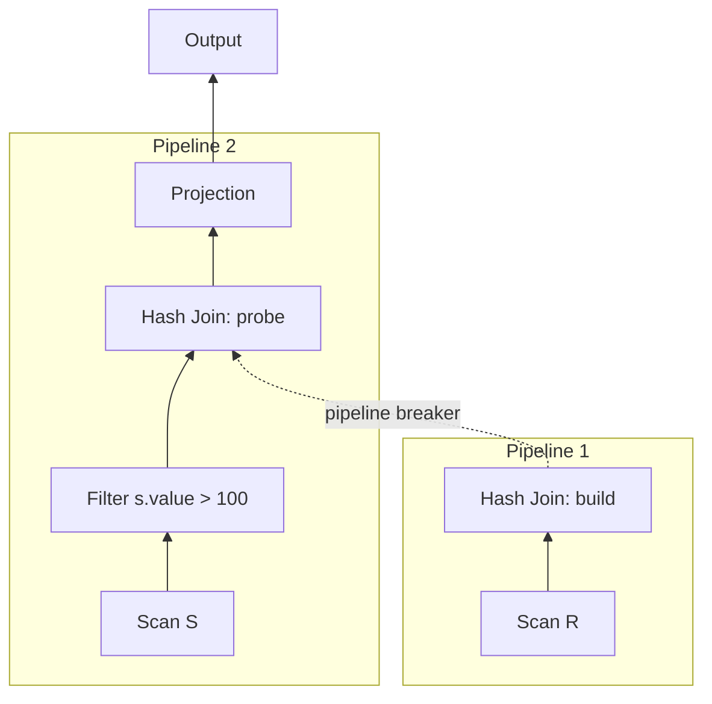

# 01 — Query Plans and Pipelines

## Where this lecture sits in the course

- Previous lectures covered the individual operator algorithms: sorting, aggregations, and joins — "the fundamental building blocks of the operators you would need to have in a relational database system" ([`2:27`](https://www.youtube.com/watch?v=HNtlew7mCc4&t=147)).
- This lecture answers the next question: how to glue those operators together and actually run a query — how data moves between operators, what the output looks like, and how inserts/updates/deletes are handled ([`2:41`](https://www.youtube.com/watch?v=HNtlew7mCc4&t=161)).
- Query *optimization* (choosing among operator implementations) is deferred to the following week ([`4:10`](https://www.youtube.com/watch?v=HNtlew7mCc4&t=250)).

## Query plans

- A SQL query is converted into a **query plan**. Ideally a DAG, but most systems implement plans as **trees** ([`3:08`](https://www.youtube.com/watch?v=HNtlew7mCc4&t=188)).
- Trade-off of trees: you cannot easily reuse an operator's output without "some trickery"; DAGs allow reuse ([`3:08`](https://www.youtube.com/watch?v=HNtlew7mCc4&t=188)).
- Running example used all lecture: scan `R` and `S`, filter on `S`, join `R ⨝ S`, then project ([`3:42`](https://www.youtube.com/watch?v=HNtlew7mCc4&t=222)).
- The plan shown is **logical**: it does not commit to a specific algorithm (e.g. hash join vs. others) or to how base data is accessed ([`3:42`](https://www.youtube.com/watch?v=HNtlew7mCc4&t=222)).

## Pipelines

- A **pipeline** is a sequence of operators through which data can move continuously, without blocking or waiting for more data ([`4:36`](https://www.youtube.com/watch?v=HNtlew7mCc4&t=276)).
- Concretely: no materialization into intermediate storage, no buffer that might have to spill to disk ([`6:00`](https://www.youtube.com/watch?v=HNtlew7mCc4&t=360)).
- In the running example there are exactly **two** pipelines ([`4:36`](https://www.youtube.com/watch?v=HNtlew7mCc4&t=276), [`5:33`](https://www.youtube.com/watch?v=HNtlew7mCc4&t=333)):
  - **Pipeline 1** — scan `R` → build side of the hash join.
  - **Pipeline 2** — scan `S` → filter → probe side of the join → projection → output.

## Pipeline breakers

- A **pipeline breaker** is a boundary where nothing further can execute until *all* tuples below have been consumed ([`6:14`](https://www.youtube.com/watch?v=HNtlew7mCc4&t=374)).
- Examples given ([`6:14`](https://www.youtube.com/watch?v=HNtlew7mCc4&t=374)):
  - The **build side** of a hash join.
  - Nested subqueries that were not correctly decorrelated — the whole subquery runs as its own pipeline.
  - `ORDER BY` / sort — no output can be produced until everything is sorted, because the ranking is unknown until then.
- Why the build side must fully complete before the probe: if probing started against a partially built hash table, matching tuples not yet inserted would produce **false negatives** ([`19:38`](https://www.youtube.com/watch?v=HNtlew7mCc4&t=1178)).
- The DBMS therefore tracks **dependencies between pipelines**: pipeline 2 cannot start until pipeline 1 finishes ([`19:57`](https://www.youtube.com/watch?v=HNtlew7mCc4&t=1197)).

## Lecture roadmap

Four parts, announced up front ([`6:50`](https://www.youtube.com/watch?v=HNtlew7mCc4&t=410)):

1. **Processing models** — how queries execute and how data moves between operators.
2. **Access methods** — how data comes out of base tables at the leaves of the plan.
3. **Modification queries** — inserts, updates, deletes.
4. **Expression evaluation** — how `WHERE`/`ON` predicates are actually evaluated.
