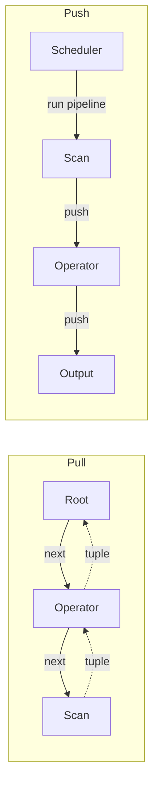

# 06 — Processing Direction: Pull vs. Push

This choice is **orthogonal** to the processing model — you can mix and match ([`10:07`](https://www.youtube.com/watch?v=HNtlew7mCc4&t=607), [`34:11`](https://www.youtube.com/watch?v=HNtlew7mCc4&t=2051)).

## Pull (top-to-bottom)

- Start at the **root**, call `next()`, which percolates down to the leaves; data is pulled up ([`30:45`](https://www.youtube.com/watch?v=HNtlew7mCc4&t=1845), [`31:18`](https://www.youtube.com/watch?v=HNtlew7mCc4&t=1878)).
- This is how **most** database systems are implemented ([`31:18`](https://www.youtube.com/watch?v=HNtlew7mCc4&t=1878)).

**Pros** ([`34:37`](https://www.youtube.com/watch?v=HNtlew7mCc4&t=2077))
- Easy output control — "stop calling next" is the whole implementation of `LIMIT`.
- No explicit "I have enough data" mechanism needed inside operators.

**Cons** ([`34:58`](https://www.youtube.com/watch?v=HNtlew7mCc4&t=2098))
- Overhead of repeated `next()` calls; in C++ this means virtual function table lookups.
- CPU cost is significant in a well-tuned in-memory system (irrelevant if you are already going to disk).

## Push (bottom-to-top)

- Start at the **leaves**, run them, and push data up to parents ([`31:35`](https://www.youtube.com/watch?v=HNtlew7mCc4&t=1895)).
- Requires a **coordinator/scheduler** above the plan that explicitly invokes each pipeline in dependency order and tells it where the intermediate results (e.g. the hash table) live ([`33:12`](https://www.youtube.com/watch?v=HNtlew7mCc4&t=1992), [`33:47`](https://www.youtube.com/watch?v=HNtlew7mCc4&t=2027)).
- With fusion, the pipelines collapse into tight nested `for` loops with no `next()` indirection ([`32:37`](https://www.youtube.com/watch?v=HNtlew7mCc4&t=1957), [`33:00`](https://www.youtube.com/watch?v=HNtlew7mCc4&t=1980)).

**Pros** ([`31:35`](https://www.youtube.com/watch?v=HNtlew7mCc4&t=1895), [`32:25`](https://www.youtube.com/watch?v=HNtlew7mCc4&t=1945), [`37:23`](https://www.youtube.com/watch?v=HNtlew7mCc4&t=2243))
- Very tight control over **where data is placed**: HyPer and CedarDB keep data not just in CPU caches but in **CPU registers**, the fastest memory available.
- Because the plan is nested loops, systems can JIT-compile it and tune batch size to cache/register capacity.

**Cons** ([`35:31`](https://www.youtube.com/watch?v=HNtlew7mCc4&t=2131), [`35:49`](https://www.youtube.com/watch?v=HNtlew7mCc4&t=2149))
- Rare in practice.
- Needs an **explicit early-termination mechanism** embedded in the nested loops to say "I have enough, stop".

## Adopters and history

- **DuckDB** originally used pull and **switched to push**; a benefit they highlight is that a separate control-flow mechanism made engineering the system much easier ([`35:49`](https://www.youtube.com/watch?v=HNtlew7mCc4&t=2149)).
- **Snowflake** uses push ([`36:20`](https://www.youtube.com/watch?v=HNtlew7mCc4&t=2180)).
- Lineage: the MonetDB researchers who invented the vectorization model built **VectorWise**, acquired by **Actian** and eventually killed off; **Marcin Zukowski** then co-founded **Snowflake**, which is built on those ideas ([`36:20`](https://www.youtube.com/watch?v=HNtlew7mCc4&t=2180), [`36:45`](https://www.youtube.com/watch?v=HNtlew7mCc4&t=2205)).

