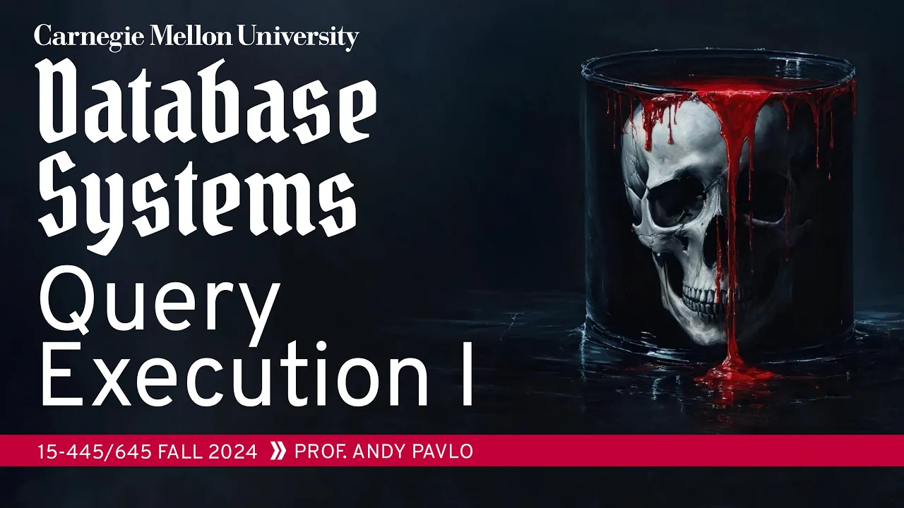
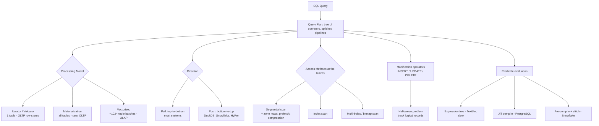

# #13 - Query Execution Part 1 (CMU Intro to Database Systems)

> **CMU Database Group** · 1:23:19 · [Watch on YouTube](https://www.youtube.com/watch?v=HNtlew7mCc4)
> Type: **university lecture / educational video** (CMU 15-445/645, Fall 2024)

## Summary

Having covered the individual relational operators (sorting, aggregation, joins) in earlier lectures, this class assembles them into a working execution engine. It walks through the three **processing models** — iterator (Volcano), materialization, and vectorized — plus the orthogonal choice of **pull vs. push** direction, then covers the three **access methods** (sequential, index, multi-index scans) and the optimizations that make them fast, notably zone maps and data skipping. It closes with how **modification queries** (insert/update/delete) compose with scan operators — including the classic **Halloween problem** — and how **predicates are evaluated**, contrasting interpreted expression trees against JIT compilation, with a live PostgreSQL demo.

## Topics

1. [Query Plans and Pipelines](./01-query-plans-and-pipelines.md) — plans as trees vs. DAGs, pipelines, pipeline breakers
2. [Processing Models: The Design Space](./02-processing-models-overview.md) — control flow vs. data flow, the three models at a glance
3. [The Iterator Model](./03-iterator-model.md) — `next`/`open`/`close`, Volcano, composability, costs
4. [The Materialization Model](./04-materialization-model.md) — MonetDB origins, operator fusion, why it is OLTP-only
5. [The Vectorization / Batch Model](./05-vectorization-model.md) — MonetDB/X100, constant vectors, why CPUs love it
6. [Processing Direction: Pull vs. Push](./06-processing-direction-pull-vs-push.md) — trade-offs, DuckDB's switch, the Snowflake lineage
7. [Access Methods and Sequential Scans](./07-sequential-scans.md) — the scan loop, LSM penalty, the optimization catalogue
8. [Data Skipping and Zone Maps](./08-data-skipping-and-zone-maps.md) — lossy sampling vs. lossless zone maps / SMAs
9. [Index Scans and Multi-Index Scans](./09-index-and-multi-index-scans.md) — selectivity, bitmap scans, on-the-fly indexes
10. [Modification Queries and the Halloween Problem](./10-modification-queries-and-halloween-problem.md) — operator responsibilities, the System R anomaly, the fix
11. [Expression Evaluation and JIT Compilation](./11-expression-evaluation-and-jit.md) — expression trees, the PostgreSQL JIT demo, pre-compilation
12. [Conclusion and Next Steps](./12-conclusion-and-next-steps.md) — closing takeaways and what comes next

## Key takeaways

- **Model choice is dictated by workload, and the mapping is unambiguous**: row store / OLTP → iterator model; OLAP → vectorization model; materialization is essentially dead outside a handful of OLTP systems ([`30:18`](https://www.youtube.com/watch?v=HNtlew7mCc4&t=1818), [`9:39`](https://www.youtube.com/watch?v=HNtlew7mCc4&t=579)).
- **The vectorized model won OLAP decisively**: invented in 2006–2007 in MonetDB/X100, it is now used by essentially every OLAP system built in the last 15 years, with older systems retrofitted to it ([`29:01`](https://www.youtube.com/watch?v=HNtlew7mCc4&t=1741), [`29:38`](https://www.youtube.com/watch?v=HNtlew7mCc4&t=1778)).
- **PostgreSQL's JIT measurably paid off in the live demo**: on a pre-warmed ~50M-tuple table, the query ran in 1.7 s with JIT off and 1.3 s with it on — 200 ms of compilation bought 400 ms of execution savings, a net ~600 ms win — and PostgreSQL's cost model correctly skips compilation for `LIMIT 1` ([`1:11:50`](https://www.youtube.com/watch?v=HNtlew7mCc4&t=4310), [`1:13:38`](https://www.youtube.com/watch?v=HNtlew7mCc4&t=4418), [`1:19:04`](https://www.youtube.com/watch?v=HNtlew7mCc4&t=4744)).
- **JIT vs. pre-compilation is a wash in measurement, but not in engineering**: a paper with TUM and CWI found neither consistently wins, yet Databricks abandoned whole-query Scala compilation in Spark SQL because it was too hard to maintain, favoring Snowflake's pre-compile-and-stitch approach — which only works because vectorization amortizes the function-pointer call across ~1000 tuples ([`1:16:49`](https://www.youtube.com/watch?v=HNtlew7mCc4&t=4609), [`1:15:14`](https://www.youtube.com/watch?v=HNtlew7mCc4&t=4514)).
- **The Halloween problem must be solved by tracking logical, not physical, records**: an update that relocates a tuple (e.g. a salary index entry) causes the ongoing scan to re-encounter and re-update it; discovered at IBM on System R in the 1970s and still required work in the course's Project 3 ([`1:00:39`](https://www.youtube.com/watch?v=HNtlew7mCc4&t=3639), [`1:01:11`](https://www.youtube.com/watch?v=HNtlew7mCc4&t=3671), [`1:02:27`](https://www.youtube.com/watch?v=HNtlew7mCc4&t=3747)).
- **Zone maps turn a scan into a skip for free**: pre-computed min/max/avg/sum/count per page let a `value > 600` predicate discard a whole page whose max is 400; supported natively by Parquet and ORC and by every column store, and originally published as Small Materialized Aggregates ([`46:01`](https://www.youtube.com/watch?v=HNtlew7mCc4&t=2761), [`46:58`](https://www.youtube.com/watch?v=HNtlew7mCc4&t=2818)).
- **A uniform operator API is what makes everything else composable**: because a parent only calls `next()`, a child can be a network source, an index probe, a subquery, a multi-index intersection, or an index built on the fly (SQL Server's spooling index scan) with no change above it — and the same property lets UPDATE/DELETE reuse scan operators instead of reimplementing them ([`11:20`](https://www.youtube.com/watch?v=HNtlew7mCc4&t=680), [`50:52`](https://www.youtube.com/watch?v=HNtlew7mCc4&t=3052), [`56:29`](https://www.youtube.com/watch?v=HNtlew7mCc4&t=3389)).
