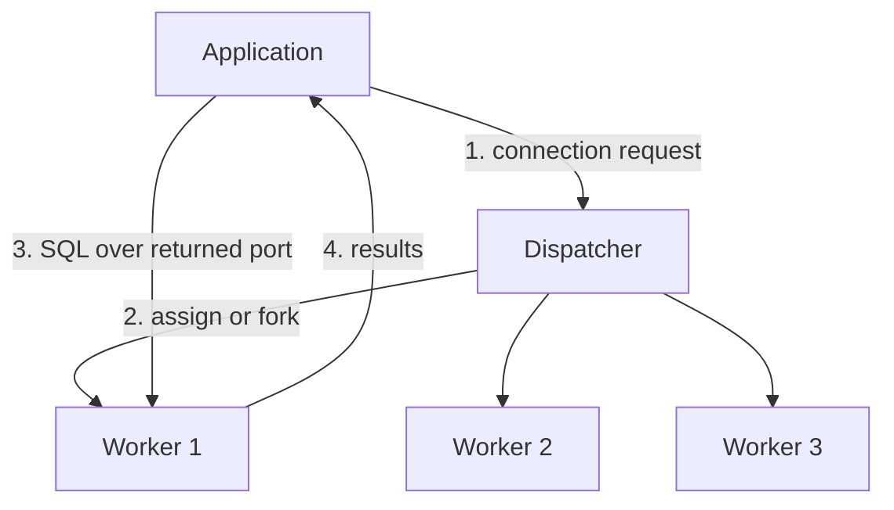

# 02 — Process Models

The **process model** is how a DBMS organizes its computational resources to execute client requests and internal background jobs in parallel ([`7:42`](https://www.youtube.com/watch?v=Vy2t_wZx4Is&t=462)).

- Workers execute both client tasks and maintenance tasks — e.g. MVCC garbage collection in PostgreSQL, or LSM-tree compaction. A worker used for compaction is a worker not used for queries ([`7:42`](https://www.youtube.com/watch?v=Vy2t_wZx4Is&t=462), [`8:29`](https://www.youtube.com/watch?v=Vy2t_wZx4Is&t=509)).
- Three approaches: **process per worker**, **thread per worker**, and **embedded** (which does not fit the process/thread dichotomy) ([`8:41`](https://www.youtube.com/watch?v=Vy2t_wZx4Is&t=521)).

## 1. Process per worker

- Each worker is a full OS process created with `fork`, with its own address space and independent OS scheduling ([`9:34`](https://www.youtube.com/watch?v=Vy2t_wZx4Is&t=574)).
- Flow: application → dispatcher (in PostgreSQL this is the **postmaster**) → dispatcher picks or forks a worker → returns its port → application connects directly to the worker ([`10:00`](https://www.youtube.com/watch?v=Vy2t_wZx4Is&t=600)).
  - Variant: the dispatcher may act as a pure coordinator that forwards queries instead of handing out ports ([`10:37`](https://www.youtube.com/watch?v=Vy2t_wZx4Is&t=637)).
- Consequences ([`10:57`](https://www.youtube.com/watch?v=Vy2t_wZx4Is&t=657)):
  - Inter-worker communication needs IPC; PostgreSQL uses **shared memory**.
  - Scheduling is delegated to the OS — you can tune priorities, but you cannot do anything sophisticated.
  - A crashing process is isolated and does not take down the system ([`12:59`](https://www.youtube.com/watch?v=Vy2t_wZx4Is&t=779)).
- **Why the old systems chose it**: in the 1980s–early 1990s, Unix threading packages were inconsistent across vendors (HP vs. AIX, etc.), so supporting many platforms meant reimplementing threading. `fork`/`join` were POSIX and worked everywhere ([`11:32`](https://www.youtube.com/watch?v=Vy2t_wZx4Is&t=692), [`12:05`](https://www.youtube.com/watch?v=Vy2t_wZx4Is&t=725)).
- Users: PostgreSQL (first implementation 1984), Oracle, DB2 ([`11:32`](https://www.youtube.com/watch?v=Vy2t_wZx4Is&t=692)).

## 2. Thread per worker — the modern default

- The DBMS spawns pthreads (or the OS equivalent) and manages its own scheduling, since it fully controls which thread runs and when ([`12:24`](https://www.youtube.com/watch?v=Vy2t_wZx4Is&t=744)).
- All workers share one address space → cheap communication ([`12:24`](https://www.youtube.com/watch?v=Vy2t_wZx4Is&t=744)).
- Downside: a crashing thread takes down the **entire system** ([`12:59`](https://www.youtube.com/watch?v=Vy2t_wZx4Is&t=779)).
- Practically every DBMS built in the last ~20 years supports it; DB2 and Oracle retrofitted it and let you choose processes or threads per environment ([`12:59`](https://www.youtube.com/watch?v=Vy2t_wZx4Is&t=779)).
- The systems that do not use it are typically forks of PostgreSQL, inheriting its process-per-worker model ([`13:55`](https://www.youtube.com/watch?v=Vy2t_wZx4Is&t=835)).

## 3. Embedded databases

- The DBMS is a library inside another application and does not own its threads: whichever application thread calls into the library executes the work. There is **no dispatcher** ([`13:55`](https://www.youtube.com/watch?v=Vy2t_wZx4Is&t=835), [`14:50`](https://www.youtube.com/watch?v=Vy2t_wZx4Is&t=890)).
- Examples: SQLite and RocksDB follow the classic caller-thread model; DuckDB can be told to spin up extra threads for parallel execution ([`13:55`](https://www.youtube.com/watch?v=Vy2t_wZx4Is&t=835)).
- One of the first embedded DBMSs with this model was **Berkeley DB**, out of UC Berkeley in the late 1980s / early 1990s, acquired by Oracle in 2016 ([`14:50`](https://www.youtube.com/watch?v=Vy2t_wZx4Is&t=890)).

## Scheduling decisions

- Most systems use a simple **FIFO priority queue** — first query in executes first — but other policies are implementable ([`15:34`](https://www.youtube.com/watch?v=Vy2t_wZx4Is&t=934)).
- Per query the DBMS decides: how many tasks to split into, how many cores/workers to use, and where each worker's output should go ([`15:34`](https://www.youtube.com/watch?v=Vy2t_wZx4Is&t=934), [`15:59`](https://www.youtube.com/watch?v=Vy2t_wZx4Is&t=959)).
- **Key argument**: the OS scheduler sees blind processes/threads; the DBMS knows the queries and the pipeline, so it is always better positioned to schedule. High-end systems (Oracle, DB2, SQL Server) rewrite essentially everything and rely on the OS for nothing ([`15:59`](https://www.youtube.com/watch?v=Vy2t_wZx4Is&t=959), [`16:36`](https://www.youtube.com/watch?v=Vy2t_wZx4Is&t=996)).

## Multiple workers ≠ intra-query parallelism

- Supporting many workers does **not** imply a single query can be split across them ([`16:52`](https://www.youtube.com/watch?v=Vy2t_wZx4Is&t=1012)).
- **MySQL** is the canonical example: it is thread-per-worker (multi-threaded), but one query is executed in its entirety by one thread — it cannot be split across cores ([`16:52`](https://www.youtube.com/watch?v=Vy2t_wZx4Is&t=1012)).
- **Redis** is cited as the famous single-process, single-worker system ([`16:52`](https://www.youtube.com/watch?v=Vy2t_wZx4Is&t=1012)).
