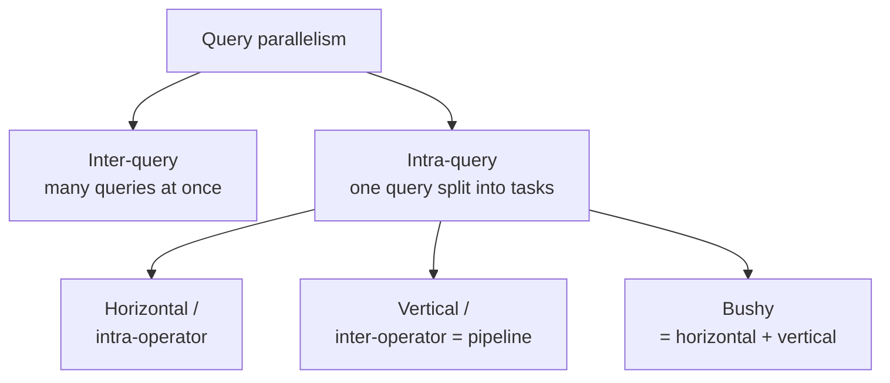

# 03 — Inter-Query vs. Intra-Query Parallelism

The high-level approaches are independent of the process model: multi-threading, multi-process, or multi-node all raise the same question of *what to execute where* — only the communication cost changes ([`17:34`](https://www.youtube.com/watch?v=Vy2t_wZx4Is&t=1054), [`18:10`](https://www.youtube.com/watch?v=Vy2t_wZx4Is&t=1090)).

## Inter-query parallelism

- Multiple queries from different connections run simultaneously ([`18:25`](https://www.youtube.com/watch?v=Vy2t_wZx4Is&t=1105)).
- Default policy is first-come-first-served; DB2 allows transaction/queue priorities by username — e.g. the CEO's queries outrank the sales team's ([`18:25`](https://www.youtube.com/watch?v=Vy2t_wZx4Is&t=1105)).
- **Read-only workloads are easy**: no coordination is needed because the logical database never changes. Internal protection mechanisms (buffer manager latches, index latches) are still required for the shared data structures ([`18:55`](https://www.youtube.com/watch?v=Vy2t_wZx4Is&t=1135)).
- Updating queries create read/write visibility problems — deferred to lecture 16 ([`19:34`](https://www.youtube.com/watch?v=Vy2t_wZx4Is&t=1174)).

## Intra-query parallelism

- A single query is broken into tasks assigned to multiple workers, cutting execution latency ([`19:34`](https://www.youtube.com/watch?v=Vy2t_wZx4Is&t=1174)).
- It reuses the same producer/consumer model as single-threaded operator pipelines, but adds **explicit control mechanisms** to wait until parallel tasks have produced their results before moving to the next pipeline stage ([`20:09`](https://www.youtube.com/watch?v=Vy2t_wZx4Is&t=1209)).
- Two building blocks, which are not mutually exclusive — high-end systems mix them ([`20:23`](https://www.youtube.com/watch?v=Vy2t_wZx4Is&t=1223)):
  - **Horizontal / intra-operator**: many instances of the same operator running at once.
  - **Vertical / inter-operator**: different pipelines or operators running simultaneously, with an explicit dependency graph.

## Parallel versions of existing algorithms

- Almost every algorithm covered earlier in the course has a parallel version requiring only minor changes ([`20:23`](https://www.youtube.com/watch?v=Vy2t_wZx4Is&t=1223)).
- Example — **Grace hash join**: after the build and probe sides are partitioned into buckets, each bucket can be processed independently by a different worker with no coordination, because the partitioning already divided the work ([`20:57`](https://www.youtube.com/watch?v=Vy2t_wZx4Is&t=1257), [`21:43`](https://www.youtube.com/watch?v=Vy2t_wZx4Is&t=1303)).
- General principle: all the divide-and-conquer techniques from earlier lectures carry over directly, just executed in parallel ([`21:43`](https://www.youtube.com/watch?v=Vy2t_wZx4Is&t=1303)).

## How common each approach is

| Approach | Prevalence |
|---|---|
| Intra-operator (horizontal) | Most common by far ([`21:56`](https://www.youtube.com/watch?v=Vy2t_wZx4Is&t=1316)) |
| Inter-operator (vertical) | Less common; mostly streaming systems ([`22:19`](https://www.youtube.com/watch?v=Vy2t_wZx4Is&t=1339)) |
| Bushy | Only high-end systems; the instructor considers it just the combination of the first two ([`21:56`](https://www.youtube.com/watch?v=Vy2t_wZx4Is&t=1316), [`22:19`](https://www.youtube.com/watch?v=Vy2t_wZx4Is&t=1339)) |
