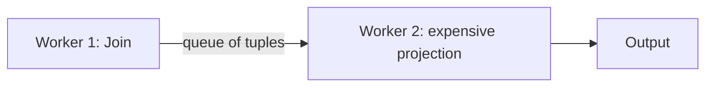
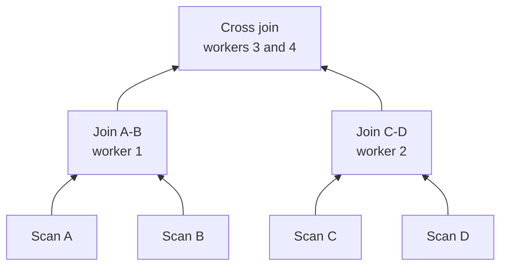

# 05 — Inter-Operator and Bushy Parallelism

## Inter-operator (vertical / pipeline) parallelism

- **Distinct** operators run at the same time even though data flows between them: a downstream operator does not wait for its child to finish all output before starting ([`29:57`](https://www.youtube.com/watch?v=Vy2t_wZx4Is&t=1797)).
- Also called **pipeline parallelism**; exchange operators are still needed to coalesce shards and produce the right number of output streams ([`30:24`](https://www.youtube.com/watch?v=Vy2t_wZx4Is&t=1824)).

### Worked example

- Worker 1 runs the join over the two tables and emits joined tuples as a stream ([`30:24`](https://www.youtube.com/watch?v=Vy2t_wZx4Is&t=1824)).
- Instead of **fusing** the projection into that pipeline, it runs on its own worker — justified when the projection is CPU-intensive (e.g. "a hash of a hash of a hash"), so the join worker is not burdened by it ([`30:59`](https://www.youtube.com/watch?v=Vy2t_wZx4Is&t=1859)).
- The join worker pushes output into a **queue**; the projection worker waits on that queue, crunching each item as it arrives ([`31:26`](https://www.youtube.com/watch?v=Vy2t_wZx4Is&t=1886)).

### Where it matters

- Most common in **streaming systems** — Spark SQL, Kafka — where the input has no end: stock ticks, temperature readings. Unlike a finite table scan that terminates, the operator is always running ([`31:26`](https://www.youtube.com/watch?v=Vy2t_wZx4Is&t=1886), [`31:48`](https://www.youtube.com/watch?v=Vy2t_wZx4Is&t=1908)).

## Bushy parallelism

- Simply the combination of horizontal (intra-operator) and vertical (inter-operator) parallelism used at the same time; exchange operators are still required to confirm completeness from the sub-plans below ([`32:03`](https://www.youtube.com/watch?v=Vy2t_wZx4Is&t=1923)).
- **Contrived example** — a cartesian product across `A`, `B`, `C`, `D` ([`32:28`](https://www.youtube.com/watch?v=Vy2t_wZx4Is&t=1948)):
  - Join `A ⋈ B` and join `C ⋈ D` run simultaneously.
  - Workers 3 and 4 run the cross join above, buffering what they have seen and matching new tuples as they arrive.
  - Acknowledged as very expensive with exploding result size — but the computation still runs in parallel instead of queueing everything up serially.

