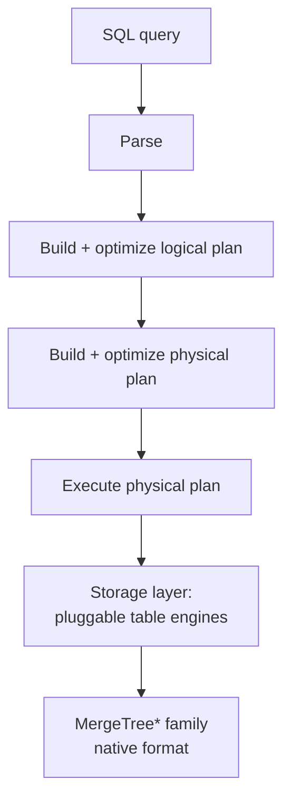

# 07 — ClickHouse: Architecture and MergeTree Storage

Guest talk by Robert (ClickHouse Inc.), starting at [`43:43`](https://www.youtube.com/watch?v=Vy2t_wZx4Is&t=2623).

## What ClickHouse is

- The name was originally an abbreviation of **"clickstream data warehouse"**; people liked it, so it stayed ([`43:43`](https://www.youtube.com/watch?v=Vy2t_wZx4Is&t=2623)).
- Open-source, **column-oriented, distributed OLAP** database ([`44:03`](https://www.youtube.com/watch?v=Vy2t_wZx4Is&t=2643)).
- Timeline and scale ([`44:03`](https://www.youtube.com/watch?v=Vy2t_wZx4Is&t=2643)):
  - Development started **15 years ago at Yandex**.
  - Code **open-sourced 8 years ago**.
  - More than **2,000 GitHub contributors**.
  - Written in C++, compiles to a **single statically linked binary** that runs on anything from a Raspberry Pi to the largest servers.
- Workload profile: filter and aggregation queries over **billions and trillions of rows**; the storage layer is optimized for **append-only** workloads with very fast inserts ([`44:31`](https://www.youtube.com/watch?v=Vy2t_wZx4Is&t=2671)).
- Clustering: nodes can replicate and shard for availability and scalability, but the cluster is **eventually consistent by default**, deliberately trading consistency for performance ([`44:47`](https://www.youtube.com/watch?v=Vy2t_wZx4Is&t=2687)).
- Typical use cases: business intelligence, log and event analysis, real-time dashboards ([`44:47`](https://www.youtube.com/watch?v=Vy2t_wZx4Is&t=2687)).

## Two-layer architecture

- **Query processing layer**: the traditional pipeline — parse SQL, build and optimize a logical plan, build and optimize a physical plan, execute it ([`45:09`](https://www.youtube.com/watch?v=Vy2t_wZx4Is&t=2709), [`45:33`](https://www.youtube.com/watch?v=Vy2t_wZx4Is&t=2733)).
- **Storage layer**: **pluggable table engines**, each representing a location and format for table data. Robert notes the abstraction is borrowed from MySQL, "we didn't come up with that idea by ourselves". The native format is the **MergeTree\*** family of engines ([`45:33`](https://www.youtube.com/watch?v=Vy2t_wZx4Is&t=2733), [`45:59`](https://www.youtube.com/watch?v=Vy2t_wZx4Is&t=2759)).

## MergeTree: parts

- On insert, the new rows are **sorted by the primary key columns** and written to disk as a **part** ([`45:59`](https://www.youtube.com/watch?v=Vy2t_wZx4Is&t=2759)).
- A part is **immutable** once written ([`46:16`](https://www.youtube.com/watch?v=Vy2t_wZx4Is&t=2776)).
- Guidance: insert in **batches — e.g. 20,000 rows at once** — to avoid creating too many small parts ([`46:16`](https://www.youtube.com/watch?v=Vy2t_wZx4Is&t=2776)).
- A background **merge job** continuously combines parts into bigger ones. Because parts are sorted, it uses a **k-way merge sort**, which is relatively cheap ([`46:16`](https://www.youtube.com/watch?v=Vy2t_wZx4Is&t=2776)).
- **Asynchronous insert mode** buffers rows from multiple inserts before flushing to disk — the answer for workloads with many tiny inserts ([`46:49`](https://www.youtube.com/watch?v=Vy2t_wZx4Is&t=2809)).

### Difference from classical LSM trees

- ClickHouse is LSM-like, but **all parts are created equal** — no level hierarchy ([`46:49`](https://www.youtube.com/watch?v=Vy2t_wZx4Is&t=2809)).
- **Advantage**: the merge can freely choose which parts to combine, unbound by LSM levels.
- **Disadvantage**: updates and deletes become much trickier — accepted because for the majority of use cases they are the exception ([`46:49`](https://www.youtube.com/watch?v=Vy2t_wZx4Is&t=2809), [`47:33`](https://www.youtube.com/watch?v=Vy2t_wZx4Is&t=2853)).

## Inside a part: granules

- After a few rounds of merging, parts typically contain **a few dozen million rows** ([`47:33`](https://www.youtube.com/watch?v=Vy2t_wZx4Is&t=2853)).
- Each part is logically divided into **granules of ~8,000 rows** by default; **all disk accesses happen at granule granularity, not row granularity** ([`47:33`](https://www.youtube.com/watch?v=Vy2t_wZx4Is&t=2853)).
- Consecutive granules are **compressed** to reduce data volume. Users pick the codec: generic ones (e.g. ZSTD) or logical ones (e.g. Delta) ([`48:07`](https://www.youtube.com/watch?v=Vy2t_wZx4Is&t=2887)).
