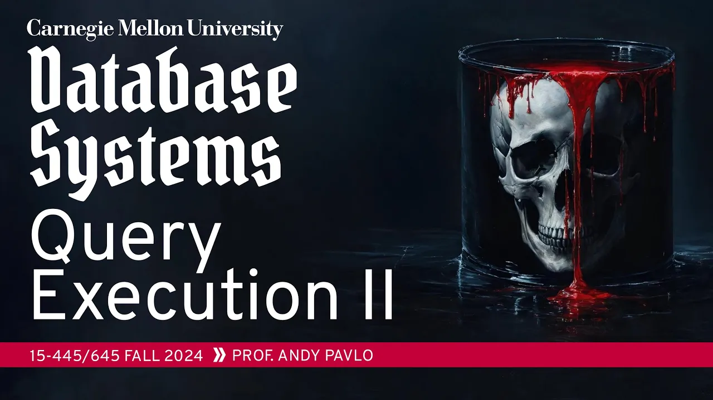
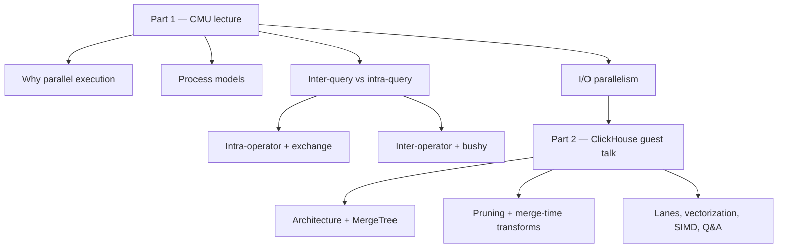

# #14 - Query Execution Part 2 ✸ ClickHouse Database Talk (CMU Intro to Database Systems)

*CMU Database Group · 1:02:49 · [Watch on YouTube](https://www.youtube.com/watch?v=Vy2t_wZx4Is)*

## Summary

The lecture covers how a DBMS executes queries **in parallel**: how workers are organized (process per worker, thread per worker, embedded), how a single query is split across them, and how disk I/O is parallelized. It builds up from inter-query parallelism to intra-query parallelism — intra-operator (horizontal), inter-operator/pipeline (vertical), and bushy — introducing the **exchange operator** from Graefe's Volcano project as the barrier that reassembles partitioned data streams, plus striping/mirroring and partitioning on the storage side.

The second half (from [`43:43`](https://www.youtube.com/watch?v=Vy2t_wZx4Is&t=2623)) is a guest talk by **Robert from ClickHouse Inc.**, walking through ClickHouse's architecture: the MergeTree storage engine with immutable parts and granules, its three data-pruning techniques, merge-time data transformations, and its lane-based vectorized execution with SIMD compute kernels. The instructor closes with a Q&A comparing ClickHouse's "specialize everything" strategy against Umbra's query-compilation approach on the ClickBench leaderboard.

## Topics

1. [Why Parallel Execution](./01-why-parallel-execution.md) — motivation, worker terminology, parallel vs. distributed databases ([`0:24`](https://www.youtube.com/watch?v=Vy2t_wZx4Is&t=24))
2. [Process Models](./02-process-models.md) — process per worker, thread per worker, embedded systems, scheduling ([`7:42`](https://www.youtube.com/watch?v=Vy2t_wZx4Is&t=462))
3. [Inter-Query vs. Intra-Query Parallelism](./03-inter-query-vs-intra-query-parallelism.md) — the taxonomy and parallel algorithm variants ([`17:34`](https://www.youtube.com/watch?v=Vy2t_wZx4Is&t=1054))
4. [Intra-Operator Parallelism and the Exchange Operator](./04-intra-operator-parallelism-and-exchange.md) — worked hash-join example, gather/distribute/repartition ([`22:33`](https://www.youtube.com/watch?v=Vy2t_wZx4Is&t=1353))
5. [Inter-Operator and Bushy Parallelism](./05-inter-operator-and-bushy-parallelism.md) — pipeline parallelism and streaming systems ([`29:57`](https://www.youtube.com/watch?v=Vy2t_wZx4Is&t=1797))
6. [I/O Parallelism](./06-io-parallelism.md) — striping vs. mirroring, RAID, object storage, partitioning ([`33:11`](https://www.youtube.com/watch?v=Vy2t_wZx4Is&t=1991))
7. [ClickHouse: Architecture and MergeTree](./07-clickhouse-architecture-and-mergetree.md) — table engines, parts, granules ([`43:43`](https://www.youtube.com/watch?v=Vy2t_wZx4Is&t=2623))
8. [ClickHouse: Data Pruning and Merge-Time Transformations](./08-clickhouse-data-pruning-and-merge-time-transformations.md) — primary key indexes, projections, skipping indexes, aggregating merges ([`48:07`](https://www.youtube.com/watch?v=Vy2t_wZx4Is&t=2887))
9. [ClickHouse: Parallel Query Execution and SIMD](./09-clickhouse-query-execution-simd.md) — lanes, vectorized volcano model, compute kernels, ClickBench Q&A ([`53:36`](https://www.youtube.com/watch?v=Vy2t_wZx4Is&t=3216))

## Key takeaways

- **Thread per worker won**: process per worker existed only because Unix threading packages were inconsistent across vendors in the 80s and early 90s, while `fork`/`join` were portable. Practically every DBMS built in the last 20 years supports threads, including retrofits in Oracle and DB2; the holdouts are PostgreSQL forks ([`11:32`](https://www.youtube.com/watch?v=Vy2t_wZx4Is&t=692), [`12:59`](https://www.youtube.com/watch?v=Vy2t_wZx4Is&t=779), [`13:55`](https://www.youtube.com/watch?v=Vy2t_wZx4Is&t=835)).
- **Multiple workers does not imply intra-query parallelism**: MySQL is multi-threaded yet executes one query entirely on one thread and cannot split it across cores ([`16:52`](https://www.youtube.com/watch?v=Vy2t_wZx4Is&t=1012)).
- **The exchange operator is the enabling primitive** for intra-query parallelism — it has no relational-algebra counterpart, acts as a pipeline barrier, and came out of Graefe's Volcano project; PostgreSQL calls it Gather, SQL Server splits it into gather / distribute / repartition ([`23:45`](https://www.youtube.com/watch?v=Vy2t_wZx4Is&t=1425), [`24:36`](https://www.youtube.com/watch?v=Vy2t_wZx4Is&t=1476), [`27:52`](https://www.youtube.com/watch?v=Vy2t_wZx4Is&t=1672)).
- **I/O layout is a three-way trade-off between performance, durability and capacity**: mirroring (RAID 1) across three drives gives faster reads and crash survival but triples write cost and cuts capacity to one third, while striping (RAID 0) keeps capacity and cheap writes at the cost of durability. S3 stores data ~5× transparently but at hundreds of milliseconds per operation ([`37:38`](https://www.youtube.com/watch?v=Vy2t_wZx4Is&t=2258), [`39:21`](https://www.youtube.com/watch?v=Vy2t_wZx4Is&t=2361), [`39:43`](https://www.youtube.com/watch?v=Vy2t_wZx4Is&t=2383), [`40:34`](https://www.youtube.com/watch?v=Vy2t_wZx4Is&t=2434)).
- **ClickHouse's speed comes from reading less**: parts are sorted and immutable, all disk access happens at ~8,000-row granule granularity, and an in-memory primary-key index of just 1,000 entries covers ~8 million rows — backed by table projections and per-granule skipping indexes ([`47:33`](https://www.youtube.com/watch?v=Vy2t_wZx4Is&t=2853), [`48:37`](https://www.youtube.com/watch?v=Vy2t_wZx4Is&t=2917), [`49:19`](https://www.youtube.com/watch?v=Vy2t_wZx4Is&t=2959), [`49:57`](https://www.youtube.com/watch?v=Vy2t_wZx4Is&t=2997)).
- **Merge-time aggregation moves `GROUP BY` cost off the query path**: aggregating merges store incrementally updatable types (average as a sum/count pair, e.g. 80+180 → 260 with count 4), decoupled from queries — at the price of not controlling when or on which parts it runs ([`52:04`](https://www.youtube.com/watch?v=Vy2t_wZx4Is&t=3124), [`52:37`](https://www.youtube.com/watch?v=Vy2t_wZx4Is&t=3157), [`53:07`](https://www.youtube.com/watch?v=Vy2t_wZx4Is&t=3187)).
- **On ClickBench, Umbra ranks first and tuned ClickHouse second**, and the two embody opposite philosophies: Umbra generates x86 assembly at runtime and hot-swaps an LLVM -O2 build in the background, while ClickHouse ships massive specialization — roughly 20 hash table implementations by data type and size, plus multi-target pre-compiled SIMD kernels selected at runtime ([`55:07`](https://www.youtube.com/watch?v=Vy2t_wZx4Is&t=3307), [`57:45`](https://www.youtube.com/watch?v=Vy2t_wZx4Is&t=3465), [`58:26`](https://www.youtube.com/watch?v=Vy2t_wZx4Is&t=3506), [`59:39`](https://www.youtube.com/watch?v=Vy2t_wZx4Is&t=3579), [`1:00:22`](https://www.youtube.com/watch?v=Vy2t_wZx4Is&t=3622)).

## Files

- [`transcript.md`](./transcript.md) — verbatim timestamped transcript
- [`cover.webp`](./cover.webp) — video cover image
