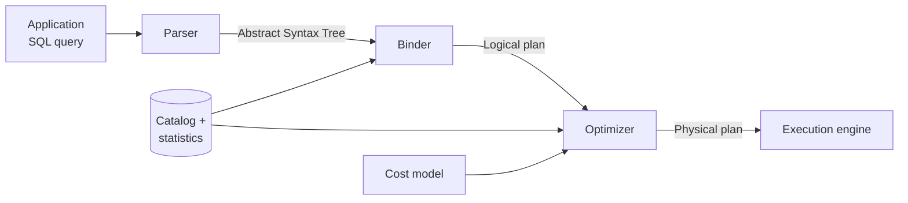

# 02 — Optimizer architecture: from SQL string to physical plan

## The pipeline

- **Parser** — turns the SQL string into an abstract syntax tree; catches malformed SQL ([`14:23`](https://www.youtube.com/watch?v=X8EHO8VLeG0&t=863), [`15:06`](https://www.youtube.com/watch?v=X8EHO8VLeG0&t=906)).
  - Off-the-shelf parsers exist: `sqlparser` in Python, `sqlparser-rs` in Rust, `libpg_query` in C/C++ ([`14:23`](https://www.youtube.com/watch?v=X8EHO8VLeG0&t=863), [`14:40`](https://www.youtube.com/watch?v=X8EHO8VLeG0&t=880)).
  - Most systems now try to speak the **PostgreSQL dialect**, and a modular version of the Postgres parser is available ([`14:40`](https://www.youtube.com/watch?v=X8EHO8VLeG0&t=880)).
- **Binder** — maps string tokens (table/column names) to internal object IDs in the catalog (e.g. Postgres' `pg_class`); errors on references that don't exist. Output is the **logical plan** ([`14:40`](https://www.youtube.com/watch?v=X8EHO8VLeG0&t=880), [`15:06`](https://www.youtube.com/watch?v=X8EHO8VLeG0&t=906), [`15:22`](https://www.youtube.com/watch?v=X8EHO8VLeG0&t=922)).
- **Optimizer** — consults the catalog and (if cost-based) a cost model, then emits a **physical plan** ([`15:22`](https://www.youtube.com/watch?v=X8EHO8VLeG0&t=922), [`16:04`](https://www.youtube.com/watch?v=X8EHO8VLeG0&t=964)).
- What `EXPLAIN` prints in Postgres / DuckDB / SQLite is the **physical plan** ([`16:04`](https://www.youtube.com/watch?v=X8EHO8VLeG0&t=964)).

## Logical vs physical plans

- **Logical plan** = *what* to do: which joins, which tables, which projections and filters — no implementation choices ([`15:22`](https://www.youtube.com/watch?v=X8EHO8VLeG0&t=922), [`16:21`](https://www.youtube.com/watch?v=X8EHO8VLeG0&t=981)).
- **Physical plan** = *how* to do it: use this index, do binary search on the sorted table, sort-merge join vs hash join, and even fine-grained knobs like hash table size or hash function ([`16:32`](https://www.youtube.com/watch?v=X8EHO8VLeG0&t=992)).
- **There is no 1:1 mapping** between logical and physical operators ([`16:51`](https://www.youtube.com/watch?v=X8EHO8VLeG0&t=1011), [`17:10`](https://www.youtube.com/watch?v=X8EHO8VLeG0&t=1030)):
  - Many-to-one: a logical join + logical `ORDER BY` can collapse into a single sort-merge join, which supplies the ordering property for free ([`16:51`](https://www.youtube.com/watch?v=X8EHO8VLeG0&t=1011)).
  - One-to-many: one logical operator can expand into several physical operators ([`17:10`](https://www.youtube.com/watch?v=X8EHO8VLeG0&t=1030)).
- The transformation is **one-directional**: once you go physical you never go back to logical, because that would throw away the optimization information you already gained ([`17:10`](https://www.youtube.com/watch?v=X8EHO8VLeG0&t=1030), [`17:33`](https://www.youtube.com/watch?v=X8EHO8VLeG0&t=1053)).

## Why it's hard

- Query optimization is **NP-hard**, driven by the number of possible join orderings/permutations ([`17:48`](https://www.youtube.com/watch?v=X8EHO8VLeG0&t=1068)).
- The full solution space of plans is far too large to enumerate, so the optimizer must jump into a promising region and search locally for a "good enough" plan in a short amount of time ([`18:07`](https://www.youtube.com/watch?v=X8EHO8VLeG0&t=1087)).
- Optimal search is feasible for trivial cases (`SELECT * FROM t WHERE id = 1` with an index on `id`), but falls apart with 6-, 7-way joins ([`18:57`](https://www.youtube.com/watch?v=X8EHO8VLeG0&t=1137)).
- The extreme case the lecturer has seen: **up to ~1,000 joins** in machine-generated queries coming out of dashboards, not humans ([`18:57`](https://www.youtube.com/watch?v=X8EHO8VLeG0&t=1137), [`19:22`](https://www.youtube.com/watch?v=X8EHO8VLeG0&t=1162)).

## The two approaches (and they compose)

| Approach | Looks at data? | Idea |
|---|---|---|
| **Rules / heuristics** | No — the query hasn't run yet, so no data is available ([`20:23`](https://www.youtube.com/watch?v=X8EHO8VLeG0&t=1223)) | Pattern-match the plan and rewrite away things known to be bad (e.g. predicate pushdown) ([`19:38`](https://www.youtube.com/watch?v=X8EHO8VLeG0&t=1178)) |
| **Cost-based search** | Yes — via catalog statistics | Enumerate candidate plans, estimate cost, pick the cheapest found ([`20:55`](https://www.youtube.com/watch?v=X8EHO8VLeG0&t=1255)) |

- They are **not mutually exclusive**; most systems run rules, then cost-based search. Postgres does rules, cost-based, then rules again — "kind of a hack" ([`20:55`](https://www.youtube.com/watch?v=X8EHO8VLeG0&t=1255)).
- Counterexample to always pushing predicates down: if the predicate calls an expensive UDF or makes an outbound call to something like OpenAI that costs money, you may want it **after** the join ([`19:53`](https://www.youtube.com/watch?v=X8EHO8VLeG0&t=1193)).
- **MySQL** is called out as the only system that will actually run *part* of a query during optimization to gather information before deciding ([`20:23`](https://www.youtube.com/watch?v=X8EHO8VLeG0&t=1223)).
