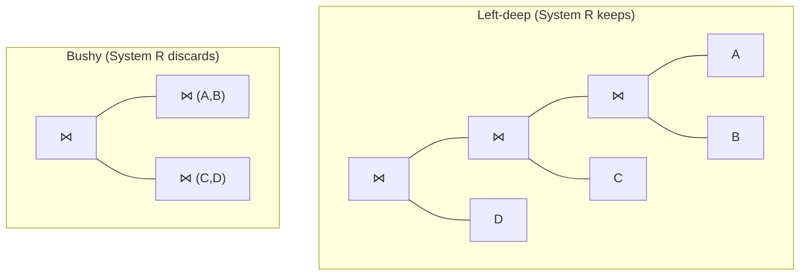

# 04 — Bottom-up cost-based search (IBM System R)

## Framing

- The problem: for one logical plan there are many candidate physical plans (sort-merge join vs nested loop join vs index nested loop join, …). Cost-based search enumerates and scores them ([`26:34`](https://www.youtube.com/watch?v=X8EHO8VLeG0&t=1594)).
- **Costs are system-internal and not comparable across systems.** A cost number from Postgres and one from MySQL for the same query mean nothing to each other — costs are only valid for *relative* comparison within one system ([`27:14`](https://www.youtube.com/watch?v=X8EHO8VLeG0&t=1634)). They can even change within a system as data, hardware, or tuning parameters change ([`27:41`](https://www.youtube.com/watch?v=X8EHO8VLeG0&t=1661)).
- **System R (IBM, 1970s)** was the first cost-based optimizer: SQL is declarative, so you need something that compiles it to an optimal plan, the way a C compiler lowers C to machine code ([`27:41`](https://www.youtube.com/watch?v=X8EHO8VLeG0&t=1661), [`28:12`](https://www.youtube.com/watch?v=X8EHO8VLeG0&t=1692)).

## Search termination

- Separate handling paths for **single-table**, **multi-table (joins)**, and — hardest — **nested subqueries** ([`28:29`](https://www.youtube.com/watch?v=X8EHO8VLeG0&t=1709)).
- The optimizer stops when it has exhausted the space (possible for single-table, essentially never above ~3 tables) or when it hits a **timeout**, which Postgres/MySQL et al. let you configure ([`28:48`](https://www.youtube.com/watch?v=X8EHO8VLeG0&t=1728), [`29:08`](https://www.youtube.com/watch?v=X8EHO8VLeG0&t=1748)).
- The trade-off, concretely: if the query runs in 10 ms, spending 100 ms optimizing is a loss; spending 10 ms to find a 20 ms plan still leaves you ahead of chasing the true optimum ([`29:20`](https://www.youtube.com/watch?v=X8EHO8VLeG0&t=1760), [`29:39`](https://www.youtube.com/watch?v=X8EHO8VLeG0&t=1779)).

## Single-table queries (easy)

- Reduces to picking the best **access method** ([`29:39`](https://www.youtube.com/watch?v=X8EHO8VLeG0&t=1779)):
  - Sequential scan — always the fallback.
  - Binary search if the data is clustered on an index.
  - The **most selective** index for the query.
- Hard case: `WHERE a = ? AND b = ?` with separate indexes on `a` and `b` → multi-index scan, intersecting the results ([`30:27`](https://www.youtube.com/watch?v=X8EHO8VLeG0&t=1827)).
- **Predicate evaluation ordering** matters a lot: evaluate the most selective predicate first to discard data fastest ([`30:27`](https://www.youtube.com/watch?v=X8EHO8VLeG0&t=1827)).
  - Example: `email LIKE '%.cmu.edu'` matches nearly everyone at CMU; `last_name = 'Pavlo'` matches almost no one, so the name index is far faster ([`30:55`](https://www.youtube.com/watch?v=X8EHO8VLeG0&t=1855)).
  - **Q&A — how does it know?** Catalog **statistics / histograms** describing the data. Never perfect, often very wrong, but better than nothing ([`31:24`](https://www.youtube.com/watch?v=X8EHO8VLeG0&t=1884)). Also pure catalog reasoning: a lookup on a declared **unique key** with its index is provably fast, so do that first ([`31:53`](https://www.youtube.com/watch?v=X8EHO8VLeG0&t=1913)).

## Multi-table queries: dynamic programming

System R's algorithm ([`33:31`](https://www.youtube.com/watch?v=X8EHO8VLeG0&t=2011), [`33:52`](https://www.youtube.com/watch?v=X8EHO8VLeG0&t=2032)):

1. Apply static rules first to discard obviously bad plans.
2. Break the query into **blocks** (e.g. a join over two tables) ([`34:06`](https://www.youtube.com/watch?v=X8EHO8VLeG0&t=2046)).
3. Per block, pick the best join algorithm and join ordering via divide-and-conquer dynamic programming, then compose the blocks ([`34:06`](https://www.youtube.com/watch?v=X8EHO8VLeG0&t=2046), [`34:43`](https://www.youtube.com/watch?v=X8EHO8VLeG0&t=2083)).

Most open-source database systems use some variation of this; Umbra uses "a cocaine-fueled version of this with hypergraphs" ([`33:52`](https://www.youtube.com/watch?v=X8EHO8VLeG0&t=2032), [`34:06`](https://www.youtube.com/watch?v=X8EHO8VLeG0&t=2046)).

## Left-deep trees only

Two reasons ([`34:43`](https://www.youtube.com/watch?v=X8EHO8VLeG0&t=2083), [`35:04`](https://www.youtube.com/watch?v=X8EHO8VLeG0&t=2104), [`35:38`](https://www.youtube.com/watch?v=X8EHO8VLeG0&t=2138), [`36:57`](https://www.youtube.com/watch?v=X8EHO8VLeG0&t=2217)):

1. **Search-space reduction** — discarding every non-left-deep shape cuts the space dramatically, which mattered enormously on 1970s hardware with limited memory.
2. **Pipelining** — with all hash joins, build hash tables on B, C, D in one pass, then stream the large table A through, probing B → C → D and emitting output without ever spilling to disk ([`35:38`](https://www.youtube.com/watch?v=X8EHO8VLeG0&t=2138), [`36:19`](https://www.youtube.com/watch?v=X8EHO8VLeG0&t=2179)).
   - Further optimization: build **Bloom filters** alongside those hash tables, keep the filters in memory, and only touch the on-disk hash tables when a tuple passes the filter ([`36:19`](https://www.youtube.com/watch?v=X8EHO8VLeG0&t=2179)).

**Q&A — do operators communicating through memory go through the buffer pool?** Not necessarily. If you might spill, you need temp buffers backed by blocks that can spill (Postgres does this). Other systems just reject the query when memory runs out. Spilled temp space is scratch space private to the query — no one else takes page locks on it, though it can be evicted ([`36:57`](https://www.youtube.com/watch?v=X8EHO8VLeG0&t=2217), [`37:20`](https://www.youtube.com/watch?v=X8EHO8VLeG0&t=2240), [`37:46`](https://www.youtube.com/watch?v=X8EHO8VLeG0&t=2266)).

## Worked example: 3-way Spotify join

Query: find all artists on an album, joining `artist ⋈ appears ⋈ album`, with `ORDER BY artist_id` ([`38:08`](https://www.youtube.com/watch?v=X8EHO8VLeG0&t=2288)).

1. **Pick access paths per table** from the catalog: sequential scan on `artist` and `appears` (no usable index for their predicates); index scan on `album` (index on name) ([`38:08`](https://www.youtube.com/watch?v=X8EHO8VLeG0&t=2288), [`38:37`](https://www.youtube.com/watch?v=X8EHO8VLeG0&t=2317), [`38:55`](https://www.youtube.com/watch?v=X8EHO8VLeG0&t=2335)).
2. **Enumerate all joins**, including cartesian products, then discard anything with a cartesian product by rule ([`38:55`](https://www.youtube.com/watch?v=X8EHO8VLeG0&t=2335), [`39:12`](https://www.youtube.com/watch?v=X8EHO8VLeG0&t=2352)).
3. **Level 1**: for each pairwise ordering (artist⋈appears, album⋈appears, …), each edge is annotated with a physical operator (hash join vs sort-merge join vs nested loop join). Ask the cost model: how much disk, how much CPU? ([`39:33`](https://www.youtube.com/watch?v=X8EHO8VLeG0&t=2373), [`39:59`](https://www.youtube.com/watch?v=X8EHO8VLeG0&t=2399), [`40:38`](https://www.youtube.com/watch?v=X8EHO8VLeG0&t=2438)).
4. **Prune**: at each logical operator keep only the cheapest incoming path, discard the rest — the DP **principle of optimality** ([`40:58`](https://www.youtube.com/watch?v=X8EHO8VLeG0&t=2458), [`41:24`](https://www.youtube.com/watch?v=X8EHO8VLeG0&t=2484)).
5. **Level 2**: join the surviving intermediate with the third table, enumerate algorithms again, keep the cheapest ([`41:37`](https://www.youtube.com/watch?v=X8EHO8VLeG0&t=2497), [`41:59`](https://www.youtube.com/watch?v=X8EHO8VLeG0&t=2519)).
6. At the top, choose the cheapest complete path back down ([`41:59`](https://www.youtube.com/watch?v=X8EHO8VLeG0&t=2519)).

## The physical-property gap (and System R's hack)

- **The plan produced is actually incorrect**: the query has `ORDER BY`, but nothing in this search tracks ordering ([`42:23`](https://www.youtube.com/watch?v=X8EHO8VLeG0&t=2543), [`42:49`](https://www.youtube.com/watch?v=X8EHO8VLeG0&t=2569)).
- System R's first implementation had **no notion of physical properties** (sorting being the obvious one; compression is another) ([`42:49`](https://www.youtube.com/watch?v=X8EHO8VLeG0&t=2569)).
- **The hack**: track plans *with* and *without* the property. For a plan lacking it, tack on the operator needed to conform (a sort above the join). If that total cost beats the plan that already satisfied the property, choose the patched plan. The cost model decides ([`42:49`](https://www.youtube.com/watch?v=X8EHO8VLeG0&t=2569), [`43:37`](https://www.youtube.com/watch?v=X8EHO8VLeG0&t=2617)). Modern systems fix this properly.

## Q&A

- **Is a hash join's cost the same for every query?** No — it depends on the incoming data, the selectivity of the join clause, the hardware, available memory, and many other hard-to-estimate factors ([`43:59`](https://www.youtube.com/watch?v=X8EHO8VLeG0&t=2639), [`44:54`](https://www.youtube.com/watch?v=X8EHO8VLeG0&t=2694)).
- **With `ORDER BY`, isn't sort-merge join always better?** No. Hash joins are provably more algorithmically efficient than sort-merge joins; if the hash join produces only two tuples, hashing then sorting afterwards is cheaper ([`44:17`](https://www.youtube.com/watch?v=X8EHO8VLeG0&t=2657), [`44:36`](https://www.youtube.com/watch?v=X8EHO8VLeG0&t=2676), [`44:54`](https://www.youtube.com/watch?v=X8EHO8VLeG0&t=2694)).
- **Can you cache estimates across identical repeated queries?** Yes if nothing has been inserted/updated — but often that isn't the case ([`45:21`](https://www.youtube.com/watch?v=X8EHO8VLeG0&t=2721)).
- **Isn't keeping only the best path greedy?** It is globally optimal only *within the set of choices considered*. Since System R never considers bushy plans, the true global optimum may be a bushy plan it never sees. Modern systems do consider bushy plans ([`45:48`](https://www.youtube.com/watch?v=X8EHO8VLeG0&t=2748), [`46:06`](https://www.youtube.com/watch?v=X8EHO8VLeG0&t=2766)).
